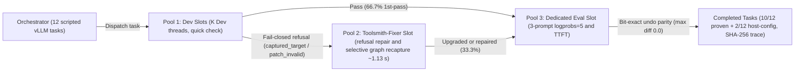

# Multi-Agent GPU Contention and Agent-Team Topologies

Running one coding agent against one dedicated GPU hides the cost of restarting an inference engine. Running `N = 2..8` concurrent workers against a shared GPU budget (`C = 1..3`) exposes it immediately: every full restart stalls the slot for tens of seconds, serialization turns `N` workers into an `O(N)` FIFO queue, and GPUs waiting on Python imports and CUDA graph capture dominate cluster spend.

> **Scope & Companion PRs:** This empirical study exercises infrastructure PRs **#209** (Dynamo GMS/Snapshot B200 benchmarks), **#210** (vLLM `CAPTURED_PREFIXES` and `CAPTURED_EXCLUSIONS`), **#211** (`RLIMIT_NOFILE` probe guard and `AsyncShadowReplenisher`), **#212** (fast-path live CLI reconfigure), **#213** (`TransformersLab`), **#214** (`SandboxPool` and `verify_trace`), **#215** (`TrtllmLab`), **#217** (SGLang decode CUDA graphs), **#218** (`SglangShadowPromoter` and PDEATHSIG-safe worker-thread respawn), and **#226** (`SandboxPool` priority scheduling).
>
> **Workload note:** All `N` concurrent workers in this study are **deterministic scripted Python threads** executing fixed, behavior-preserving edits and config updates (not LLM-generated code changes). See [Section 5](#5-what-this-study-does-not-show) for scope boundaries and caveats.

This document reports controlled studies on `NVIDIA B200` GPUs (`our 2026-11-24 B200 runs`), evaluating:

1. **Multi-agent GPU contention (`EXP-A`):** warm-cache restart-per-edit (anchored by `n = 3` single-GPU repeats and corroborated by two live multi-agent restart trials) versus `SandboxPool` shared-slot scheduling (`core/livelab/rsibox/pool.py`, PR #214) across `C ∈ {1, 2, 3}` GPUs and `N ∈ {1, 2, 4, 8}` scripted agent threads on `Qwen/Qwen3-8B` (`vLLM 0.33.0`, CUDA graphs enabled), including two synthetic-poison fault-injection cells.
2. **Fault-resilient multi-agent recovery (`EXP-C` & continuous multi-crash `EXP-E1`):** single-GPU (`C = 1`, `N ∈ {4, 8}`) head-to-head comparison of `SandboxPool` with plain GMS RO respawn versus Dynamo GMS Standby Shadow failover under mid-burst crashes — on `vLLM 0.33.0` (`Qwen/Qwen3-8B`, genuine `SIGKILL` crash, Scratch-KV `StandbyShadowDriver`) and `SGLang` (`Qwen/Qwen3-0.6B`, worker poison, `SglangShadowPromoter`, PR #218) — plus a 3-crash continuous `SIGKILL` stress run exercising off-critical-path `AsyncShadowReplenisher` (PR #211).
3. **Multi-agent team topologies (`EXP-B`) & empirically validated pool sizing (`EXP-D` + 4-framework portability):** `27` `EXP-B` cells (`324` pipeline task runs: `270` hot-path tasks proven + `54` startup-only host-excluded config commits) comparing `Monolithic`, `Dev+Eval Split`, and `Orchestrator + 3-Pool Triad`, followed by `16` `EXP-D` cells (`448` leases) validating stage-proportional `2 Eval : 1 Dev+Toolsmith` splits and priority-scheduled shared pools (`PR #226`), plus `12` cross-framework `SandboxPool` cells (`252` leases) spanning `SGLang` (CUDA graphs ON), `TensorRT-LLM`, and `HuggingFace Transformers`.

### Headline Findings

- **43.7×–54.4× multi-agent steady-state speedup in clean cells (`N = 2–8`; `53.0×–60.5×` at `N = 1`; `7.1×–9.4×` under injected worker poison without Shadow):** replacing warm-cache restarts (`45.74 ± 0.43 s` to ready + check + stop, `n = 3`, measured) with `SandboxPool` leasing over live hot-reload cuts per-edit slot hold time to `0.63–0.88 s` and sustains `68.3–190.4` edits/min in clean cells (`18.7–35.9` edits/min in the two `EXP-A` fault-injection cells that triggered a full warm-cache respawn).
- **53.2×–53.6× faster crash recovery & sustained sub-second failover across 3 consecutive live `SIGKILL` crashes (`EXP-C` & `EXP-E1`):** wiring `StandbyShadowDriver` into `SandboxPool` on `vLLM Qwen/Qwen3-8B` (`C = 1`) collapses single-crash recovery from **`36.27–39.98 s` → `0.677–0.752 s`**, raises burst throughput **`3.91×–6.99×`** (`19.74 → 138.04` at `N = 4`; `38.97 → 152.40` edits/min at `N = 8`), and cuts p95 queue wait **`12.75×–24.59×`**. Pairing `VllmShadowPromoter` with `AsyncShadowReplenisher` (PR #211) sustains **`0.803 s`, `0.726 s`, and `0.647 s`** recovery across **3 consecutive `SIGKILL` crashes** (`2.176 s` total downtime, **`154.69` proven edits/min**, `208` edits completed non-blockingly during `37.99 s` / `40.12 s` background shadow restocks, `0` GMS errors, `max_abs_logprob_diff == 0.0`). On `SGLang Qwen/Qwen3-0.6B` (`PR #218`), `SglangShadowPromoter` cuts recovery **`23.5×–25.4×`** (`11.41–11.52 s → 0.449–0.490 s`).
- **28.7× lower mean queue wait at `C = 1, N = 4`:** mean wait drops from `68.97 s` (p95 `137.84 s`, `1` edit/agent live restart trial) to `2.40 s` (p95 `5.31 s`, `4` edits/agent `SandboxPool`).
- **1 GPU running `rsibox` beats 3 GPUs running live restart-per-edit by 19.2×:** a single B200 serving `N = 8` concurrent workers reaches `68.3` edits/min on `rsibox`, versus `3.56` edits/min across 3 B200s running live warm-cache restart-per-edit at `C = 3, N = 6` — delivering `19.2×` higher throughput with `3×` fewer GPUs (comparing `N = 8` vs. `N = 6`).
- **Fail-closed refusal-to-repair pipeline reaches `10/12` proven hot-path tasks + `2/12` host-excluded commits (`66.7%` first-pass $\to$ `100.0%` pipeline completion):** across all `27` `EXP-B` and `16` `EXP-D` cells, fail-closed refusals (`captured_target` and `patch_invalid`) route to the Toolsmith-Fixer stage without corrupting live state (`global_max_abs_logprob_diff == 0.0`).
- **Stage-proportional sizing (`+53–61%` throughput at `0/12` stalls) and priority scheduling (`4.68×–8.65×` lower Eval wait at `N = 8`) cure the 1:1:1 Triad bottleneck (`EXP-D`):** while static 1:1:1 partitioning saturates Eval (`96–97%`) and caps throughput at `40.4–42.4` ideas/min (`EXP-B`), a `2 Eval : 1 Dev+Toolsmith` split lifts throughput to **`64.0–67.2` ideas/min** (`+53–61%` vs. `EXP-B` matched-`N` `triad_orchestrator`) with **`0 / 12` Eval stalls (`0.000 s` wait)**, and a priority-scheduled shared `SandboxPool` (`PR #226`, `Eval=10 > Fix=5 > Dev=0`) sustains peak **`76.3–80.7` ideas/min** (`C = 3, N ≥ 4`) while cutting mean Eval wait **`4.68×`** at `C = 3, N = 8` (`1.164 → 0.249 s`) and **`8.65×`** at `C = 2, N = 8` (`2.088 → 0.241 s`). Across `SGLang` (`52` decode CUDA graphs), `TensorRT-LLM`, and `HuggingFace Transformers`, the same `SandboxPool` priority mechanism cuts `N = 8` Eval wait **`6.98×–7.21×`** with **`76 / 76`** verified SHA-256 traces (`2,054` total leases).

---

## 1. Mechanism Cost Ladder & Experimental Setup

Following [Lesson 12](lessons.md#12-most-real-changes-need-a-restart-so-make-restarts-cheap-and-name-them-in-words), every action is named in plain words with what the time runs to and whether the figure was measured in this B200 study (`Qwen/Qwen3-8B`, `BF16`, `TP=1`, CUDA graphs enabled) or comes from a companion PR:

| Action | Implementation | Overhead & status | Source | What it updates |
|---|---|---|---|---|
| **Fast-path live CLI reconfigure** | [`repos/vllm/livelab/services/engine.py`](../repos/vllm/livelab/services/engine.py), [`live_reconfig.py`](../repos/vllm/livelab/services/live_reconfig.py) | **`~96 ms`** to applied (`92.9–99.6 ms` across `EXP-A`, `95.7 ms` mean, measured in this study); `4.3 ms` in-process control-plane update (measured in PR #212) | This study / PR #212 | Runtime scheduler flags (`--max-num-seqs`, `--scheduling-policy`, `--max-num-batched-tokens`) with zero restart and zero graph recapture |
| **In-place Python hot-swap** | [`core/livelab/kernel/swap.py`](../core/livelab/kernel/swap.py) | **`~80–120 ms`** to installed / undone (measured in this study) | This study | Function and method bodies outside captured CUDA graphs (worker sampler, scheduler utils, host-excluded modules) with journaled undo |
| **Selective CUDA graph recapture** | [`repos/vllm/livelab/adapter/recapture.py`](../repos/vllm/livelab/adapter/recapture.py) | **`~1.13 s`** to recaptured (`0.78–1.64 s` mean across `EXP-A` cells, measured in this study) | This study | Graph-captured GPU kernels (`FlashAttentionImpl.forward`), recapturing only affected CUDA graphs in-place |
| **NVIDIA Dynamo GMS Shadow failover** | [`repos/vllm/livelab/adapter/snapshot_hooks.py`](../repos/vllm/livelab/adapter/snapshot_hooks.py), `repos/sglang/livelab/adapter/shadow.py` *(PR #218)* | **`0.68–0.75 s`** to ready on `vLLM Qwen3-8B` under `SIGKILL` (`0.45–0.49 s` on `SGLang Qwen3-0.6B` eager under poison, measured in `EXP-C`); `0.31–1.86 s` across `0.6B–151.5 GiB` TP4 in PR #209 | `EXP-C` / PR #209 / PR #218 | Warm failover keeping GPU weights resident in GMS VMM when a worker crashes or is poisoned |
| **Warm-cache restart** *(persistent compile cache on disk)* | Plain `vllm serve` respawn | **`45.74 ± 0.43 s`** to ready + check + stop (`44.76 s` to ready + `0.38 s` check + `0.59 s` stop, `n = 3`, measured in this study) | This study | Fresh process reusing warm on-disk compile cache (`1.31` edits/min on 1 GPU) |
| **Cold-cache restart** *(empty compile cache)* | Plain `vllm serve` first compile | **`170.33 s`** total wall (`164.08 s` to `/health`, `n = 1`, measured in separate pre-suite warmup run) | Pre-suite warmup | Full cold compilation and initial graph capture |

### Hardware, `EXP-A` / `EXP-B` Serving Configuration, and Suite Run Accounting

- **Hardware:** `3× NVIDIA B200` (`183,359 MiB` HBM per GPU) for `EXP-A`/`EXP-B`/`EXP-D`, plus `1× NVIDIA B200` per engine for `EXP-C`, `EXP-E1`, and cross-framework pool runs.
- **Run accounting (`EXP-A` / `EXP-B`):** The cold-cache restart reference (`170.33 s`, `n = 1`) ran in a separate pre-suite warmup run to populate the persistent compile cache. The main `1,159.11 s` continuous suite (`our 2026-11-24 B200 run`) executed: `init`, `3×` warm-cache restart repeats, `2×` live multi-agent restart contention trials (`C = 1, N = 4` and `C = 3, N = 6`), the `50.25 s` parallel 3-GPU warm pool boot, all `12` `EXP-A` pool cells, all `27` `EXP-B` pool cells, and `teardown` — logged at 1 Hz across all 3 GPUs (`3,477` telemetry samples = `3 GPUs × 1,159 s`).
- **Engine & Model (`EXP-A` / `EXP-B`):** `vLLM 0.33.0` serving `Qwen/Qwen3-8B` (`BF16`, `-tp 1`, `--distributed-executor-backend mp`, `--worker-extension-cls adapter.worker_ext.KernelWorkerExtension`, `--gpu-memory-utilization 0.42`, `--max-model-len 1024`, `--max-num-seqs 64`, `--max-num-batched-tokens 8192`, `--disable-flashinfer-autotune`, `--seed 0`). (`EXP-C` vLLM and SGLang serving flags are documented in [Section 2.4](#24-curing-the-recovery-cliff-sandboxpool--dynamo-gms-standby-shadow-exp-c).)
- **CUDA Graphs (`EXP-A` / `EXP-B`):** `FULL_AND_PIECEWISE` mode with `--compilation-config '{"cudagraph_capture_sizes": [1, 2, 4, 8]}'`.
- **Determinism (`EXP-A` / `EXP-B`):** `VLLM_BATCH_INVARIANT=1`, greedy decoding (`temperature=0.0`, `seed=0`, `max_tokens=12`, `logprobs=5`).

### Trust & Tamper-Evident Verification Methodology

1. **SHA-256 hash-chained lease traces (`76 / 76` passed):** every `SandboxPool` cell writes an append-only JSONL lease log chaining each record's `prev_sha256` into `record_sha256`. Post-run verification via `verify_trace(..., expected_head=...)` passed `39 / 39` traces (`936` leases: `180` in `EXP-A` + `756` in `EXP-B`), `8 / 8` traces (`192` leases) in `EXP-C`, `1 / 1` continuous multi-crash trace (`226` leases) in `EXP-E1`, `16 / 16` traces (`448` leases) in `EXP-D`, and `12 / 12` cross-framework traces (`252` leases across `SGLang`, `TensorRT-LLM`, and `Transformers`) — **`76 / 76` (`100%`), `2,054` real lease records**.
2. **Numerical preservation & zero cross-agent contamination (`max_abs_logprob_diff == 0.0`):** because all hot-path code edits in `EXP-A`/`EXP-B`/`EXP-D` are behavior-preserving swaps and `EXP-C`/`EXP-E1`/cross-framework runs roll back visible edits before post-cell verification, `logprobs=5` parity (or greedy digest parity on `Transformers`/`TensorRT-LLM`) directly checks for state corruption or cross-agent leakage. Cross-GPU baselines matched (`cross_gpu_baseline_logprob_diff == 0.0`), every post-install/post-undo check across all `55` `EXP-A`/`EXP-B`/`EXP-D` cells and post-cell check across `EXP-C`, `EXP-E1`, and `SGLang` gave `max_abs_logprob_diff == 0.0` (with bit-exact greedy rollback across `Transformers` and `TensorRT-LLM`), and every slot was asserted clean (`state == "base"`, zero poison) after every cell.
3. **Execution witnesses on hot-path edits:** per [`core/livelab/INTERFACE.md`](../core/livelab/INTERFACE.md), live code swaps prove execution via witness counters — `12` calls per 12-token prompt (`36` across a 3-prompt Eval) for in-place Python hot-swaps (`vllm.v1.worker.gpu.sample.sampler`, `vllm.v1.core.sched.utils`) and `36` calls across 36 transformer layers during the **prefill/mixed step (live witness ledger)** for selective CUDA graph recapture (`FlashAttentionImpl.forward`, since captured CUDA graphs handle decode replay under `FULL_AND_PIECEWISE`).
4. **Continuous 1 Hz GPU hardware telemetry (`3,477` samples in `EXP-A`/`EXP-B`, `714` samples in `EXP-D`):** background `nvidia-smi` sampling across all 3 GPUs recorded active warm device memory of **`~93.3 GiB`** (`95,494–95,626 MiB` total device memory, `+74.8 GiB` above the `18,894 MiB` pre-run reservation baseline), utilization, power, and temperature, and verified clean return to baseline memory (`18,894 MiB`) and `0%` utilization after teardown (with initial/final baseline VRAM parity also asserted in `EXP-C`, `EXP-E1`, `SGLang`, and `Transformers`).

---

## 2. Multi-Agent Contention Study (`EXP-A`)

### 2.1 Restart-per-Edit Baselines and Live Contention Trials

When workers restart the engine for each edit, GPUs sit kernel-idle for **over 96%** of wall clock (`1.9–3.7%` mean GPU utilization in our 1 Hz telemetry) while waiting on Python imports, weight loads, and CUDA graph capture:

| Baseline measurement | GPUs (`C`) | Agents (`N`) | Edits | Wall clock (s) | Mean queue wait (s) | P95 queue wait (s) | Mean service (s) | Throughput (edits/min) |
|---|---:|---:|---:|---:|---:|---:|---:|---:|
| Cold-cache restart *(pre-suite warmup, `n = 1`)* | 1 | 1 | 1 | `170.33` | `0.00` | `0.00` | `170.33` | `0.35` |
| Warm-cache restart *(`n = 3` repeats)* | 1 | 1 | 1 | `45.74 ± 0.43` | `0.00` | `0.00` | `45.74` | `1.31` |
| Live warm-cache restart trial *(1 edit/agent)* | 1 | 4 | 4 | `184.12` | `68.97` | `137.84` | `46.03` | `1.30` |
| Live warm-cache restart trial *(1 edit/agent)* | 3 | 6 | 6 | `101.14` | `25.45` | `51.21` | `50.47` | `3.56` |

In the 12-cell matrix below, real `SandboxPool` measurements are compared against an analytical FIFO restart curve anchored to the `n = 3` warm-cache restart mean (`45.74 s`). The live `C = 1, N = 4` trial corroborates this FIFO model within **`0.6%`** (`184.12 s` measured vs. `182.97 s` analytical; `1.304` vs. `1.312` edits/min). Moreover, the live `C = 3, N = 6` trial shows concurrent 3-GPU restarts suffer host-CPU and PCIe contention (`50.47 s` mean service vs. `45.74 s` single-GPU), making the analytical FIFO curve slightly optimistic for restart-per-edit and therefore conservative with respect to `rsibox` speedups.

### 2.2 Complete `SandboxPool` Contention Matrix (`C ∈ {1, 2, 3} × N ∈ {1, 2, 4, 8}`)

In each cell (`n = 1` run per cell), `N` scripted threads each execute `4` leases (`4N` total leases) cycling through:
1. **In-place Python hot-swap** (`vllm.v1.worker.gpu.sample.sampler` or `vllm.v1.core.sched.utils`, `~80–120 ms`) + witness proof + undo parity check;
2. **Fast-path live CLI reconfigure** (`--max-num-seqs 32 --scheduling-policy priority` or `48 / fcfs`, `~96 ms`) + check;
3. **Selective CUDA graph recapture** (`FlashAttentionImpl.forward` with `rebuild=["R1"]`, `~1.13 s`) + witness proof + undo parity check;
4. **Refusal / exclusion / fault lease:** fail-closed broken-syntax refusal (`patch_invalid`) + `reset("state")`, host-side excluded `vllm.model_executor.models.config` hot-swap (zero recapture), or — in two explicitly marked fault-injection cells — a synthetic `session.fault` poison triggering a real warm-cache restart on the faulted slot.

| `C` | `N` | Leases | `rsibox` Wall (s) | `rsibox` Edits/min | Restart Edits/min *(FIFO)* | Speedup | Mean Q-Wait (s) | P95 Q-Wait (s) | Mean Hold (s) | Slot Recoveries | Max LP Diff | Proven\*\* | Trace OK |
|---:|---:|---:|---:|---:|---:|---:|---:|---:|---:|---|---:|---:|:---:|
| 1 | 1 | 4 | 3.02 | **79.4** | 1.31 | **60.5×** | 0.000 | 0.000 | 0.628 | 0 | 0.0 | 2/2 | Yes |
| 1 | 2 | 8 | 6.83 | **70.3** | 1.31 | **53.6×** | 0.803 | 1.804 | 0.729 | 0 | 0.0 | 4/4 | Yes |
| 1 | 4 | 16 | 13.74 | **69.9** | 1.31 | **53.3×** | 2.404 | 5.314 | 0.738 | 0 | 0.0 | 8/8 | Yes |
| 1 | 8 | 32 | 28.10 | **68.3** | 1.31 | **52.1×** | 5.700 | 12.784 | 0.758 | 0 | 0.0 | 16/16 | Yes |
| 2 | 1 | 4 | 3.45 | **69.5** | 1.31 | **53.0×** | 0.000 | 0.000 | 0.728 | 0 | 0.0 | 2/2 | Yes |
| 2 | 2 | 8 | 3.83 | **125.2** | 2.62 | **47.7×** | 0.000 | 0.000 | 0.725 | 0 | 0.0 | 4/4 | Yes |
| 2 | 4 | 16 | 51.29 | **18.7** | 2.62 | **7.1×**\* | 0.823 | 1.900 | 0.744 | 1 (`44.74 s`)\* | 0.0 | 8/8 | Yes |
| 2 | 8 | 32 | 13.71 | **140.0** | 2.62 | **53.4×** | 2.340 | 5.240 | 0.729 | 0 | 0.0 | 16/16 | Yes |
| 3 | 1 | 4 | 3.38 | **71.1** | 1.31 | **54.2×** | 0.000 | 0.000 | 0.706 | 0 | 0.0 | 2/2 | Yes |
| 3 | 2 | 8 | 4.19 | **114.6** | 2.62 | **43.7×** | 0.000 | 0.000 | 0.875 | 0 | 0.0 | 4/4 | Yes |
| 3 | 4 | 16 | 5.04 | **190.4** | 3.50 | **54.4×** | 0.221 | 0.671 | 0.739 | 0 | 0.0 | 8/8 | Yes |
| 3 | 8 | 32 | 53.53 | **35.9** | 3.82 | **9.4×**\* | 1.362 | 2.809 | 0.746 | 1 (`45.60 s`)\* | 0.0 | 16/16 | Yes |

\* *Fault-injection cells `(C = 2, N = 4)` and `(C = 3, N = 8)` injected a synthetic `session.fault` (`participant_failed`) on one lease to force a real warm-cache respawn (`44.74 s` / `45.60 s`) on the faulted slot.*  
\*\* *`Proven = 2N/2N` counts the 2 inference-hot-path code-swap leases per agent (in-place Python hot-swap + selective CUDA graph recapture); live CLI reconfigurations, refusals, and startup-only config edits are not witness-checked.*

### 2.3 Takeaways from `EXP-A`

1. **High throughput with sub-linear multi-GPU scaling:** on 1 GPU, `rsibox` sustains `68.3–79.4` edits/min across `N = 1..8` (`52.1×–60.5×` over warm-cache restart). Peak clean-cell throughput scales sub-linearly with `C` from `79.4` (`C = 1, N = 1`) to `140.0` (`C = 2, N = 8`, **`1.76×`**) and `190.4` edits/min (`C = 3, N = 4`, **`2.40×`**), with `~±10%` single-run (`n = 1`) cell-to-cell variance visible across `N = 1` (`69.5–79.4` edits/min) and `N = 2` (`114.6–125.2` edits/min).
2. **3× fewer GPUs with 19.2× higher throughput:** 1 B200 running `rsibox` (`68.3` edits/min at `N = 8`) outperforms 3 B200s running live warm-cache restart-per-edit (`3.56` edits/min at `C = 3, N = 6`) by **`19.2×`** while using `3×` fewer GPUs (noting `N = 8` vs. `N = 6`).
3. **28.7× queue-wait collapse at `C = 1, N = 4`:** mean queue wait drops from `68.97 s` (`1` edit/agent live restart trial) to `2.40 s` (`4` edits/agent pool), and p95 queue wait drops from `137.84 s` to `5.31 s` (`25.9×`).
4. **Fault isolation works — and exposes the tail cost of plain warm-cache respawns:** in `(C = 2, N = 4)` and `(C = 3, N = 8)`, `SandboxPool` detected the synthetic poison on lease release, respawned only the faulted slot (`44.74 s` and `45.60 s`), and kept sibling GPUs serving uninterrupted (mean queue wait stayed `0.823 s` and `1.362 s`, `0` slots left quarantined, `0.0` logprob diff). However, that single `~45 s` respawn still dropped cell speedup to **`7.1×`** and **`9.4×`**. Section 2.4 (`EXP-C`) directly cures this recovery cliff by wiring Dynamo GMS Standby Shadow into `SandboxPool`.

### 2.4 Curing the Recovery Cliff: `SandboxPool` + Dynamo GMS Standby Shadow (`EXP-C`)

To measure whether Dynamo GMS Standby Shadow eliminates the `~40–45 s` multi-agent recovery cliff observed in `EXP-A`, we ran a follow-up single-GPU (`C = 1`, `N ∈ {4, 8}`, `4` leases/agent = `16` / `32` leases per cell, `n = 1` per cell) fault-injection study across **two serving engines** on NVIDIA B200 (`our 2026-11-24 B200 follow-up run`):

- **vLLM (`0.33.0`, `Qwen/Qwen3-8B`, exact `EXP-A` model, `FULL_AND_PIECEWISE` CUDA graphs ON with default capture sizes `35 PIECEWISE + 19 FULL` across `1..256`, `--gpu-memory-utilization 0.35` primary / `0.42` shadow, `--max-model-len 1024`, `--max-num-seqs 128`, default `--max-num-batched-tokens 16384`, FlashInfer autotune ON, `--enable-sleep-mode`, `VLLM_BATCH_INVARIANT=0`, GMS RO + `VllmShadowPromoter` via `StandbyShadowDriver`):** `N` concurrent threads execute real `R0` visible sampler hot-swaps (`install -> check(proven) -> uninstall`); on `agent-0`'s second lease, the worker sends a genuine **`SIGKILL`** to the live vLLM process tree (waiting for PID exit via `10 ms` poll; fault-lease `hold_s = 107–119 ms`) and faults the session, forcing `SandboxPool` to recover the dead slot via either GMS RO respawn (**No Shadow**) or pre-parked Scratch-KV Shadow promotion (**Shadow**; note `shadow_N8` inherited the promoted `0.42` shadow from `shadow_N4` before promoting a second `0.42` shadow).
- **SGLang (`0.0.0.dev1+g302b78ccf`, `Qwen/Qwen3-0.6B`, `disable_cuda_graph=True` eager mode, `mem_fraction_static=0.35`, `context_length=2048`, `random_seed=0`, `4`-prompt `max_new_tokens=16` check, GMS RO + `SglangShadowPromoter` via `StandbyShadowDriver`, PR #218):** same `N ∈ {4, 8}` burst with `R0` visible sampler hot-swaps and a mid-burst worker fault, comparing GMS RO respawn (**No Shadow**) against a pre-parked `SglangShadowPromoter` standby (**Shadow**). Running this multi-threaded pool study also exposed and verified fixes for two real systems bugs in `SglangLab._start_engine()`: unconditional `signal.signal(SIGQUIT, SIG_IGN)` crashing non-main recovery threads with `ValueError`, and Linux `PR_SET_PDEATHSIG` binding SGLang scheduler/detokenizer children to the spawning worker TID (fixed via a process-lifetime daemon spawner thread in PR #218).

Note on throughput numerator: whereas `EXP-A` divided by `total_leases` (`16` / `32`), `EXP-C` computes `Edits/min = (proven_edits / wall_s) × 60`, excluding the `1` intentionally injected fault lease per cell (`15` proven of `16` leases at `N = 4`; `31` proven of `32` leases at `N = 8`); Shadow vs. No-Shadow speedup ratios are unaffected.

| Engine & Model (`C = 1`) | Fault Mode | `N` | Recovery Arm | Leases (`Proven`) | Wall (s) | Edits/min | Recovery (s) | Mean Q-Wait (s) | P95 Q-Wait (s) | Mean Hold (s) | Recovery Speedup | Throughput Speedup | P95 Q-Wait Reduction | Max LP Diff | Trace OK |
|---|---|---:|---|---:|---:|---:|---:|---:|---:|---:|---:|---:|---:|---:|:---:|
| **vLLM** `Qwen3-8B` | Live `SIGKILL` | 4 | No Shadow *(GMS RO respawn)* | 16 (15) | 45.59 | 19.74 | 39.982 | 8.412 | 40.868 | 0.265 | — | — | — | 0.0 | Yes (`16`) |
| **vLLM** `Qwen3-8B` | Live `SIGKILL` | 4 | **Dynamo GMS Shadow** | 16 (15) | **6.52** | **138.04** | **0.752** | **1.084** | **1.662** | 0.272 | **53.20×** | **6.99×** | **24.59×** | 0.0 | Yes (`16`) |
| **vLLM** `Qwen3-8B` | Live `SIGKILL` | 8 | No Shadow *(GMS RO respawn)* | 32 (31) | 47.73 | 38.97 | 36.268 | 10.119 | 38.631 | 0.270 | — | — | — | 0.0 | Yes (`32`) |
| **vLLM** `Qwen3-8B` | Live `SIGKILL` | 8 | **Dynamo GMS Shadow** | 32 (31) | **12.20** | **152.40** | **0.677** | **2.350** | **3.030** | 0.272 | **53.59×** | **3.91×** | **12.75×** | 0.0 | Yes (`32`) |
| **SGLang** `Qwen3-0.6B` *(eager)* | Worker poison | 4 | No Shadow *(GMS RO respawn)* | 16 (15) | 19.48 | 46.20 | 11.410 | 3.516 | 14.127 | 0.494 | — | — | — | 0.0 | Yes (`16`) |
| **SGLang** `Qwen3-0.6B` *(eager)* | Worker poison | 4 | **`SglangShadowPromoter`** | 16 (15) | **8.36** | **107.62** | **0.449** | **1.431** | **3.312** | 0.485 | **25.44×** | **2.33×** | **4.27×** | 0.0 | Yes (`16`) |
| **SGLang** `Qwen3-0.6B` *(eager)* | Worker poison | 8 | No Shadow *(GMS RO respawn)* | 32 (31) | 26.57 | 70.01 | 11.518 | 5.496 | 17.063 | 0.443 | — | — | — | 0.0 | Yes (`32`) |
| **SGLang** `Qwen3-0.6B` *(eager)* | Worker poison | 8 | **`SglangShadowPromoter`** | 32 (31) | **15.06** | **123.47** | **0.490** | **2.973** | **5.025** | 0.446 | **23.53×** | **1.76×** | **3.40×** | 0.0 | Yes (`32`) |

Across all `8` `EXP-C` cells (`192` SHA-256 hash-chained leases verified `8 / 8` via `verify_trace`, `0` quarantined slots, `0` GMS errors, `max_abs_logprob_diff == 0.0`, clean VRAM return to baseline), Dynamo GMS Standby Shadow turns a `~36–40 s` vLLM `SIGKILL` stall into a **`0.68–0.75 s`** hiccup (**`53.2×–53.6×`** faster recovery, **`3.91×–6.99×`** higher burst throughput, **`12.75×–24.59×`** lower p95 queue wait) and turns an `11.4–11.5 s` SGLang eager respawn into a **`0.45–0.49 s`** promotion (**`23.5×–25.4×`** faster recovery).

**Continuous multi-crash resilience with off-critical-path `AsyncShadowReplenisher` (`EXP-E1`, PR #211):** to verify that sub-second failover holds across repeated crashes (not just one pre-parked shadow), we ran a continuous `N = 4` `SandboxPool` stress test on `1× NVIDIA B200` (`vLLM 0.33.0`, `Qwen/Qwen3-8B`, CUDA graphs ON, `VLLM_BATCH_INVARIANT=0`) injecting **3 consecutive live `SIGKILL` crashes** spaced until background replenishment parked the next Scratch-KV shadow. Every crash recovered in under a second (**`0.803 s`**, **`0.726 s`**, and **`0.647 s`** — **`2.176 s`** cumulative downtime vs. `~120 s` projected from `3 × EXP-C N = 4` plain GMS RO respawns at `39.98 s`), while `AsyncShadowReplenisher` booted and parked Shadow #2 (`37.99 s`, `sleep 23.4 ms`) and Shadow #3 (`40.12 s`, `sleep 29.3 ms`) off the critical path with **`208` real `R0` edits completed during background replenishment** (`223` proven edits / `226` total leases in `86.50 s` = **`154.69` proven edits/min**, `99.997%` slot util, `p95` queue wait `1.279 s`, `replenisher.status`: `2` GPU shadow replenishments + `1` target-reached early-return skip after Crash #3 = `attempts=3, succeeded=3, failed=0`, `226/226` SHA-256 `verify_trace`, `0` GMS handshake errors, `max_abs_logprob_diff == 0.0`, clean VRAM return to baseline).

---

## 3. Multi-Agent Team Architecture & Division-of-Labor Study (`EXP-B`)

`EXP-A` treats all workers identically. Multi-agent engineering pipelines split labor across roles: **Dev** workers apply edits and run quick sanity checks, a **Toolsmith-Fixer** handles fail-closed sandbox refusals, and a **Dedicated Eval** stage runs multi-prompt correctness and TTFT verification.

### 3.1 Fixed 6-Idea Scripted vLLM Workload

Every `EXP-B` cell runs `12` concurrent scripted tasks (`2×` each of `6` tasks, producing `28` hash-chained `SandboxPool` leases per cell: `12` Dev + `4` Toolsmith-Fixer + `12` Eval):

| # | Trace ID | Initial Dev action | First-pass outcome | Toolsmith-Fixer scripted action | Eval verification & proof status |
|---:|---|---|---|---|---|
| 1 | `idea1_r0_sampler` | In-place Python hot-swap on `vllm.v1.worker.gpu.sample.sampler` | Pass (`12` witness calls) | — | **Proven:** 3-prompt `logprobs=5` + TTFT + witness (`36`) + undo parity |
| 2 | `idea2_tier1_seqs_priority` | Fast-path live CLI reconfigure (`--max-num-seqs 32 --scheduling-policy priority`, `~96 ms`) | Pass (scheduler ack verified) | — | **Proven (config ack):** 3-prompt `logprobs=5` + TTFT |
| 3 | `idea3_r1_attn_missing_r1` | Edit `FlashAttentionImpl.forward` without graph recapture | **Refused fail-closed** (`captured_target`) | Upgrades to selective CUDA graph recapture (`rebuild=["R1"]`, `~1.13 s`) | **Proven:** 3-prompt `logprobs=5` + TTFT + prefill/mixed witness (`36`) + undo parity |
| 4 | `idea4_r0_host_config_excl` | In-place Python hot-swap on `vllm.model_executor.models.config` (host-excluded) | Pass (zero recapture) | — | **Committed without execution proof (`witness = 0` by design):** startup-only function exercising `CAPTURED_EXCLUSIONS` + undo parity |
| 5 | `idea5_broken_syntax_fault` | Broken Python syntax in `sampler` | **Refused fail-closed** (`patch_invalid`) | Substitutes valid in-place Python hot-swap on `vllm.v1.core.sched.utils` | **Proven:** 3-prompt `logprobs=5` + TTFT + witness (`36`) + undo parity |
| 6 | `idea6_tier1_batch_tokens` | Fast-path live CLI reconfigure (`--max-num-batched-tokens 4096`, `~96 ms`) | Pass (scheduler ack verified) | — | **Proven (config ack):** 3-prompt `logprobs=5` + TTFT |

Per [Lesson 5](lessons.md#5-code-that-runs-at-build-import-or-capture-time-is-not-reached-by-a-swap), a zero witness is never counted as execution-proven. Each 12-task cell therefore completes **`10 / 12` proven hot-path tasks** (`6 / 6` inference-hot-path code edits with live witnesses + `4 / 4` live CLI reconfigurations with verified scheduler acks) plus **`2 / 12` startup-only host-excluded config edits** committed without execution proof (`witness = 0` by design) to verify that `CAPTURED_EXCLUSIONS` avoids unnecessary CUDA graph recapture.

### 3.2 Complete 27-Cell Topology Matrix (`324` Pipeline Task Runs)

Three topologies were evaluated over `C ∈ {1, 2, 3}` GPUs and `N ∈ {1, 2, 3, 4, 6, 8}` scripted threads (`n = 1` per cell):
- **`monolithic`:** all `N` threads share one undifferentiated `C`-GPU `SandboxPool` for Dev, repair, and Eval.
- **`dev_eval_split` (`C ≥ 2`):** `C - 1` GPUs form the Dev/Repair pool (`K_dev = N - 1` threads) and `1` dedicated GPU forms the Eval pool.
- **`triad_orchestrator` (`C = 3`):** `1` GPU for Dev (`Pool 1`, `K_dev = N - 2` threads), `1` GPU for Toolsmith-Fixer (`Pool 2`), and `1` GPU for Dedicated Eval (`Pool 3`).

In all `27` cells: **1st-pass pass rate = `66.7%`**, **post-Toolsmith pipeline completion = `100.0%` (`10/12` proven hot-path + `2/12` host-excluded config commits)**, **`max_abs_logprob_diff == 0.0`**, and **SHA-256 trace verification = `27 / 27` passed**.

#### `C = 1` GPU

| Topology | `N` | `K_dev` | Wall (s) | Ideas/min | Mean Q-Wait (s) | Eval Q-Wait (s) | Eval Stalls (`/12`) | Dev / TS / Eval Util\* | Mean TTFT (ms) |
|---|---:|---:|---:|---:|---:|---:|---:|---|---:|
| `monolithic` | 1 | 1 | 25.84 | **27.9** | 0.000 | **0.000** | **0** | 1.00 / — / 1.00 | 22.1 |
| `monolithic` | 2 | 2 | 25.84 | **27.9** | 0.878 | **1.048** | **12** | 1.00 / — / 1.00 | 21.4 |
| `monolithic` | 4 | 4 | 25.65 | **28.1** | 2.434 | **2.672** | **12** | 1.00 / — / 1.00 | 21.2 |
| `monolithic` | 6 | 6 | 25.90 | **27.8** | 3.630 | **4.055** | **12** | 1.00 / — / 1.00 | 21.5 |
| `monolithic` | 8 | 8 | 26.20 | **27.5** | 4.500 | **5.304** | **12** | 1.00 / — / 1.00 | 21.3 |

#### `C = 2` GPUs

| Topology | `N` | `K_dev` | Wall (s) | Ideas/min | Mean Q-Wait (s) | Eval Q-Wait (s) | Eval Stalls (`/12`) | Dev / TS / Eval Util\* | Mean TTFT (ms) |
|---|---:|---:|---:|---:|---:|---:|---:|---|---:|
| `monolithic` | 1 | 1 | 26.25 | **27.4** | 0.000 | **0.000** | **0** | 0.50 / — / 0.50 | 21.3 |
| `monolithic` | 2 | 2 | 13.52 | **53.2** | 0.000 | **0.000** | **0** | 0.94 / — / 0.94 | 21.6 |
| `monolithic` | 4 | 4 | 13.36 | **53.9** | 0.802 | **0.856** | **12** | 0.97 / — / 0.97 | 21.2 |
| `monolithic` | 6 | 6 | 13.13 | **54.8** | 1.386 | **1.456** | **12** | 0.98 / — / 0.98 | 21.1 |
| `monolithic` | 8 | 8 | 13.00 | **55.4** | 1.828 | **2.090** | **12** | 0.99 / — / 0.99 | 21.3 |
| `dev_eval_split` | 2 | 1 | 17.24 | **41.8** | 0.000 | **0.000** | **0** | 0.55 / — / 0.96 | 20.9 |
| `dev_eval_split` | 4 | 3 | 17.03 | **42.3** | 0.625 | **0.000** | **0** | 0.56 / — / 0.97 | 20.8 |
| `dev_eval_split` | 6 | 5 | 17.23 | **41.8** | 0.988 | **0.000** | **0** | 0.53 / — / 0.97 | 20.8 |
| `dev_eval_split` | 8 | 7 | 17.13 | **42.0** | 1.392 | **0.000** | **0** | 0.57 / — / 0.96 | 20.8 |

#### `C = 3` GPUs

| Topology | `N` | `K_dev` | Wall (s) | Ideas/min | Mean Q-Wait (s) | Eval Q-Wait (s) | Eval Stalls (`/12`) | Dev / TS / Eval Util\* | Mean TTFT (ms) |
|---|---:|---:|---:|---:|---:|---:|---:|---|---:|
| `monolithic` | 1 | 1 | 26.82 | **26.8** | 0.000 | **0.000** | **0** | 0.33 / — / 0.33 | 21.4 |
| `monolithic` | 2 | 2 | 13.31 | **54.1** | 0.000 | **0.000** | **0** | 0.64 / — / 0.64 | 21.1 |
| `monolithic` | 4 | 4 | 10.11 | **71.2** | 0.278 | **0.345** | **10** | 0.85 / — / 0.85 | 21.7 |
| `monolithic` | 6 | 6 | 10.01 | **72.0** | 0.695 | **0.664** | **11** | 0.89 / — / 0.89 | 21.2 |
| `monolithic` | 8 | 8 | 9.63 | **74.7** | 0.993 | **1.189** | **10** | 0.90 / — / 0.90 | 21.0 |
| `dev_eval_split` | 2 | 1 | 17.22 | **41.8** | 0.000 | **0.000** | **0** | 0.27 / — / 0.96 | 20.8 |
| `dev_eval_split` | 4 | 3 | 17.06 | **42.2** | 0.149 | **0.000** | **0** | 0.28 / — / 0.97 | 20.8 |
| `dev_eval_split` | 6 | 5 | 16.98 | **42.4** | 0.370 | **0.000** | **0** | 0.28 / — / 0.97 | 20.9 |
| `dev_eval_split` | 8 | 7 | 17.12 | **42.1** | 0.521 | **0.000** | **0** | 0.28 / — / 0.97 | 20.9 |
| `triad_orchestrator` | 3 | 1 | 17.81 | **40.4** | 0.000 | **0.000** | **0** | 0.30 / 0.23 / 0.97 | 20.8 |
| `triad_orchestrator` | 4 | 2 | 17.18 | **41.9** | 0.170 | **0.000** | **0** | 0.31 / 0.25 / 0.97 | 20.8 |
| `triad_orchestrator` | 6 | 4 | 17.24 | **41.8** | 0.480 | **0.000** | **0** | 0.31 / 0.24 / 0.96 | 20.8 |
| `triad_orchestrator` | 8 | 6 | 17.29 | **41.6** | 0.733 | **0.000** | **0** | 0.31 / 0.24 / 0.96 | 20.8 |

\* *In `monolithic`, all GPUs serve every role, so `Dev Util` and `Eval Util` both report the fleet-wide average slot utilization.*

---

## 4. Pool-Sizing Heuristic

The `EXP-B` matrix exposes a concrete scheduling trade-off under real GPU service times:

1. **Dedicated Eval pools eliminate Eval queue interference.** Whenever `N > C` in `monolithic`, Eval leases queue behind Dev and repair leases: `10–12` of `12` evaluations stall with `0.34–5.30 s` mean Eval queue wait (`p95` up to `8.22 s`), and mean TTFT spans `21.0–21.7 ms` (`22.1 ms` at `C = 1, N = 1`). Both `dev_eval_split` and `triad_orchestrator` cut Eval stalls to **`0 / 12`** and Eval queue wait to **`0.000 s`** across `N = 2..8`, holding mean TTFT tightly at `20.8–20.9 ms`.
2. **Static 1-GPU-per-role partitioning bottlenecks on Eval and strands `~70–77%` of Dev/Toolsmith capacity.** Across all four `triad_orchestrator` traces (`48` Dev, `16` Toolsmith, `48` Eval leases), measured busy time (`hold_s + cleanup_s`) per task averages:
   - **Eval** (3-prompt `logprobs=5` + TTFT + undo parity): **`1.38 s` / idea** (`16.54 s` per 12 ideas — **`64.4%`** of total GPU-seconds);
   - **Dev** (initial install + 1-prompt sanity check): **`0.42 s` / idea** (`5.03 s` per 12 ideas — **`19.6%`** of total GPU-seconds);
   - **Toolsmith-Fixer** (`1.03 s` per repaired idea across `4 / 12` failing ideas): **`0.34 s` amortized / idea** (`4.13 s` per 12 ideas — **`16.1%`** of total GPU-seconds).

   Because a single Eval GPU tops out at `60 / 1.38 ≈ 43.5` ideas/min, pinning 1 GPU to Eval caps both `dev_eval_split` and `triad_orchestrator` at **`40.4–42.4` ideas/min** (`16.98–17.81 s` wall) with `96–97%` Eval utilization while leaving Dev (`27–31%` at `C = 3`; `30–31%` in triad) and Toolsmith (`23–25%`) mostly idle. Meanwhile, `monolithic` (`C = 3, N = 8`) runs Eval on all 3 GPUs concurrently and reaches **`74.7` ideas/min** (`9.63 s` wall, `90%` fleet utilization) at the cost of `10 / 12` Eval stalls (`1.19 s` mean Eval wait).

### Practical Pool-Sizing Rules (Empirically Validated in `EXP-D`)

1. **Match static role GPU shares to measured stage service time.** If strict `0.000 s` Eval isolation is required, size each role's GPU share proportionally to its amortized GPU-seconds per idea:

   $$\frac{C_{\text{eval}}}{C} \approx \frac{T_{\text{eval}}}{T_{\text{dev}} + T_{\text{toolsmith}} + T_{\text{eval}}}$$

   For this workload ($T_{\text{eval}} / T_{\text{total}} = 0.644$), a 3-GPU cluster assigns **2 GPUs to Eval and 1 shared GPU to Dev + Toolsmith** rather than 1:1:1. As measured in `EXP-D` below, this lifts throughput **`+53% to +61%`** over `EXP-B` matched-`N` 1:1:1 `triad_orchestrator` (`41.6–41.9 → 64.0–67.2` ideas/min, cross-session) while preserving **`0 / 12` Eval stalls (`0.000 s` wait)** and rebalancing GPU utilization to **`83.5–84.0%` Dev+TS / `73.6–75.5%` Eval** (finite-batch startup and tail drain trim the steady-state `78.6` ideas/min analytical ceiling to `67.2` ideas/min on a 12-idea batch).
2. **Use priority-scheduled shared pools (`SandboxPool(..., priority=...)`, PR #226) when peak throughput matters more than `0.000 s` Eval wait.** In `EXP-D` below, sharing all `C` GPUs with `Eval priority=10 > Fix priority=5 > Dev priority=0` sustains full monolithic throughput (**`76.3–80.7` ideas/min** at `C = 3, N ≥ 4`, `90.6–95.8%` util; **`53.9–57.3` ideas/min** at `C = 2`, `97.0–97.6%` util — zero stranded capacity) while cutting mean Eval queue wait **`4.68×`** at `C = 3, N = 8` (`1.164 → 0.249 s`) and **`8.65×`** at `C = 2, N = 8` (`2.088 → 0.241 s`, p95 **`6.87×`** from `3.440 → 0.501 s`, computed from raw timings). Because scheduling is non-preemptive, an arriving Eval lease waits only for one currently executing lease's residual service time (`~0.23–0.39 s` across all contended cells) rather than the full `O(N)` FIFO backlog.
3. **Share Dev and Toolsmith slots unless repair cost dominates.** At a `33.3%` refusal rate with `1.03 s` average repair time, Toolsmith accounts for only `16.1%` of GPU-seconds. A dedicated Toolsmith GPU is warranted only when repairs invoke much heavier rebuilds (such as `.cu` side-library compilation at `7.3–19.2 s`, `repos/vllm/kb/costs.md`) that would otherwise block Dev throughput.

### 4.1 Live 3× B200 Validation of Proportional & Priority Pool Sizing (`EXP-D`)

Using the exact `EXP-B` serving configuration (`3× NVIDIA B200`, `vLLM 0.33.0`, `Qwen/Qwen3-8B`, CUDA graphs ON `[1,2,4,8]`, `VLLM_BATCH_INVARIANT=1`, `12` scripted pipeline tasks = `28` leases/cell, `our 2026-11-24 B200 EXP-D run`, `n = 1` per cell), we benchmarked same-session FIFO `monolithic` anchors against `priority_shared` (`Eval=10 > Fix=5 > Dev=0`, PR #226) and `proportional_2eval_1dev` (`2` Eval GPUs + `1` shared Dev+Toolsmith GPU). All `16 / 16` SHA-256 hash-chained traces (`448` leases) passed `verify_trace(..., expected_head=...)`, `global_max_abs_logprob_diff == 0.0`, and `1st-pass = 66.7%` / `post-fix = 100.0%` (`10/12` proven + `2/12` host-excluded commits) across every cell (reduction factors computed from raw unrounded timings):

| Topology | `C` | `N` | Wall (s) | Ideas/min | Eval Mean Q-Wait (s) | Eval P95 Q-Wait (s) | Eval Stalls (`/12`) | Dev Mean Q-Wait (s) | Dev / Eval Util\* | Mean TTFT (ms) |
|---|---:|---:|---:|---:|---:|---:|---:|---:|---|---:|
| `monolithic` *(FIFO anchor)* | 2 | 4 | 12.48 | 57.7 | 0.873 | 1.868 | 12 | 0.633 | 0.96 / 0.96 | 22.1 |
| **`priority_shared`** *(Eval=10)* | 2 | 4 | 12.57 | **57.3** | **0.231** (`3.79×↓`) | **0.496** (`3.76×↓`) | 10 | 1.272 | 0.97 / 0.97 | 20.9 |
| `monolithic` *(FIFO anchor)* | 2 | 8 | 13.07 | 55.1 | 2.088 | 3.440 | 12 | 1.381 | 0.97 / 0.97 | 20.9 |
| **`priority_shared`** *(Eval=10)* | 2 | 8 | 12.71 | **56.6** | **0.241** (`8.65×↓`) | **0.501** (`6.87×↓`) | 10 | 3.663 | 0.97 / 0.97 | 21.2 |
| `monolithic` *(FIFO anchor)* | 3 | 4 | 8.81 | 81.7 | 0.304 | 1.033 | 11 | 0.246 | 0.95 / 0.95 | 21.3 |
| **`priority_shared`** *(Eval=10)* | 3 | 4 | 9.44 | **76.3** | **0.243** (`1.25×↓`) | **1.010** (`1.02×↓`) | 10 | 0.228 | 0.92 / 0.92 | 21.0 |
| **`proportional_2eval_1dev`** | 3 | 4 | 11.25 | **64.0** | **0.000** | **0.000** | **0** | 0.580 | 0.84 / 0.74 | **20.7** |
| `monolithic` *(FIFO anchor)* | 3 | 6 | 9.26 | 77.7 | 0.718 | 1.401 | 11 | 0.549 | 0.89 / 0.89 | 20.9 |
| **`priority_shared`** *(Eval=10)* | 3 | 6 | 8.92 | **80.7** | **0.303** (`2.37×↓`) | **1.056** (`1.33×↓`) | 11 | 1.228 | 0.96 / 0.96 | 20.8 |
| **`proportional_2eval_1dev`** | 3 | 6 | 10.82 | **66.6** | **0.000** | **0.000** | **0** | 1.222 | 0.83 / 0.75 | **20.8** |
| `monolithic` *(FIFO anchor)* | 3 | 8 | 9.28 | 77.6 | 1.164 | 2.281 | 10 | 0.641 | 0.91 / 0.91 | 21.1 |
| **`priority_shared`** *(Eval=10)* | 3 | 8 | 9.40 | **76.6** | **0.249** (`4.68×↓`) | **1.052** (`2.17×↓`) | 9 | 1.945 | 0.91 / 0.91 | 20.9 |
| **`proportional_2eval_1dev`** | 3 | 8 | 10.72 | **67.2** | **0.000** | **0.000** | **0** | 1.950 | 0.84 / 0.76 | **20.7** |

*(Additional `priority_shared` cells not shown above: zero-contention `N = 2` cells at `C = 2` [`56.3` ideas/min, `0.000 s` Eval wait, `0/12` stalls, `97.3%` util] and `C = 3` [`56.6` ideas/min, `0.000 s` Eval wait, `0/12` stalls, `65.2%` util]; and contended `C = 2, N = 6` [`53.9` ideas/min, `0.389 s` mean / `1.206 s` p95 Eval wait, `10/12` stalls, `2.628 s` Dev wait, `97.6%` util].)*

### 4.2 Cross-Framework Engine-Agnostic `SandboxPool` & Priority Portability (`C = 1` B200)

Because `SandboxPool` (`core/livelab/rsibox/pool.py`, PR #214 + PR #226) speaks only the fixed 5-verb `Lab` interface (`install`, `check`, `uninstall`, `reset`, `status`), the same scheduler and priority mechanism work unmodified across **four real inference engines** on `1× NVIDIA B200` (`our 2026-11-24 B200 cross-framework pool run`, `4` real edits/agent, `N ∈ {1, 4, 8}` FIFO plus `N = 8` priority with `2` Eval agents at `priority=10` vs. `6` Dev agents at `priority=0`, `100%` SHA-256 `verify_trace` and bit-exact rollback / `max_abs_logprob_diff == 0.0`):

| Engine & Adapter | Model & Mode | `fifo_N1` Edits/min | `fifo_N4` Edits/min | `fifo_N8` Edits/min (`Mean Q-Wait`) | `priority_N8` Edits/min (`Eval Q-Wait`) | Eval Q-Wait Reduction | Traces (`Leases`) |
|---|---|---:|---:|---|---|---:|---|
| **SGLang** *(CUDA graphs ON, `52` decode)* | `Qwen/Qwen3-0.6B` *(R0 sampler)* | 413.3 | 540.8 | **544.9** (`0.650 s`) | **500.6** (**`0.092 s`**) | **7.08×** | `4/4` (`84`) |
| **TensorRT-LLM `1.0.0rc6`** *(PR #215)* | `Qwen/Qwen3-0.6B` *(PyExecutor sampler)* | 470.9 | 468.2 | **491.1** (`0.748 s`) | **486.5** (**`0.107 s`**) | **6.98×** | `4/4` (`84`) |
| **HuggingFace `transformers`** *(PR #213)* | `Qwen/Qwen3-8B` *(3 HF modules)* | 88.2 | 91.6 | **88.9** (`4.156 s`) | **89.7** (**`0.576 s`**) | **7.21×** | `4/4` (`84`) |
| **vLLM `0.33.0`** *(CUDA graphs ON, `EXP-A` `C = 1`)*\* | `Qwen/Qwen3-8B` *(mixed R0/R1/Tier-1)* | 79.4 | 69.9 | **68.3** (`5.700 s`) | *not run at `C = 1`; see `EXP-D` (`C = 2..3`)* | **4.68×–8.65×** *(at `N = 8`)* | `3/3` (`52`) + `16/16` `EXP-D` |

\* *The 3 single-GPU portability engines (`SGLang`, `TensorRT-LLM`, `Transformers`) divide `Edits/min` by `proven_edits` (`4/4` per agent) and run `priority_N8` at `C = 1`; the `vLLM` reference row cites `EXP-A`'s `3` `C = 1` FIFO cells (`52` leases, `Edits/min` over `total_leases`) alongside `EXP-D`'s multi-GPU `C ∈ {2, 3}` priority pipeline (`1.25×–8.65×` across `N ∈ {4, 6, 8}`, `4.68×–8.65×` at `N = 8`).*

---

## 5. What This Study Does Not Show

To prevent over-extrapolating from a controlled benchmark, the following boundaries apply directly to every number above:

- **Scripted workers, not LLM agents:** all `N` workers were deterministic Python threads executing a fixed 6-idea suite with zero LLM think-time; real coding agents generate variable edit mixes, longer think intervals between leases, and semantic bugs that require multi-turn diagnosis rather than a scripted fallback substitution.
- **Swappable-only edit mix:** every hot-path edit in `EXP-A` and `EXP-B` stayed within in-place Python hot-swap, fast-path live CLI reconfigure, or selective CUDA graph recapture. Real upstream PR replays across vLLM, Megatron-LM, and FastVideo show roughly `~50%` of PRs touch constructors, module-level state, or startup code that requires a restart tier ([Lesson 12](lessons.md#12-most-real-changes-need-a-restart-so-make-restarts-cheap-and-name-them-in-words)). Furthermore, `~25%` of `EXP-A` pool leases were fast refusals, startup-only config edits, or injected fault leases rather than full GPU kernel changes.
- **Single-run (`n = 1`) pool cells:** each of the `12` `EXP-A`, `27` `EXP-B`, `8` `EXP-C`, `16` `EXP-D`, `1` `EXP-E1`, and `12` cross-framework pool cells ran once (`n = 1`), exhibiting `~±7%` spread at `N = 1` (`69.5–79.4` edits/min) and `~±4.5%` spread at `N = 2` (`114.6–125.2` edits/min) in `EXP-A`, and `-0.6%` to `+14.8%` cross-session spread across the 5 overlapping `EXP-B` vs. `EXP-D` monolithic anchors (`71.2` vs. `81.7` ideas/min at `C = 3, N = 4`; `74.7` vs. `77.6` at `C = 3, N = 8`).
- **Imperfect like-for-like cross-arm comparisons:** the `C = 1, N = 4` queue-wait comparison (`68.97 s` vs. `2.40 s`) compares `1` edit/agent in the live restart trial against `4` edits/agent in `SandboxPool`, the `19.2×` 1-GPU vs. 3-GPU comparison compares `N = 8` on 1 GPU (`68.3` edits/min) against `N = 6` on 3 GPUs (`3.56` edits/min), and `proportional_2eval_1dev`'s `+53–61%` gain compares `EXP-D` against `EXP-B` `triad_orchestrator` across separate server boots.
- **Fault-injection & replenishment scope (`EXP-A` vs. `EXP-C` / `EXP-E1`):** the two `EXP-A` fault-injection cells `(C = 2, N = 4)` and `(C = 3, N = 8)` injected synthetic `session.fault` poison without Shadow failover and recovered via plain warm-cache respawns (`44.74 s` / `45.60 s`). The follow-up `EXP-C` Shadow failover cells exercised a real `SIGKILL` process crash on `vLLM Qwen/Qwen3-8B` (CUDA graphs ON, `VLLM_BATCH_INVARIANT=0`) and worker poison on `SGLang Qwen/Qwen3-0.6B` (`disable_cuda_graph=True` eager mode) with one pre-parked shadow per cell. The `EXP-E1` continuous stress test exercised 3 consecutive `SIGKILL` crashes with background `AsyncShadowReplenisher` (PR #211) on `vLLM Qwen/Qwen3-8B`, waiting for each background shadow restock (`~38–40 s`) before injecting the next crash (it did not inject a crash *mid-replenishment* to trigger `StandbyShadowDriver`'s `standby_not_ready` fallback guard, which is verified on CPU in PR #211). Also note that calling `lab.status()` immediately (`< 1 ms`) after `kill_tree(SIGKILL)` before the kernel reaps the dying PID can race `VllmLab._ctl` into waiting on a dead file channel; `EXP-C` and `EXP-E1` wait for PID exit (`10 ms` poll) before releasing the faulted lease.
- **Priority scheduling semantics (`EXP-D` & cross-framework `priority_N8`):** `SandboxPool` priority scheduling (PR #226) is non-preemptive and strict non-aging; sustained continuous arrivals of higher-priority leases can starve lower-priority waiters until `timeout_s`, and dynamic cross-role slot borrowing (elastic reallocation across named roles) has not been implemented or benchmarked.
