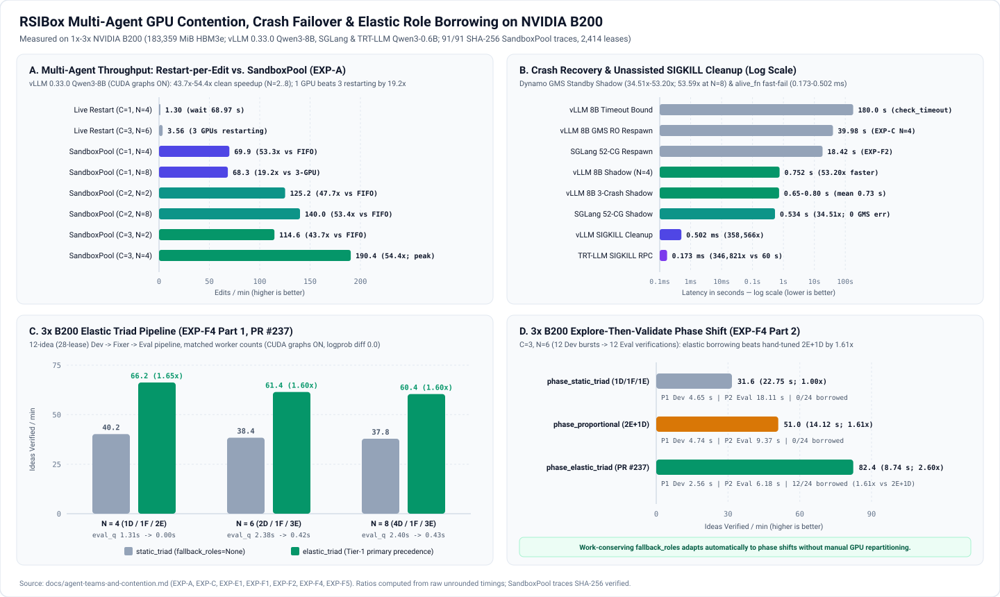
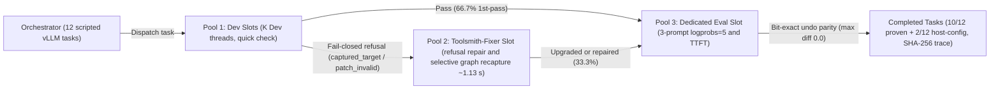
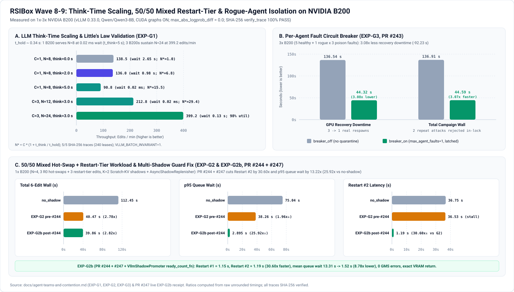
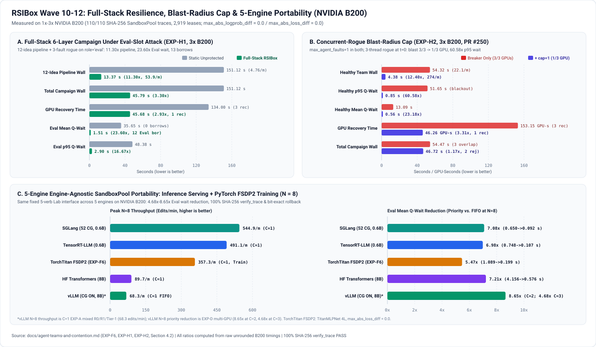
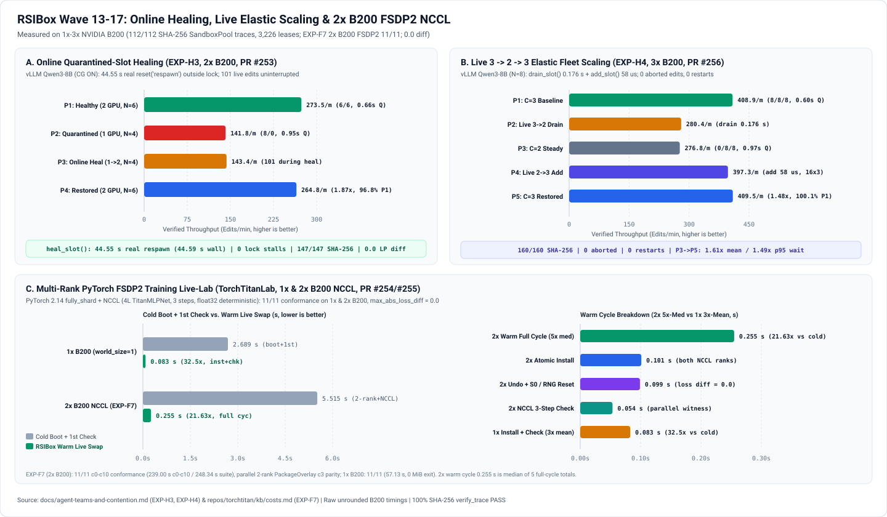

# Multi-Agent GPU Contention and Agent-Team Topologies

Running one coding agent against one dedicated GPU hides the cost of restarting an inference engine. Running `N = 2..24` concurrent workers against a shared GPU budget (`C = 1..3`) exposes it immediately: every full restart stalls the slot for tens of seconds, serialization turns `N` workers into an `O(N)` FIFO queue, and GPUs waiting on Python imports and CUDA graph capture dominate cluster spend.

> **Scope & Companion PRs:** This empirical study exercises infrastructure PRs **#209** (Dynamo GMS/Snapshot B200 benchmarks), **#210** (vLLM `CAPTURED_PREFIXES` and `CAPTURED_EXCLUSIONS`), **#211** (`RLIMIT_NOFILE` probe guard and `AsyncShadowReplenisher`), **#212** (fast-path live CLI reconfigure), **#213** (`TransformersLab`), **#214** (`SandboxPool` and `verify_trace`), **#215** (`TrtllmLab`), **#217** (SGLang decode CUDA graphs), **#218** (`SglangShadowPromoter` and PDEATHSIG-safe worker-thread respawn), **#222** (`TorchTitanLab` PyTorch FSDP2 adapter), **#226** (`SandboxPool` priority scheduling), **#229/#230/#235** (`alive_fn` file-channel fast-fail across `ipc.py`, `VllmLab`, and `TrtllmLab`), **#232** (`SglangLab` targeted teardown preserving co-process GMS), **#233** (`SandboxPool` anti-starvation `priority_aging_s`), **#236** (`vLLM` `FULL_AND_PIECEWISE` `R1` guard/per-mode stamping fix), **#237** (`SandboxPool` work-conserving `fallback_roles` borrowing), **#242/#246/#252/#262** (multi-agent contention/elastic triad, Wave 8–9 scaling/mixed/isolation, Wave 10–12 full-stack/blast-radius/5-engine, and Wave 13–17 online healing/elastic scaling/2× B200 FSDP2 charts), **#243** (`SandboxPool` per-agent fault circuit breaker), **#244/#247/#248** (multi-shadow `ready_count_fn` + `AsyncShadowReplenisher.wait(..., until=...)` early wake across `StandbyShadowDriver`, `VllmShadowPromoter`, and `SglangShadowPromoter` with `_TargetedFallbackDriver`), **#250** (`SandboxPool` `max_slots_per_agent` concurrency cap), **#253** (`SandboxPool.heal_slot()` online quarantined-slot rehabilitation), **#256** (`SandboxPool.add_slot()` and `drain_slot()` live elastic fleet scaling), **#260** (`SandboxPool` `max_waiters` + `slot_states()`), **#268** (`PoolAutoScaler`), **#278** (`EXP-H5`/`EXP-H6` live `2× B200` `PoolAutoScaler` & `max_waiters` receipt), and **#317** (multi-instance `VllmLab(shared=False)` + explicit `close()`).
>
> **Workload note:** All `N` concurrent workers in this study are **deterministic scripted Python threads** executing fixed, behavior-preserving edits and config updates (not LLM-generated code changes); `EXP-G1` models LLM think-time via deterministic inter-lease sleeps (`0–5 s`). See [Section 5](#5-what-this-study-does-not-show) for scope boundaries and caveats.

This document reports controlled studies on `NVIDIA B200` GPUs (`our 2026-11-24 B200 runs`), evaluating:

1. **Multi-agent GPU contention & realistic think-time scaling (`EXP-A`, `EXP-G1`, `EXP-G2`, `EXP-G2b`, `EXP-G2c`):** warm-cache restart-per-edit (anchored by `n = 3` single-GPU repeats and corroborated by two live multi-agent restart trials) versus `SandboxPool` shared-slot scheduling (`core/livelab/rsibox/pool.py`, PR #214) across `C ∈ {1, 2, 3}` GPUs and `N ∈ {1, 2, 4, 8, 12, 24}` scripted agent threads on `Qwen/Qwen3-8B` (`vLLM 0.33.0`, CUDA graphs enabled), including two synthetic-poison fault-injection cells (`EXP-A`), Little's Law think-time scaling (`0–5 s` inter-lease think-time up to `N = 24` on `3× B200`, `EXP-G1`), and multi-shadow (`K = 2`) failover before and after the standby-guard fix on both `vLLM` (`EXP-G2` / `EXP-G2b`, PR #244/#247) and `SGLang` (`52` decode CUDA graphs + `_TargetedFallbackDriver`, `EXP-G2c`, PR #248).
2. **Fault-resilient multi-agent recovery, rogue-agent isolation, online healing, elastic scaling & admission backpressure (`EXP-C`, `EXP-E1`, `EXP-F1`, `EXP-F2`, `EXP-F5`, `EXP-G3`, `EXP-H2`, `EXP-H3`, `EXP-H4`, `EXP-H5`, `EXP-H6`):** single-GPU (`C = 1`, `N ∈ {4, 8}`) head-to-head comparison of `SandboxPool` with plain GMS RO respawn versus Dynamo GMS Standby Shadow failover under mid-burst crashes — on `vLLM 0.33.0` (`Qwen/Qwen3-8B`, genuine `SIGKILL` crash, Scratch-KV `StandbyShadowDriver`), `SGLang` (`Qwen/Qwen3-0.6B`, eager and `52`-decode-CUDA-graph modes with targeted GMS-safe shutdown, PR #218/#232) — plus a 3-crash continuous `SIGKILL` stress run (`AsyncShadowReplenisher`, PR #211), zero-sleep unassisted `SIGKILL` fast-fail on both `vLLM` (`EXP-F1`, PR #229/#230) and `TensorRT-LLM` (`EXP-F5`, PR #235), `3× B200` per-agent circuit-breaker isolation (`EXP-G3`, PR #243), `3× B200` concurrent-rogue blast-radius containment via `max_slots_per_agent=1` (`EXP-H2`, PR #250), `2× B200` online quarantined-slot healing without stalling sibling GPUs (`EXP-H3`, PR #253), `3× B200` zero-restart `3 → 2 → 3` live elastic fleet scaling (`EXP-H4`, PR #256), and `2× B200` `max_waiters=2` admission backpressure (`EXP-H5`, PR #260/#278) + `PoolAutoScaler` `1 → 2 → 1` self-healing & `VllmLab(shared=False)` isolation (`EXP-H6`, PR #268/#278/#317).
3. **Multi-agent team topologies (`EXP-B`), pool sizing (`EXP-D`), 5-engine portability (`EXP-F6`), anti-starvation aging (`EXP-F3`), elastic role borrowing (`EXP-F4`), and full-stack 6-layer integration (`EXP-H1`):** `27` `EXP-B` cells (`324` pipeline task runs: `270` hot-path tasks proven + `54` startup-only host-excluded config commits) comparing `Monolithic`, `Dev+Eval Split`, and `Orchestrator + 3-Pool Triad`; `16` `EXP-D` cells (`448` leases) validating stage-proportional `2 Eval : 1 Dev+Toolsmith` splits and priority-scheduled shared pools (`PR #226`); `16` cross-framework `SandboxPool` cells (`336` leases) spanning `SGLang` (CUDA graphs ON), `TensorRT-LLM`, `HuggingFace Transformers`, and `TorchTitan` PyTorch FSDP2 training (`EXP-F6`, PR #222); `3` `EXP-F3` starvation-vs-aging cells (`72` leases, PR #233); `9` `3× B200` `EXP-F4` elastic role borrowing cells (`240` leases, PR #236/#237); and `2` `3× B200` `EXP-H1` full-stack integration cells (`60` leases) combining priority, aging, elastic borrowing, per-agent circuit breaking, and `R1` recapture under an active Eval-slot rogue attack.

### Headline Findings

- **43.7×–54.4× multi-agent steady-state speedup in clean cells (`N = 2–8`; `53.0×–60.5×` at `N = 1`; `7.1×–9.4×` under injected worker poison without Shadow):** replacing warm-cache restarts (`45.74 ± 0.43 s` to ready + check + stop, `n = 3`, measured) with `SandboxPool` leasing over live hot-reload cuts per-edit slot hold time to `0.63–0.88 s` and sustains `68.3–190.4` edits/min in clean cells (`18.7–35.9` edits/min in the two `EXP-A` fault-injection cells that triggered a full warm-cache respawn).
- **Little's Law think-time multiplexing (`EXP-G1`):** with `3–5 s` simulated LLM coding think-time (`t_hold ≈ 0.34 s`), **1 B200 serves `N = 8` agents at `0.02 ms` mean queue wait** (`90.8` edits/min, `N* = 15.47`), and **3 B200s sustain `N = 24` concurrent agents at `399.2` edits/min** (`0.132 s` mean / `0.426 s` p95 wait, `97.7–98.5%` GPU util).
- **50/50 mixed hot-swap + restart-tier acceleration & multi-shadow guard fix (`EXP-G2`, `EXP-G2b`, `EXP-G2c`):** on `1× B200` (`3` hot-swap + `3` restart-tier edits), Dynamo GMS Standby Shadow cuts wall clock **`2.78×–2.82×`** vs. plain GMS RO respawn (`112.45 → 40.47 s` pre-fix in `EXP-G2`; **`39.86 s` / `9.03` edits/min** post-fix in `EXP-G2b`, **`6.89×`** vs. `6 × 45.74 s` warm restarts). Fixing the multi-shadow (`K = 2`) replenishment-guard stall (**PR #244/#247**) cuts Restart #2 **`30.60×`** (`36.533 → 1.194 s`), mean queue wait **`8.78×`** (`13.309 → 1.516 s`, **`20.87×↓`** vs. `no_shadow`), and p95 wait **`13.22×`** (`38.256 → 2.895 s`, **`25.92×↓`** vs. `no_shadow`). On SGLang (`52` decode CGs, **PR #248**), `EXP-G2c` confirms `sh2` promotes in **`0.484 s`** (`38.06×`) while `AsyncShadowReplenisher` is `in_flight`, with `_TargetedFallbackDriver` (`18.41 s`, `52` CGs) and `0` GMS errors.
- **Rogue-agent isolation & concurrent blast-radius containment (`EXP-G3`, `EXP-H2`):** under a sequential 3-fault rogue agent on `3× B200`, per-agent circuit breaking (**PR #243**) cuts recovery downtime **`3.08×`** (`136.54 → 44.32 s`, `EXP-G3`). When a multi-threaded rogue launches `3` simultaneous attacks (`EXP-H2`), adding `max_slots_per_agent=1` (**PR #250**) bounds blast radius to `1/3` GPU instead of an all-`3/3`-GPU blackout — accelerating the healthy team **`12.40×`** (`54.32 → 4.38 s`, `22.09 → 273.97` edits/min), cutting healthy mean/p95 wait **`23.18× / 60.58×`** (`13.089 → 0.565 s` / `51.646 → 0.852 s`), and cutting cumulative GPU recovery time **`3.31×`** (`153.15 → 46.26 s`).
- **Online quarantined-slot healing & zero-restart `3 → 2 → 3` elastic scaling (`EXP-H3`, `EXP-H4`):** `SandboxPool.heal_slot()` (**PR #253**) rehabilitates a fail-closed quarantined GPU online on `2× B200` (`44.55 s` real `reset("respawn")`) while the surviving GPU completes **`101` live verified edits uninterrupted** (`0` lock stalls), restoring throughput **`1.87×`** (`141.80 → 264.82` edits/min, `96.8%` of healthy `273.49`, `EXP-H3`). `SandboxPool.drain_slot()` and `add_slot()` (**PR #256**) scale a live `3× B200` fleet `3 → 2 → 3` under continuous `N = 8` load with **`0` aborted edits and `0` restarts** — draining gracefully in **`0.176 s`**, re-attaching the warm GPU in **`58 µs`**, and immediately restoring **`409.47` edits/min** (`1.48×` over `C = 2` `276.82` edits/min, `100.1%` of baseline `408.87`, `EXP-H4`).
- **Full-stack 6-layer integration under active rogue attack (`EXP-H1`):** combining priority, aging, elastic borrowing, per-agent circuit breaking, and `R1` recapture on `3× B200` cuts 12-idea pipeline wall **`11.30×`** (`151.12 → 13.37 s`, `4.76 → 53.86` ideas/min), Eval mean wait **`23.60×`** (`35.654 → 1.511 s`, p95 **`16.67×`** `48.377 → 2.902 s`), and total campaign wall **`3.30×`** (`151.12 → 45.79 s`, `2.93×↓` GPU recovery downtime).
- **53.2×–53.6× faster crash recovery, sub-millisecond unassisted `SIGKILL` fast-fail (`0.502 ms` on vLLM, `0.173 ms` on TRT-LLM), and `34.51×` faster SGLang 52-CUDA-graph Shadow failover (`EXP-C`, `EXP-E1`, `EXP-F1`, `EXP-F2`, `EXP-F5`):** wiring `StandbyShadowDriver` into `SandboxPool` on `vLLM Qwen/Qwen3-8B` (`C = 1`) collapses single-crash recovery from **`36.27–39.98 s` → `0.677–0.752 s`**, raises burst throughput **`3.91×–6.99×`** (`19.74 → 138.04` at `N = 4`; `38.97 → 152.40` edits/min at `N = 8`), and cuts p95 queue wait **`12.75×–24.59×`**. Adding `alive_fn` liveness checks (PR #229/#230/#235) eliminates dead-channel timeout stalls on zero-sleep unassisted `SIGKILL`, cutting cleanup latency to **`0.502 ms`** on `vLLM` (`358,566×` below the `180 s` `check_timeout`, with `0.805 s` Shadow recovery in `EXP-F1`) and **`0.173 ms`** on `TensorRT-LLM` (`346,821×` below the `60 s` RPC timeout, with `0.329 s` post-preflight quiesce poisoning in `EXP-F5`). Pairing `VllmShadowPromoter` with `AsyncShadowReplenisher` (PR #211) sustains **`0.803 s`, `0.726 s`, and `0.647 s`** recovery across **3 consecutive `SIGKILL` crashes** (`2.176 s` total downtime, **`154.69` proven edits/min**, `0` GMS errors). On `SGLang Qwen/Qwen3-0.6B` with **`52` decode CUDA graphs ON** and targeted shutdown (PR #218/#232), `SglangShadowPromoter` cuts recovery **`34.51×`** (`18.417 → 0.534 s`), raises burst throughput **`4.67×`** (`42.85 → 200.16` edits/min), and cuts p95 wait **`11.31×`** (`19.172 → 1.694 s`) with `0` GMS errors (`EXP-F2`).
- **28.7× lower mean queue wait at `C = 1, N = 4`:** mean wait drops from `68.97 s` (p95 `137.84 s`, `1` edit/agent live restart trial) to `2.40 s` (p95 `5.31 s`, `4` edits/agent `SandboxPool`).
- **1 GPU running `rsibox` beats 3 GPUs running live restart-per-edit by 19.2×:** a single B200 serving `N = 8` concurrent workers reaches `68.3` edits/min on `rsibox`, versus `3.56` edits/min across 3 B200s running live warm-cache restart-per-edit at `C = 3, N = 6` — delivering `19.2×` higher throughput with `3×` fewer GPUs (comparing `N = 8` vs. `N = 6`).
- **Fail-closed refusal-to-repair pipeline reaches `10/12` proven hot-path tasks + `2/12` host-excluded commits (`66.7%` first-pass $\to$ `100.0%` pipeline completion):** across all `27` `EXP-B`, `16` `EXP-D`, `6` `EXP-F4` Triad, and `2` `EXP-H1` cells, fail-closed refusals (`captured_target` and `patch_invalid`) route to the Toolsmith-Fixer stage without corrupting live state (`global_max_abs_logprob_diff == 0.0`).
- **Stage-proportional sizing (`+53–61%`), priority + anti-starvation aging (`4.68×–8.65×` lower Eval wait in `EXP-D`, `5.47×–7.21×` across 4 single-GPU engines including `TorchTitan` FSDP2 training; `2.07×` lower Dev starvation via tunable `priority_aging_s` in `EXP-F3`), and work-conserving elastic role borrowing (`1.60×–1.65×` Triad, `2.60×` Phase-Shift) cure static Triad imbalance (`EXP-D`, `EXP-F3`, `EXP-F4`, `EXP-F6`):** static 1:1:1 partitioning saturates Eval (`96–97%`) and caps throughput at `37.8–41.9` ideas/min; `priority_aging_s=0.30` (PR #233) cuts `Dev` max starvation wait **`2.07×`** (`14.620 → 7.069 s`, trading `Eval` mean wait back toward FIFO on `C = 1` in `EXP-F3`); and adding work-conserving `fallback_roles` borrowing (PR #237) lifts the 1:1:1 Triad to **`60.4–66.2` ideas/min** (`1.60×–1.65×`, `eval_q = 0.000 s` at `N = 4`, `0` Eval stalls) and accelerates explore-then-validate phase shifts **`2.60×`** vs. static triad (`31.6 → 82.4` ideas/min) and **`1.61×`** vs. hand-tuned `2 Eval : 1 Dev` (`51.0 → 82.4` ideas/min, raw unrounded `82.367 / 51.005`) across **`114 / 114`** verified SHA-256 `SandboxPool` traces (`3,272` total leases across **5 live engines**).

---

## 1. Mechanism Cost Ladder & Experimental Setup

Following [Lesson 12](lessons.md#12-most-real-changes-need-a-restart-so-make-restarts-cheap-and-name-them-in-words), every action is named in plain words with what the time runs to and whether the figure was measured in this B200 study (`Qwen/Qwen3-8B`, `BF16`, `TP=1`, CUDA graphs enabled) or comes from a companion PR:

| Action | Implementation | Overhead & status | Source | What it updates |
|---|---|---|---|---|
| **Fast-path live CLI reconfigure** | [`repos/vllm/livelab/services/engine.py`](../repos/vllm/livelab/services/engine.py), [`live_reconfig.py`](../repos/vllm/livelab/services/live_reconfig.py) | **`~96 ms`** to applied (`92.9–99.6 ms` across `EXP-A`, `95.7 ms` mean, measured in this study); `4.3 ms` in-process control-plane update (measured in PR #212) | This study / PR #212 | Runtime scheduler flags (`--max-num-seqs`, `--scheduling-policy`, `--max-num-batched-tokens`) with zero restart and zero graph recapture |
| **In-place Python hot-swap** | [`core/livelab/kernel/swap.py`](../core/livelab/kernel/swap.py) | **`~80–120 ms`** to installed / undone (measured in this study) | This study | Function and method bodies outside captured CUDA graphs (worker sampler, scheduler utils, host-excluded modules) with journaled undo |
| **Selective CUDA graph recapture** | [`repos/vllm/livelab/adapter/recapture.py`](../repos/vllm/livelab/adapter/recapture.py) | **`~1.13 s`** to recaptured (`0.78–1.64 s` mean across `EXP-A` cells, measured in this study) | This study | Graph-captured GPU kernels (`FlashAttentionImpl.forward`), recapturing only affected CUDA graphs in-place |
| **NVIDIA Dynamo GMS Shadow failover** | [`repos/vllm/livelab/adapter/snapshot_hooks.py`](../repos/vllm/livelab/adapter/snapshot_hooks.py), `repos/sglang/livelab/adapter/shadow.py` *(PR #218)* | **`0.68–0.75 s`** to ready on `vLLM Qwen3-8B` under `SIGKILL` (`0.45–0.49 s` on `SGLang Qwen3-0.6B` eager under poison, measured in `EXP-C`); `0.31–1.86 s` across `0.6B–151.5 GiB` TP4 in PR #209 | `EXP-C` / PR #209 / PR #218 | Warm failover keeping GPU weights resident in GMS VMM when a worker crashes or is poisoned |
| **Warm-cache restart** *(persistent compile cache on disk)* | Plain `vllm serve` respawn | **`45.74 ± 0.43 s`** to ready + check + stop (`44.76 s` to ready + `0.38 s` check + `0.59 s` stop, `n = 3`, measured in this study) | This study | Fresh process reusing warm on-disk compile cache (`1.31` edits/min on 1 GPU) |
| **Cold-cache restart** *(empty compile cache)* | Plain `vllm serve` first compile | **`170.33 s`** total wall (`164.08 s` to `/health`, `n = 1`, measured in separate pre-suite warmup run) | Pre-suite warmup | Full cold compilation and initial graph capture |

### Hardware, `EXP-A` / `EXP-B` Serving Configuration, and Suite Run Accounting

- **Hardware:** `3× NVIDIA B200` (`183,359 MiB` HBM per GPU) for `EXP-A`/`EXP-B`/`EXP-D`/`EXP-F4`/`EXP-G1`/`EXP-G3`/`EXP-H1`/`EXP-H2`/`EXP-H4`, `2× NVIDIA B200` for `EXP-H3`, plus `1× NVIDIA B200` per engine for `EXP-C`, `EXP-E1`, `EXP-F1`, `EXP-F2`, `EXP-F3`, `EXP-F5`, `EXP-F6`, `EXP-G2`/`EXP-G2b`/`EXP-G2c`, and cross-framework pool runs.
- **Run accounting (`EXP-A` / `EXP-B`):** The cold-cache restart reference (`170.33 s`, `n = 1`) ran in a separate pre-suite warmup run to populate the persistent compile cache. The main `1,159.11 s` continuous suite (`our 2026-11-24 B200 run`) executed: `init`, `3×` warm-cache restart repeats, `2×` live multi-agent restart contention trials (`C = 1, N = 4` and `C = 3, N = 6`), the `50.25 s` parallel 3-GPU warm pool boot, all `12` `EXP-A` pool cells, all `27` `EXP-B` pool cells, and `teardown` — logged at 1 Hz across all 3 GPUs (`3,477` telemetry samples = `3 GPUs × 1,159 s`).
- **Engine & Model (`EXP-A` / `EXP-B`):** `vLLM 0.33.0` serving `Qwen/Qwen3-8B` (`BF16`, `-tp 1`, `--distributed-executor-backend mp`, `--worker-extension-cls adapter.worker_ext.KernelWorkerExtension`, `--gpu-memory-utilization 0.42`, `--max-model-len 1024`, `--max-num-seqs 64`, `--max-num-batched-tokens 8192`, `--disable-flashinfer-autotune`, `--seed 0`). (`EXP-C` vLLM and SGLang serving flags are documented in [Section 2.4](#24-curing-the-recovery-cliff-sandboxpool--dynamo-gms-standby-shadow-exp-c).)
- **CUDA Graphs (`EXP-A` / `EXP-B`):** `FULL_AND_PIECEWISE` mode with `--compilation-config '{"cudagraph_capture_sizes": [1, 2, 4, 8]}'`.
- **Determinism (`EXP-A` / `EXP-B`):** `VLLM_BATCH_INVARIANT=1`, greedy decoding (`temperature=0.0`, `seed=0`, `max_tokens=12`, `logprobs=5`).

### Trust & Tamper-Evident Verification Methodology

1. **SHA-256 hash-chained lease traces (`114 / 114` passed):** every `SandboxPool` cell writes an append-only JSONL lease log chaining each record's `prev_sha256` into `record_sha256`. Post-run verification via `verify_trace(..., expected_head=...)` passed `39 / 39` traces (`936` leases: `180` in `EXP-A` + `756` in `EXP-B`), `8 / 8` traces (`192` leases) in `EXP-C`, `1 / 1` continuous multi-crash trace (`226` leases) in `EXP-E1`, `16 / 16` traces (`448` leases) in `EXP-D`, `16 / 16` cross-framework traces (`336` leases across `SGLang`, `TensorRT-LLM`, `Transformers`, and `TorchTitan` FSDP2 `EXP-F6`), `1 / 1` trace (`16` leases) in `EXP-F1`, `2 / 2` traces (`32` leases) in `EXP-F2`, `3 / 3` traces (`72` leases) in `EXP-F3`, `9 / 9` traces (`240` leases) in `EXP-F4`, `5 / 5` traces (`240` leases) in `EXP-G1`, `2 / 2` traces (`12` leases) in `EXP-G2`, `1 / 1` trace (`6` leases) in `EXP-G2b`, `1 / 1` trace (`15` leases) in `EXP-G2c`, `2 / 2` traces (`44` leases) in `EXP-G3`, `2 / 2` traces (`60` leases) in `EXP-H1`, `2 / 2` traces (`44` leases) in `EXP-H2`, `1 / 1` trace (`147` leases) in `EXP-H3`, `1 / 1` trace (`160` leases) in `EXP-H4`, `1 / 1` trace (`4` leases) in `EXP-H5`, and `1 / 1` trace (`42` leases) in `EXP-H6` — **`114 / 114` (`100%`), `3,272` real lease records**.
2. **Numerical preservation & zero cross-agent contamination (`max_abs_logprob_diff == 0.0` / `max_abs_loss_diff == 0.0`):** because all hot-path code edits in `EXP-A`/`EXP-B`/`EXP-D`/`EXP-F4`/`EXP-H1` are behavior-preserving swaps and `EXP-C`/`EXP-E1`/`EXP-F1`/`EXP-F2`/`EXP-F3`/`EXP-F6`/`EXP-G1`–`EXP-G3`/`EXP-G2b`/`EXP-G2c`/`EXP-H2`/`EXP-H3`/`EXP-H4`/`EXP-H5`/`EXP-H6`/cross-framework runs roll back visible edits before post-cell verification, `logprobs=5` parity (or greedy digest parity on `Transformers`/`TensorRT-LLM`/`EXP-H5`/`EXP-H6` `gemma-3-1b-it`, and bit-exact 3-step training loss parity `max_abs_loss_diff == 0.0` on `TorchTitan` FSDP2 `EXP-F6`) directly checks for state corruption or cross-agent leakage. Cross-GPU baselines matched (`cross_gpu_baseline_logprob_diff == 0.0`), every post-install/post-undo check across all `66` `EXP-A`/`EXP-B`/`EXP-D`/`EXP-F4`/`EXP-H1` cells and post-cell check across `EXP-C`, `EXP-E1`, `EXP-F1`–`EXP-F3`, `EXP-G1`–`EXP-G3`/`EXP-G2b`/`EXP-G2c`, `EXP-H2`, `EXP-H3`, `EXP-H4`, `EXP-H5`, `EXP-H6`, and `SGLang` gave `max_abs_logprob_diff == 0.0` (with bit-exact greedy rollback across `Transformers`, `TensorRT-LLM`, and `EXP-H5`/`EXP-H6`, and `max_abs_loss_diff == 0.0` across `TorchTitan` FSDP2 `EXP-F6`), and every slot was asserted clean (`state == "base"`, zero poison) after every cell.
3. **Execution witnesses on hot-path edits:** per [`core/livelab/INTERFACE.md`](../core/livelab/INTERFACE.md), live code swaps prove execution via witness counters — `12` calls per 12-token prompt (`36` across a 3-prompt Eval) for in-place Python hot-swaps (`vllm.v1.worker.gpu.sample.sampler`, `vllm.v1.core.sched.utils`) and `36` calls across 36 transformer layers during the **prefill/mixed step (live witness ledger)** for selective CUDA graph recapture (`FlashAttentionImpl.forward`, since captured CUDA graphs handle decode replay under `FULL_AND_PIECEWISE`).
4. **Continuous 1 Hz GPU hardware telemetry (`3,477` samples in `EXP-A`/`EXP-B`, `714` samples in `EXP-D`, `594` samples in `EXP-F4`, `954` samples in `EXP-G1`/`EXP-G3`, `765` samples in `EXP-H1`, `486` samples in `EXP-H2`, `333` samples = `111` ticks × `3` visible GPUs in `EXP-H3`, `279` samples in `EXP-H4`):** background `nvidia-smi` sampling recorded active warm device memory of **`~93.3 GiB`** (`95,494–95,626 MiB` total device memory, `+74.8 GiB` above the `18,894 MiB` pre-run reservation baseline in `EXP-A`/`EXP-B`/`EXP-D`/`EXP-G1`/`EXP-G3`/`EXP-H1`/`EXP-H2`/`EXP-H3`) and **`74.8–77.4 GiB`** (`76,604–79,208 MiB` above the `0 MiB` pre-run baseline in `EXP-H4`), plus utilization, power, and temperature; `EXP-A`/`EXP-B`/`EXP-D`/`EXP-G1`/`EXP-G3`/`EXP-H1`/`EXP-H2` verified clean return to baseline memory (`18,894 MiB`) and `0%` utilization in saved teardown telemetry (with initial/final baseline VRAM parity also asserted in `EXP-C`, `EXP-E1`, `EXP-F1`, `EXP-F3`, `EXP-F5`, `EXP-F6`, `EXP-G2`, `EXP-G2b`, `EXP-G2c`, `SGLang` eager, and `Transformers`; see [Section 5](#5-what-this-study-does-not-show) for `EXP-F2`'s `1 MiB` driver reservation delta, `EXP-F4`'s sibling co-residency telemetry, and `EXP-H3`/`EXP-H4` saved teardown snapshot timing).

---

## 2. Multi-Agent Contention Study (`EXP-A`)

### 2.1 Restart-per-Edit Baselines and Live Contention Trials

When workers restart the engine for each edit, GPUs sit kernel-idle for **over 96%** of wall clock (`1.9–3.7%` mean GPU utilization in our 1 Hz telemetry) while waiting on Python imports, weight loads, and CUDA graph capture:

| Baseline measurement | GPUs (`C`) | Agents (`N`) | Edits | Wall clock (s) | Mean queue wait (s) | P95 queue wait (s) | Mean service (s) | Throughput (edits/min) |
|---|---:|---:|---:|---:|---:|---:|---:|---:|
| Cold-cache restart *(pre-suite warmup, `n = 1`)* | 1 | 1 | 1 | `170.33` | `0.00` | `0.00` | `170.33` | `0.35` |
| Warm-cache restart *(`n = 3` repeats)* | 1 | 1 | 1 | `45.74 ± 0.43` | `0.00` | `0.00` | `45.74` | `1.31` |
| Live warm-cache restart trial *(1 edit/agent)* | 1 | 4 | 4 | `184.12` | `68.97` | `137.84` | `46.03` | `1.30` |
| Live warm-cache restart trial *(1 edit/agent)* | 3 | 6 | 6 | `101.14` | `25.45` | `51.21` | `50.47` | `3.56` |

In the 12-cell matrix below, real `SandboxPool` measurements are compared against an analytical FIFO restart curve anchored to the `n = 3` warm-cache restart mean (`45.74 s`). The live `C = 1, N = 4` trial corroborates this FIFO model within **`0.6%`** (`184.12 s` measured vs. `182.97 s` analytical; `1.304` vs. `1.312` edits/min). Moreover, the live `C = 3, N = 6` trial shows concurrent 3-GPU restarts suffer host-CPU and PCIe contention (`50.47 s` mean service vs. `45.74 s` single-GPU), making the analytical FIFO curve slightly optimistic for restart-per-edit and therefore conservative with respect to `rsibox` speedups.

### 2.2 Complete `SandboxPool` Contention Matrix (`C ∈ {1, 2, 3} × N ∈ {1, 2, 4, 8}`)

In each cell (`n = 1` run per cell), `N` scripted threads each execute `4` leases (`4N` total leases) cycling through:
1. **In-place Python hot-swap** (`vllm.v1.worker.gpu.sample.sampler` or `vllm.v1.core.sched.utils`, `~80–120 ms`) + witness proof + undo parity check;
2. **Fast-path live CLI reconfigure** (`--max-num-seqs 32 --scheduling-policy priority` or `48 / fcfs`, `~96 ms`) + check;
3. **Selective CUDA graph recapture** (`FlashAttentionImpl.forward` with `rebuild=["R1"]`, `~1.13 s`) + witness proof + undo parity check;
4. **Refusal / exclusion / fault lease:** fail-closed broken-syntax refusal (`patch_invalid`) + `reset("state")`, host-side excluded `vllm.model_executor.models.config` hot-swap (zero recapture), or — in two explicitly marked fault-injection cells — a synthetic `session.fault` poison triggering a real warm-cache restart on the faulted slot.

| `C` | `N` | Leases | `rsibox` Wall (s) | `rsibox` Edits/min | Restart Edits/min *(FIFO)* | Speedup | Mean Q-Wait (s) | P95 Q-Wait (s) | Mean Hold (s) | Slot Recoveries | Max LP Diff | Proven\*\* | Trace OK |
|---:|---:|---:|---:|---:|---:|---:|---:|---:|---:|---|---:|---:|:---:|
| 1 | 1 | 4 | 3.02 | **79.4** | 1.31 | **60.5×** | 0.000 | 0.000 | 0.628 | 0 | 0.0 | 2/2 | Yes |
| 1 | 2 | 8 | 6.83 | **70.3** | 1.31 | **53.6×** | 0.803 | 1.804 | 0.729 | 0 | 0.0 | 4/4 | Yes |
| 1 | 4 | 16 | 13.74 | **69.9** | 1.31 | **53.3×** | 2.404 | 5.314 | 0.738 | 0 | 0.0 | 8/8 | Yes |
| 1 | 8 | 32 | 28.10 | **68.3** | 1.31 | **52.1×** | 5.700 | 12.784 | 0.758 | 0 | 0.0 | 16/16 | Yes |
| 2 | 1 | 4 | 3.45 | **69.5** | 1.31 | **53.0×** | 0.000 | 0.000 | 0.728 | 0 | 0.0 | 2/2 | Yes |
| 2 | 2 | 8 | 3.83 | **125.2** | 2.62 | **47.7×** | 0.000 | 0.000 | 0.725 | 0 | 0.0 | 4/4 | Yes |
| 2 | 4 | 16 | 51.29 | **18.7** | 2.62 | **7.1×**\* | 0.823 | 1.900 | 0.744 | 1 (`44.74 s`)\* | 0.0 | 8/8 | Yes |
| 2 | 8 | 32 | 13.71 | **140.0** | 2.62 | **53.4×** | 2.340 | 5.240 | 0.729 | 0 | 0.0 | 16/16 | Yes |
| 3 | 1 | 4 | 3.38 | **71.1** | 1.31 | **54.2×** | 0.000 | 0.000 | 0.706 | 0 | 0.0 | 2/2 | Yes |
| 3 | 2 | 8 | 4.19 | **114.6** | 2.62 | **43.7×** | 0.000 | 0.000 | 0.875 | 0 | 0.0 | 4/4 | Yes |
| 3 | 4 | 16 | 5.04 | **190.4** | 3.50 | **54.4×** | 0.221 | 0.671 | 0.739 | 0 | 0.0 | 8/8 | Yes |
| 3 | 8 | 32 | 53.53 | **35.9** | 3.82 | **9.4×**\* | 1.362 | 2.809 | 0.746 | 1 (`45.60 s`)\* | 0.0 | 16/16 | Yes |

\* *Fault-injection cells `(C = 2, N = 4)` and `(C = 3, N = 8)` injected a synthetic `session.fault` (`participant_failed`) on one lease to force a real warm-cache respawn (`44.74 s` / `45.60 s`) on the faulted slot.*  
\*\* *`Proven = 2N/2N` counts the 2 inference-hot-path code-swap leases per agent (in-place Python hot-swap + selective CUDA graph recapture); live CLI reconfigurations, refusals, and startup-only config edits are not witness-checked.*

### 2.3 Takeaways from `EXP-A`

1. **High throughput with sub-linear multi-GPU scaling:** on 1 GPU, `rsibox` sustains `68.3–79.4` edits/min across `N = 1..8` (`52.1×–60.5×` over warm-cache restart). Peak clean-cell throughput scales sub-linearly with `C` from `79.4` (`C = 1, N = 1`) to `140.0` (`C = 2, N = 8`, **`1.76×`**) and `190.4` edits/min (`C = 3, N = 4`, **`2.40×`**), with `~±10%` single-run (`n = 1`) cell-to-cell variance visible across `N = 1` (`69.5–79.4` edits/min) and `N = 2` (`114.6–125.2` edits/min).
2. **3× fewer GPUs with 19.2× higher throughput:** 1 B200 running `rsibox` (`68.3` edits/min at `N = 8`) outperforms 3 B200s running live warm-cache restart-per-edit (`3.56` edits/min at `C = 3, N = 6`) by **`19.2×`** while using `3×` fewer GPUs (noting `N = 8` vs. `N = 6`).
3. **28.7× queue-wait collapse at `C = 1, N = 4`:** mean queue wait drops from `68.97 s` (`1` edit/agent live restart trial) to `2.40 s` (`4` edits/agent pool), and p95 queue wait drops from `137.84 s` to `5.31 s` (`25.9×`).
4. **Fault isolation works — and exposes the tail cost of plain warm-cache respawns:** in `(C = 2, N = 4)` and `(C = 3, N = 8)`, `SandboxPool` detected the synthetic poison on lease release, respawned only the faulted slot (`44.74 s` and `45.60 s`), and kept sibling GPUs serving uninterrupted (mean queue wait stayed `0.823 s` and `1.362 s`, `0` slots left quarantined, `0.0` logprob diff). However, that single `~45 s` respawn still dropped cell speedup to **`7.1×`** and **`9.4×`**. Section 2.4 (`EXP-C`) directly cures this recovery cliff by wiring Dynamo GMS Standby Shadow into `SandboxPool`.

### 2.4 Curing the Recovery Cliff: `SandboxPool` + Dynamo GMS Standby Shadow (`EXP-C`)

To measure whether Dynamo GMS Standby Shadow eliminates the `~40–45 s` multi-agent recovery cliff observed in `EXP-A`, we ran a follow-up single-GPU (`C = 1`, `N ∈ {4, 8}`, `4` leases/agent = `16` / `32` leases per cell, `n = 1` per cell) fault-injection study across **two serving engines** on NVIDIA B200 (`our 2026-11-24 B200 follow-up run`):

- **vLLM (`0.33.0`, `Qwen/Qwen3-8B`, exact `EXP-A` model, `FULL_AND_PIECEWISE` CUDA graphs ON with default capture sizes `35 PIECEWISE + 19 FULL` across `1..256`, `--gpu-memory-utilization 0.35` primary / `0.42` shadow, `--max-model-len 1024`, `--max-num-seqs 128`, default `--max-num-batched-tokens 16384`, FlashInfer autotune ON, `--enable-sleep-mode`, `VLLM_BATCH_INVARIANT=0`, GMS RO + `VllmShadowPromoter` via `StandbyShadowDriver`):** `N` concurrent threads execute real `R0` visible sampler hot-swaps (`install -> check(proven) -> uninstall`); on `agent-0`'s second lease, the worker sends a genuine **`SIGKILL`** to the live vLLM process tree (waiting for PID exit via `10 ms` poll; fault-lease `hold_s = 107–119 ms`) and faults the session, forcing `SandboxPool` to recover the dead slot via either GMS RO respawn (**No Shadow**) or pre-parked Scratch-KV Shadow promotion (**Shadow**; note `shadow_N8` inherited the promoted `0.42` shadow from `shadow_N4` before promoting a second `0.42` shadow).
- **SGLang (`0.0.0.dev1+g302b78ccf`, `Qwen/Qwen3-0.6B`, `disable_cuda_graph=True` eager mode, `mem_fraction_static=0.35`, `context_length=2048`, `random_seed=0`, `4`-prompt `max_new_tokens=16` check, GMS RO + `SglangShadowPromoter` via `StandbyShadowDriver`, PR #218):** same `N ∈ {4, 8}` burst with `R0` visible sampler hot-swaps and a mid-burst worker fault, comparing GMS RO respawn (**No Shadow**) against a pre-parked `SglangShadowPromoter` standby (**Shadow**). Running this multi-threaded pool study also exposed and verified fixes for two real systems bugs in `SglangLab._start_engine()`: unconditional `signal.signal(SIGQUIT, SIG_IGN)` crashing non-main recovery threads with `ValueError`, and Linux `PR_SET_PDEATHSIG` binding SGLang scheduler/detokenizer children to the spawning worker TID (fixed via a process-lifetime daemon spawner thread in PR #218).

Note on throughput numerator: whereas `EXP-A` divided by `total_leases` (`16` / `32`), `EXP-C` computes `Edits/min = (proven_edits / wall_s) × 60`, excluding the `1` intentionally injected fault lease per cell (`15` proven of `16` leases at `N = 4`; `31` proven of `32` leases at `N = 8`); Shadow vs. No-Shadow speedup ratios are unaffected.

| Engine & Model (`C = 1`) | Fault Mode | `N` | Recovery Arm | Leases (`Proven`) | Wall (s) | Edits/min | Recovery (s) | Mean Q-Wait (s) | P95 Q-Wait (s) | Mean Hold (s) | Recovery Speedup | Throughput Speedup | P95 Q-Wait Reduction | Max LP Diff | Trace OK |
|---|---|---:|---|---:|---:|---:|---:|---:|---:|---:|---:|---:|---:|---:|:---:|
| **vLLM** `Qwen3-8B` | Live `SIGKILL` | 4 | No Shadow *(GMS RO respawn)* | 16 (15) | 45.59 | 19.74 | 39.982 | 8.412 | 40.868 | 0.265 | — | — | — | 0.0 | Yes (`16`) |
| **vLLM** `Qwen3-8B` | Live `SIGKILL` | 4 | **Dynamo GMS Shadow** | 16 (15) | **6.52** | **138.04** | **0.752** | **1.084** | **1.662** | 0.272 | **53.20×** | **6.99×** | **24.59×** | 0.0 | Yes (`16`) |
| **vLLM** `Qwen3-8B` | Live `SIGKILL` | 8 | No Shadow *(GMS RO respawn)* | 32 (31) | 47.73 | 38.97 | 36.268 | 10.119 | 38.631 | 0.270 | — | — | — | 0.0 | Yes (`32`) |
| **vLLM** `Qwen3-8B` | Live `SIGKILL` | 8 | **Dynamo GMS Shadow** | 32 (31) | **12.20** | **152.40** | **0.677** | **2.350** | **3.030** | 0.272 | **53.59×** | **3.91×** | **12.75×** | 0.0 | Yes (`32`) |
| **SGLang** `Qwen3-0.6B` *(eager)* | Worker poison | 4 | No Shadow *(GMS RO respawn)* | 16 (15) | 19.48 | 46.20 | 11.410 | 3.516 | 14.127 | 0.494 | — | — | — | 0.0 | Yes (`16`) |
| **SGLang** `Qwen3-0.6B` *(eager)* | Worker poison | 4 | **`SglangShadowPromoter`** | 16 (15) | **8.36** | **107.62** | **0.449** | **1.431** | **3.312** | 0.485 | **25.44×** | **2.33×** | **4.27×** | 0.0 | Yes (`16`) |
| **SGLang** `Qwen3-0.6B` *(eager)* | Worker poison | 8 | No Shadow *(GMS RO respawn)* | 32 (31) | 26.57 | 70.01 | 11.518 | 5.496 | 17.063 | 0.443 | — | — | — | 0.0 | Yes (`32`) |
| **SGLang** `Qwen3-0.6B` *(eager)* | Worker poison | 8 | **`SglangShadowPromoter`** | 32 (31) | **15.06** | **123.47** | **0.490** | **2.973** | **5.025** | 0.446 | **23.53×** | **1.76×** | **3.40×** | 0.0 | Yes (`32`) |

Across all `8` `EXP-C` cells (`192` SHA-256 hash-chained leases verified `8 / 8` via `verify_trace`, `0` quarantined slots, `0` GMS errors, `max_abs_logprob_diff == 0.0`, clean VRAM return to baseline), Dynamo GMS Standby Shadow turns a `~36–40 s` vLLM `SIGKILL` stall into a **`0.68–0.75 s`** hiccup (**`53.2×–53.6×`** faster recovery, **`3.91×–6.99×`** higher burst throughput, **`12.75×–24.59×`** lower p95 queue wait) and turns an `11.4–11.5 s` SGLang eager respawn into a **`0.45–0.49 s`** promotion (**`23.5×–25.4×`** faster recovery).

**Continuous multi-crash resilience with off-critical-path `AsyncShadowReplenisher` (`EXP-E1`, PR #211):** to verify that sub-second failover holds across repeated crashes (not just one pre-parked shadow), we ran a continuous `N = 4` `SandboxPool` stress test on `1× NVIDIA B200` (`vLLM 0.33.0`, `Qwen/Qwen3-8B`, CUDA graphs ON, `VLLM_BATCH_INVARIANT=0`) injecting **3 consecutive live `SIGKILL` crashes** spaced until background replenishment parked the next Scratch-KV shadow. Every crash recovered in under a second (**`0.803 s`**, **`0.726 s`**, and **`0.647 s`** — **`2.176 s`** cumulative downtime vs. `~120 s` projected from `3 × EXP-C N = 4` plain GMS RO respawns at `39.98 s`), while `AsyncShadowReplenisher` booted and parked Shadow #2 (`37.99 s`, `sleep 23.4 ms`) and Shadow #3 (`40.12 s`, `sleep 29.3 ms`) off the critical path with **`208` real `R0` edits completed during background replenishment** (`223` proven edits / `226` total leases in `86.50 s` = **`154.69` proven edits/min**, `99.997%` slot util, `p95` queue wait `1.279 s`, `replenisher.status`: `2` GPU shadow replenishments + `1` target-reached early-return skip after Crash #3 = `attempts=3, succeeded=3, failed=0`, `226/226` SHA-256 `verify_trace`, `0` GMS handshake errors, `max_abs_logprob_diff == 0.0`, clean VRAM return to baseline).

---

## 3. Multi-Agent Team Architecture & Division-of-Labor Study (`EXP-B`)

`EXP-A` treats all workers identically. Multi-agent engineering pipelines split labor across roles: **Dev** workers apply edits and run quick sanity checks, a **Toolsmith-Fixer** handles fail-closed sandbox refusals, and a **Dedicated Eval** stage runs multi-prompt correctness and TTFT verification.

### 3.1 Fixed 6-Idea Scripted vLLM Workload

Every `EXP-B` cell runs `12` concurrent scripted tasks (`2×` each of `6` tasks, producing `28` hash-chained `SandboxPool` leases per cell: `12` Dev + `4` Toolsmith-Fixer + `12` Eval):

| # | Trace ID | Initial Dev action | First-pass outcome | Toolsmith-Fixer scripted action | Eval verification & proof status |
|---:|---|---|---|---|---|
| 1 | `idea1_r0_sampler` | In-place Python hot-swap on `vllm.v1.worker.gpu.sample.sampler` | Pass (`12` witness calls) | — | **Proven:** 3-prompt `logprobs=5` + TTFT + witness (`36`) + undo parity |
| 2 | `idea2_tier1_seqs_priority` | Fast-path live CLI reconfigure (`--max-num-seqs 32 --scheduling-policy priority`, `~96 ms`) | Pass (scheduler ack verified) | — | **Proven (config ack):** 3-prompt `logprobs=5` + TTFT |
| 3 | `idea3_r1_attn_missing_r1` | Edit `FlashAttentionImpl.forward` without graph recapture | **Refused fail-closed** (`captured_target`) | Upgrades to selective CUDA graph recapture (`rebuild=["R1"]`, `~1.13 s`) | **Proven:** 3-prompt `logprobs=5` + TTFT + prefill/mixed witness (`36`) + undo parity |
| 4 | `idea4_r0_host_config_excl` | In-place Python hot-swap on `vllm.model_executor.models.config` (host-excluded) | Pass (zero recapture) | — | **Committed without execution proof (`witness = 0` by design):** startup-only function exercising `CAPTURED_EXCLUSIONS` + undo parity |
| 5 | `idea5_broken_syntax_fault` | Broken Python syntax in `sampler` | **Refused fail-closed** (`patch_invalid`) | Substitutes valid in-place Python hot-swap on `vllm.v1.core.sched.utils` | **Proven:** 3-prompt `logprobs=5` + TTFT + witness (`36`) + undo parity |
| 6 | `idea6_tier1_batch_tokens` | Fast-path live CLI reconfigure (`--max-num-batched-tokens 4096`, `~96 ms`) | Pass (scheduler ack verified) | — | **Proven (config ack):** 3-prompt `logprobs=5` + TTFT |

Per [Lesson 5](lessons.md#5-code-that-runs-at-build-import-or-capture-time-is-not-reached-by-a-swap), a zero witness is never counted as execution-proven. Each 12-task cell therefore completes **`10 / 12` proven hot-path tasks** (`6 / 6` inference-hot-path code edits with live witnesses + `4 / 4` live CLI reconfigurations with verified scheduler acks) plus **`2 / 12` startup-only host-excluded config edits** committed without execution proof (`witness = 0` by design) to verify that `CAPTURED_EXCLUSIONS` avoids unnecessary CUDA graph recapture.

### 3.2 Complete 27-Cell Topology Matrix (`324` Pipeline Task Runs)

Three topologies were evaluated over `C ∈ {1, 2, 3}` GPUs and `N ∈ {1, 2, 3, 4, 6, 8}` scripted threads (`n = 1` per cell):
- **`monolithic`:** all `N` threads share one undifferentiated `C`-GPU `SandboxPool` for Dev, repair, and Eval.
- **`dev_eval_split` (`C ≥ 2`):** `C - 1` GPUs form the Dev/Repair pool (`K_dev = N - 1` threads) and `1` dedicated GPU forms the Eval pool.
- **`triad_orchestrator` (`C = 3`):** `1` GPU for Dev (`Pool 1`, `K_dev = N - 2` threads), `1` GPU for Toolsmith-Fixer (`Pool 2`), and `1` GPU for Dedicated Eval (`Pool 3`).

In all `27` cells: **1st-pass pass rate = `66.7%`**, **post-Toolsmith pipeline completion = `100.0%` (`10/12` proven hot-path + `2/12` host-excluded config commits)**, **`max_abs_logprob_diff == 0.0`**, and **SHA-256 trace verification = `27 / 27` passed**.

#### `C = 1` GPU

| Topology | `N` | `K_dev` | Wall (s) | Ideas/min | Mean Q-Wait (s) | Eval Q-Wait (s) | Eval Stalls (`/12`) | Dev / TS / Eval Util\* | Mean TTFT (ms) |
|---|---:|---:|---:|---:|---:|---:|---:|---|---:|
| `monolithic` | 1 | 1 | 25.84 | **27.9** | 0.000 | **0.000** | **0** | 1.00 / — / 1.00 | 22.1 |
| `monolithic` | 2 | 2 | 25.84 | **27.9** | 0.878 | **1.048** | **12** | 1.00 / — / 1.00 | 21.4 |
| `monolithic` | 4 | 4 | 25.65 | **28.1** | 2.434 | **2.672** | **12** | 1.00 / — / 1.00 | 21.2 |
| `monolithic` | 6 | 6 | 25.90 | **27.8** | 3.630 | **4.055** | **12** | 1.00 / — / 1.00 | 21.5 |
| `monolithic` | 8 | 8 | 26.20 | **27.5** | 4.500 | **5.304** | **12** | 1.00 / — / 1.00 | 21.3 |

#### `C = 2` GPUs

| Topology | `N` | `K_dev` | Wall (s) | Ideas/min | Mean Q-Wait (s) | Eval Q-Wait (s) | Eval Stalls (`/12`) | Dev / TS / Eval Util\* | Mean TTFT (ms) |
|---|---:|---:|---:|---:|---:|---:|---:|---|---:|
| `monolithic` | 1 | 1 | 26.25 | **27.4** | 0.000 | **0.000** | **0** | 0.50 / — / 0.50 | 21.3 |
| `monolithic` | 2 | 2 | 13.52 | **53.2** | 0.000 | **0.000** | **0** | 0.94 / — / 0.94 | 21.6 |
| `monolithic` | 4 | 4 | 13.36 | **53.9** | 0.802 | **0.856** | **12** | 0.97 / — / 0.97 | 21.2 |
| `monolithic` | 6 | 6 | 13.13 | **54.8** | 1.386 | **1.456** | **12** | 0.98 / — / 0.98 | 21.1 |
| `monolithic` | 8 | 8 | 13.00 | **55.4** | 1.828 | **2.090** | **12** | 0.99 / — / 0.99 | 21.3 |
| `dev_eval_split` | 2 | 1 | 17.24 | **41.8** | 0.000 | **0.000** | **0** | 0.55 / — / 0.96 | 20.9 |
| `dev_eval_split` | 4 | 3 | 17.03 | **42.3** | 0.625 | **0.000** | **0** | 0.56 / — / 0.97 | 20.8 |
| `dev_eval_split` | 6 | 5 | 17.23 | **41.8** | 0.988 | **0.000** | **0** | 0.53 / — / 0.97 | 20.8 |
| `dev_eval_split` | 8 | 7 | 17.13 | **42.0** | 1.392 | **0.000** | **0** | 0.57 / — / 0.96 | 20.8 |

#### `C = 3` GPUs

| Topology | `N` | `K_dev` | Wall (s) | Ideas/min | Mean Q-Wait (s) | Eval Q-Wait (s) | Eval Stalls (`/12`) | Dev / TS / Eval Util\* | Mean TTFT (ms) |
|---|---:|---:|---:|---:|---:|---:|---:|---|---:|
| `monolithic` | 1 | 1 | 26.82 | **26.8** | 0.000 | **0.000** | **0** | 0.33 / — / 0.33 | 21.4 |
| `monolithic` | 2 | 2 | 13.31 | **54.1** | 0.000 | **0.000** | **0** | 0.64 / — / 0.64 | 21.1 |
| `monolithic` | 4 | 4 | 10.11 | **71.2** | 0.278 | **0.345** | **10** | 0.85 / — / 0.85 | 21.7 |
| `monolithic` | 6 | 6 | 10.01 | **72.0** | 0.695 | **0.664** | **11** | 0.89 / — / 0.89 | 21.2 |
| `monolithic` | 8 | 8 | 9.63 | **74.7** | 0.993 | **1.189** | **10** | 0.90 / — / 0.90 | 21.0 |
| `dev_eval_split` | 2 | 1 | 17.22 | **41.8** | 0.000 | **0.000** | **0** | 0.27 / — / 0.96 | 20.8 |
| `dev_eval_split` | 4 | 3 | 17.06 | **42.2** | 0.149 | **0.000** | **0** | 0.28 / — / 0.97 | 20.8 |
| `dev_eval_split` | 6 | 5 | 16.98 | **42.4** | 0.370 | **0.000** | **0** | 0.28 / — / 0.97 | 20.9 |
| `dev_eval_split` | 8 | 7 | 17.12 | **42.1** | 0.521 | **0.000** | **0** | 0.28 / — / 0.97 | 20.9 |
| `triad_orchestrator` | 3 | 1 | 17.81 | **40.4** | 0.000 | **0.000** | **0** | 0.30 / 0.23 / 0.97 | 20.8 |
| `triad_orchestrator` | 4 | 2 | 17.18 | **41.9** | 0.170 | **0.000** | **0** | 0.31 / 0.25 / 0.97 | 20.8 |
| `triad_orchestrator` | 6 | 4 | 17.24 | **41.8** | 0.480 | **0.000** | **0** | 0.31 / 0.24 / 0.96 | 20.8 |
| `triad_orchestrator` | 8 | 6 | 17.29 | **41.6** | 0.733 | **0.000** | **0** | 0.31 / 0.24 / 0.96 | 20.8 |

\* *In `monolithic`, all GPUs serve every role, so `Dev Util` and `Eval Util` both report the fleet-wide average slot utilization.*

---

## 4. Pool-Sizing Heuristic

The `EXP-B` matrix exposes a concrete scheduling trade-off under real GPU service times:

1. **Dedicated Eval pools eliminate Eval queue interference.** Whenever `N > C` in `monolithic`, Eval leases queue behind Dev and repair leases: `10–12` of `12` evaluations stall with `0.34–5.30 s` mean Eval queue wait (`p95` up to `8.22 s`), and mean TTFT spans `21.0–21.7 ms` (`22.1 ms` at `C = 1, N = 1`). Both `dev_eval_split` and `triad_orchestrator` cut Eval stalls to **`0 / 12`** and Eval queue wait to **`0.000 s`** across `N = 2..8`, holding mean TTFT tightly at `20.8–20.9 ms`.
2. **Static 1-GPU-per-role partitioning bottlenecks on Eval and strands `~70–77%` of Dev/Toolsmith capacity.** Across all four `triad_orchestrator` traces (`48` Dev, `16` Toolsmith, `48` Eval leases), measured busy time (`hold_s + cleanup_s`) per task averages:
   - **Eval** (3-prompt `logprobs=5` + TTFT + undo parity): **`1.38 s` / idea** (`16.54 s` per 12 ideas — **`64.4%`** of total GPU-seconds);
   - **Dev** (initial install + 1-prompt sanity check): **`0.42 s` / idea** (`5.03 s` per 12 ideas — **`19.6%`** of total GPU-seconds);
   - **Toolsmith-Fixer** (`1.03 s` per repaired idea across `4 / 12` failing ideas): **`0.34 s` amortized / idea** (`4.13 s` per 12 ideas — **`16.1%`** of total GPU-seconds).

   Because a single Eval GPU tops out at `60 / 1.38 ≈ 43.5` ideas/min, pinning 1 GPU to Eval caps both `dev_eval_split` and `triad_orchestrator` at **`40.4–42.4` ideas/min** (`16.98–17.81 s` wall) with `96–97%` Eval utilization while leaving Dev (`27–31%` at `C = 3`; `30–31%` in triad) and Toolsmith (`23–25%`) mostly idle. Meanwhile, `monolithic` (`C = 3, N = 8`) runs Eval on all 3 GPUs concurrently and reaches **`74.7` ideas/min** (`9.63 s` wall, `90%` fleet utilization) at the cost of `10 / 12` Eval stalls (`1.19 s` mean Eval wait).

### Practical Pool-Sizing Rules (Empirically Validated in `EXP-D`)

1. **Match static role GPU shares to measured stage service time.** If strict `0.000 s` Eval isolation is required, size each role's GPU share proportionally to its amortized GPU-seconds per idea:

   $$\frac{C_{\text{eval}}}{C} \approx \frac{T_{\text{eval}}}{T_{\text{dev}} + T_{\text{toolsmith}} + T_{\text{eval}}}$$

   For this workload ($T_{\text{eval}} / T_{\text{total}} = 0.644$), a 3-GPU cluster assigns **2 GPUs to Eval and 1 shared GPU to Dev + Toolsmith** rather than 1:1:1. As measured in `EXP-D` below, this lifts throughput **`+53% to +61%`** over `EXP-B` matched-`N` 1:1:1 `triad_orchestrator` (`41.6–41.9 → 64.0–67.2` ideas/min, cross-session) while preserving **`0 / 12` Eval stalls (`0.000 s` wait)** and rebalancing GPU utilization to **`83.5–84.0%` Dev+TS / `73.6–75.5%` Eval** (finite-batch startup and tail drain trim the steady-state `78.6` ideas/min analytical ceiling to `67.2` ideas/min on a 12-idea batch).
2. **Use priority-scheduled shared pools (`SandboxPool(..., priority=...)`, PR #226) when peak throughput matters more than `0.000 s` Eval wait.** In `EXP-D` below, sharing all `C` GPUs with `Eval priority=10 > Fix priority=5 > Dev priority=0` sustains full monolithic throughput (**`76.3–80.7` ideas/min** at `C = 3, N ≥ 4`, `90.6–95.8%` util; **`53.9–57.3` ideas/min** at `C = 2`, `97.0–97.6%` util — zero stranded capacity) while cutting mean Eval queue wait **`4.68×`** at `C = 3, N = 8` (`1.164 → 0.249 s`) and **`8.65×`** at `C = 2, N = 8` (`2.088 → 0.241 s`, p95 **`6.87×`** from `3.440 → 0.501 s`, computed from raw timings). Because scheduling is non-preemptive, an arriving Eval lease waits only for one currently executing lease's residual service time (`~0.23–0.39 s` across all contended cells) rather than the full `O(N)` FIFO backlog.
3. **Share Dev and Toolsmith slots unless repair cost dominates.** At a `33.3%` refusal rate with `1.03 s` average repair time, Toolsmith accounts for only `16.1%` of GPU-seconds. A dedicated Toolsmith GPU is warranted only when repairs invoke much heavier rebuilds (such as `.cu` side-library compilation at `7.3–19.2 s`, `repos/vllm/kb/costs.md`) that would otherwise block Dev throughput.

### 4.1 Live 3× B200 Validation of Proportional & Priority Pool Sizing (`EXP-D`)

Using the exact `EXP-B` serving configuration (`3× NVIDIA B200`, `vLLM 0.33.0`, `Qwen/Qwen3-8B`, CUDA graphs ON `[1,2,4,8]`, `VLLM_BATCH_INVARIANT=1`, `12` scripted pipeline tasks = `28` leases/cell, `our 2026-11-24 B200 EXP-D run`, `n = 1` per cell), we benchmarked same-session FIFO `monolithic` anchors against `priority_shared` (`Eval=10 > Fix=5 > Dev=0`, PR #226) and `proportional_2eval_1dev` (`2` Eval GPUs + `1` shared Dev+Toolsmith GPU). All `16 / 16` SHA-256 hash-chained traces (`448` leases) passed `verify_trace(..., expected_head=...)`, `global_max_abs_logprob_diff == 0.0`, and `1st-pass = 66.7%` / `post-fix = 100.0%` (`10/12` proven + `2/12` host-excluded commits) across every cell (reduction factors computed from raw unrounded timings):

| Topology | `C` | `N` | Wall (s) | Ideas/min | Eval Mean Q-Wait (s) | Eval P95 Q-Wait (s) | Eval Stalls (`/12`) | Dev Mean Q-Wait (s) | Dev / Eval Util\* | Mean TTFT (ms) |
|---|---:|---:|---:|---:|---:|---:|---:|---:|---|---:|
| `monolithic` *(FIFO anchor)* | 2 | 4 | 12.48 | 57.7 | 0.873 | 1.868 | 12 | 0.633 | 0.96 / 0.96 | 22.1 |
| **`priority_shared`** *(Eval=10)* | 2 | 4 | 12.57 | **57.3** | **0.231** (`3.79×↓`) | **0.496** (`3.76×↓`) | 10 | 1.272 | 0.97 / 0.97 | 20.9 |
| `monolithic` *(FIFO anchor)* | 2 | 8 | 13.07 | 55.1 | 2.088 | 3.440 | 12 | 1.381 | 0.97 / 0.97 | 20.9 |
| **`priority_shared`** *(Eval=10)* | 2 | 8 | 12.71 | **56.6** | **0.241** (`8.65×↓`) | **0.501** (`6.87×↓`) | 10 | 3.663 | 0.97 / 0.97 | 21.2 |
| `monolithic` *(FIFO anchor)* | 3 | 4 | 8.81 | 81.7 | 0.304 | 1.033 | 11 | 0.246 | 0.95 / 0.95 | 21.3 |
| **`priority_shared`** *(Eval=10)* | 3 | 4 | 9.44 | **76.3** | **0.243** (`1.25×↓`) | **1.010** (`1.02×↓`) | 10 | 0.228 | 0.92 / 0.92 | 21.0 |
| **`proportional_2eval_1dev`** | 3 | 4 | 11.25 | **64.0** | **0.000** | **0.000** | **0** | 0.580 | 0.84 / 0.74 | **20.7** |
| `monolithic` *(FIFO anchor)* | 3 | 6 | 9.26 | 77.7 | 0.718 | 1.401 | 11 | 0.549 | 0.89 / 0.89 | 20.9 |
| **`priority_shared`** *(Eval=10)* | 3 | 6 | 8.92 | **80.7** | **0.303** (`2.37×↓`) | **1.056** (`1.33×↓`) | 11 | 1.228 | 0.96 / 0.96 | 20.8 |
| **`proportional_2eval_1dev`** | 3 | 6 | 10.82 | **66.6** | **0.000** | **0.000** | **0** | 1.222 | 0.83 / 0.75 | **20.8** |
| `monolithic` *(FIFO anchor)* | 3 | 8 | 9.28 | 77.6 | 1.164 | 2.281 | 10 | 0.641 | 0.91 / 0.91 | 21.1 |
| **`priority_shared`** *(Eval=10)* | 3 | 8 | 9.40 | **76.6** | **0.249** (`4.68×↓`) | **1.052** (`2.17×↓`) | 9 | 1.945 | 0.91 / 0.91 | 20.9 |
| **`proportional_2eval_1dev`** | 3 | 8 | 10.72 | **67.2** | **0.000** | **0.000** | **0** | 1.950 | 0.84 / 0.76 | **20.7** |

*(Additional `priority_shared` cells not shown above: zero-contention `N = 2` cells at `C = 2` [`56.3` ideas/min, `0.000 s` Eval wait, `0/12` stalls, `97.3%` util] and `C = 3` [`56.6` ideas/min, `0.000 s` Eval wait, `0/12` stalls, `65.2%` util]; and contended `C = 2, N = 6` [`53.9` ideas/min, `0.389 s` mean / `1.206 s` p95 Eval wait, `10/12` stalls, `2.628 s` Dev wait, `97.6%` util].)*

### 4.2 Cross-Framework Engine-Agnostic `SandboxPool` & Priority Portability (`C = 1` B200, 5 Engines Including FSDP2 Training)

Because `SandboxPool` (`core/livelab/rsibox/pool.py`, PR #214 + PR #226) speaks only the fixed 5-verb `Lab` interface (`install`, `check`, `uninstall`, `reset`, `status`), the same scheduler and priority mechanism work unmodified across **five real ML engines spanning both inference serving and distributed PyTorch FSDP2 training** on `1× NVIDIA B200` (`our 2026-11-24 B200 cross-framework pool runs`, `4` real edits/agent, `N ∈ {1, 4, 8}` FIFO plus `N = 8` priority with `2` Eval agents at `priority=10` vs. `6` Dev agents at `priority=0`, `100%` SHA-256 `verify_trace` and bit-exact rollback / `max_abs_logprob_diff == 0.0` / `max_abs_loss_diff == 0.0`):

| Engine & Adapter | Model & Mode | `fifo_N1` Edits/min | `fifo_N4` Edits/min | `fifo_N8` Edits/min (`Mean Q-Wait`) | `priority_N8` Edits/min (`Eval Q-Wait`) | Eval Q-Wait Reduction | Traces (`Leases`) |
|---|---|---:|---:|---|---|---:|---|
| **SGLang** *(CUDA graphs ON, `52` decode)* | `Qwen/Qwen3-0.6B` *(R0 sampler)* | 413.3 | 540.8 | **544.9** (`0.650 s`) | **500.6** (**`0.092 s`**) | **7.08×** | `4/4` (`84`) |
| **TensorRT-LLM `1.0.0rc6`** *(PR #215)* | `Qwen/Qwen3-0.6B` *(PyExecutor sampler)* | 470.9 | 468.2 | **491.1** (`0.748 s`) | **486.5** (**`0.107 s`**) | **6.98×** | `4/4` (`84`) |
| **TorchTitan FSDP2** *(PR #222, `EXP-F6`)* | `TitanMLPNet` *(`hidden=512, 4L, 3 steps`, `fully_shard`)* | 327.7 | 337.5 | **336.7** (`1.089 s`) | **357.3** (**`0.199 s`**) | **5.47×** | `4/4` (`84`) |
| **HuggingFace `transformers`** *(PR #213)* | `Qwen/Qwen3-8B` *(3 HF modules)* | 88.2 | 91.6 | **88.9** (`4.156 s`) | **89.7** (**`0.576 s`**) | **7.21×** | `4/4` (`84`) |
| **vLLM `0.33.0`** *(CUDA graphs ON, `EXP-A` `C = 1`)*\* | `Qwen/Qwen3-8B` *(mixed R0/R1/Tier-1)* | 79.4 | 69.9 | **68.3** (`5.700 s`) | *not run at `C = 1`; see `EXP-D` (`C = 2..3`)* | **4.68×–8.65×** *(at `N = 8`)* | `3/3` (`52`) + `16/16` `EXP-D` |

\* *The 4 single-GPU portability engines (`SGLang`, `TensorRT-LLM`, `TorchTitan` FSDP2 `EXP-F6` [boot `2.74 s`, `max_abs_loss_diff == 0.0`, exact `18,894 → 18,894 MiB` VRAM return, configured with `max_slots_per_agent=1` without regression on `C = 1`], and `Transformers`) divide `Edits/min` by `proven_edits` (`4/4` per agent) and run `priority_N8` at `C = 1`; the `vLLM` reference row cites `EXP-A`'s `3` `C = 1` FIFO cells (`52` leases, `Edits/min` over `total_leases`) alongside `EXP-D`'s multi-GPU `C ∈ {2, 3}` priority pipeline (`1.25×–8.65×` across `N ∈ {4, 6, 8}`, `4.68×–8.65×` at `N = 8`).*

### 4.3 Systems Hardening & Work-Conserving Elastic Role Borrowing (`EXP-F1`–`EXP-F5`)

Five follow-up B200 experiments (`our 2026-11-24 B200 Wave 5–6 runs`) directly close the systems limitations identified in `EXP-C` and `EXP-D`:

#### `EXP-F1` & `EXP-F5` — Zero-Sleep Unassisted `SIGKILL` Fast-Fail on vLLM and TensorRT-LLM (`PR #229` + `PR #230` + `PR #235`, `1× B200`)

Without peer-liveness checks in `ipc.file_channel_call`, releasing a `SandboxPool` lease or issuing a control RPC immediately (`0 ms` sleep) after a worker `SIGKILL` stalled the client for the entire configured timeout (`check_timeout = 180 s` on `VllmLab`; `rpc_timeout = 60 s` on `TrtllmLab`). Wiring `alive_fn` (`PR #229` in `core/livelab/rsibox/ipc.py`, `PR #230` in `repos/vllm/livelab/adapter/client.py` + `conformance_lab.py`, and `PR #235` in `repos/trtllm/livelab/adapter/lab.py` with `transport_error=True` propagation) cuts dead-channel cleanup latency to sub-millisecond on both engines:

| Experiment & Engine | Configured Timeout | Post-Fix `SIGKILL` Fast-Fail | Speedup vs. Timeout | Recovery & Verification |
|---|---:|---:|---:|---|
| **`EXP-F1` (`vLLM 0.33.0`, `Qwen/Qwen3-8B`, `C = 1, N = 4`, `PR #229/#230`)** | `180.0 s` (`check_timeout`) | **`0.502 ms`** (`0.000502 s` cleanup) | **`358,566×`** (`358,576×` vs. pre-fix `180.005 s` stall\*) | `0.805 s` Standby Shadow recovery; `6.541 s` burst (`15` proven edits + `1` zero-sleep `SIGKILL`, `137.59` edits/min, p95 wait `1.710 s`), `0` GMS errors, `16 / 16` SHA-256 `verify_trace`, `max_abs_logprob_diff == 0.0`, exact baseline VRAM (`18,894 MiB`) |
| **`EXP-F5` (`TensorRT-LLM 1.0.0rc6`, `Qwen/Qwen3-0.6B`, `transport="file"`, `PR #235`)** | `60.0 s` (`rpc_timeout`) | **`0.173 ms`** pre-send (`0.000173 s`); **`0.329 s`** post-preflight quiesce (`_dirty=True`) | **`346,821×`** (pre-send vs. `60 s` timeout) | `26.889 s` boot; `12.243 s` & `11.979 s` clean `reset("respawn")` recoveries with bit-exact greedy token parity; `0.00 MiB` VRAM delta (`19,515.81 → 19,515.81 MiB`) |

\* *See [Section 5](#5-what-this-study-does-not-show) regarding `EXP-F1`'s pre-fix `180.005 s` observation.*

#### `EXP-F2` — SGLang `52`-Decode-CUDA-Graph Standby Shadow + Targeted Shutdown (`PR #232`, `1× B200`)

Previously, `SglangLab._shutdown_engine()` called upstream `Engine.shutdown()` (`kill_process_tree(os.getpid())`), killing any co-process `DynamoGmsStore` sidecar and preventing `SglangShadowPromoter` from surviving `close()`/`reset("respawn")` under CUDA graphs. Delegating `_shutdown_engine()` to `stop_sglang_engine_targeted(self, preserve_process_env=False)` (`PR #232`) preserves the GMS server (`0` GMS errors) while keeping all `52` decode CUDA graphs active on `SGLang Qwen/Qwen3-0.6B` under mid-burst `session.fault` worker poison (`C = 1, N = 4`, `16` leases/cell, `allow_nonpauseable_cuda_graphs=True`):

| Cell (`EXP-F2`, `SGLang Qwen/Qwen3-0.6B`, `52` decode CGs, worker poison) | Wall (s) | Edits/min | Mean / p95 Q-Wait (s) | Recovery (s) | Post-Failover CGs | GMS Errors | Trace & Logprob |
|---|---:|---:|---|---:|---:|---:|---|
| `no_shadow_cg_N4` (targeted respawn) | 21.00 | 42.85 | 3.886 / 19.172 | 18.417 | `52` | `0` | `16/16`, `0.0` |
| **`shadow_cg_N4`** (`SglangShadowPromoter`) | **4.50** | **200.16 (`4.67×`)** | **0.797 / 1.694 (`11.31×↓` p95)** | **0.534 (`34.51×`)** | **`52`** | **`0`** | `16/16`, `0.0` |

#### `EXP-F3` — Anti-Starvation Priority Aging Under Sustained Eval Flood (`PR #233`, `1× B200`)

Under strict non-aging priority (`PR #226`), a continuous flood of `Eval` (`priority=10`) arrivals starves `Dev` (`priority=0`) waiters. Adding `priority_aging_s` (`PR #233`, `effective_priority = priority + wait_s / priority_aging_s`) provides a tunable latency-vs-fairness knob that bounds worst-case `Dev` starvation on `vLLM 0.33.0 Qwen/Qwen3-8B` (`C = 1`, CUDA graphs ON, `5` Eval × `4` leases + `2` Dev × `2` leases = `24` leases/cell): at aggressive `priority_aging_s = 0.30`, `Dev` max wait drops **`2.07×`** (`14.620 → 7.069 s`) while `Eval` mean/p95 wait moves from `static_priority` (`2.623 / 2.885 s`) back to `fifo` levels (`3.157 / 4.195 s` vs. `3.136 / 4.189 s`):

| Arm (`EXP-F3`, `vLLM Qwen/Qwen3-8B`, `C = 1`) | Wall (s) | Edits/min | Eval Mean / p95 Wait (s) | Dev Mean Wait (s) | Dev Max Wait (s) | Dev Completion Ranks | Trace & Logprob |
|---|---:|---:|---|---:|---:|---|---|
| `fifo` (`Eval=0, Dev=0`) | 16.77 | 85.88 | 3.136 / 4.189 | 2.250 | 4.134 | `[1, 2, 8, 9]` | `24/24`, `0.0` |
| `static_priority` (`Eval=10, Dev=0`) | 16.67 | 86.39 | 2.623 / 2.885 | 7.460 | 14.620 | `[1, 22, 23, 24]` | `24/24`, `0.0` |
| **`aged_priority`** (`priority_aging_s=0.30`) | **17.07** | **84.34** | **3.157 / 4.195** | **4.961** | **7.069 (`2.07×↓`)** | **`[1, 10, 12, 20]`** | `24/24`, `0.0` |

#### `EXP-F4` — Work-Conserving Elastic Role Borrowing (`PR #236` + `PR #237`, `3× B200`)

Static role partitioning (`1 Dev : 1 Fixer : 1 Eval`) leaves `Dev` (`24.8–25.5%`) and `Fixer` (`30.5–33.2%`) idle while `Eval` saturates (`97.3–97.4%`), and even a hand-tuned `2 Eval : 1 Dev` split (`EXP-D`) under-utilizes GPUs when workloads shift from Dev exploration to Eval verification. `SandboxPool(..., fallback_roles=...)` (`PR #237`) enables work-conserving borrowing with unconditional Tier-1 primary precedence (zero primary-role theft), verified end to end on `3× NVIDIA B200` (`vLLM 0.33.0`, `Qwen/Qwen3-8B`, `FULL_AND_PIECEWISE` CUDA graphs ON with `PR #236`'s per-mode wrapper-stamping fix, `VLLM_BATCH_INVARIANT=1`, `9` cells, `240` leases, `198.24 s` suite wall, `global_max_abs_logprob_diff == 0.0`, `9 / 9` SHA-256 `verify_trace` PASS):

**Part 1 — 12-Idea (`28`-Lease) Dev $\to$ Toolsmith-Fixer $\to$ Eval Pipeline (`C = 3`, identical worker counts per `N`):**

| Team Size `N` (`K_D/K_F/K_E`) | Mode | Wall (s) | Ideas/min | Mean Eval Q-Wait (s) | Eval Stalls | Borrowed Leases | Slot Util (`dev` / `fixer` / `eval`) |
|---|---|---:|---:|---:|---:|---:|---|
| `N = 4` (`1/1/2`) | `static_triad` | 17.91 | 40.2 | 1.309 | 11 | `0 / 28` | `25.5% / 30.5% / 97.3%` |
| `N = 4` (`1/1/2`) | **`elastic_triad`** | **10.87** | **66.2 (`1.65×`)** | **0.000015** | **0** | `10 / 28` (`7` Eval, `3` Fixer) | **`80.9% / 78.6% / 90.1%`** |
| `N = 6` (`2/1/3`) | `static_triad` | 18.77 | 38.4 | 2.380 | 11 | `0 / 28` | `24.8% / 33.2% / 97.4%` |
| `N = 6` (`2/1/3`) | **`elastic_triad`** | **11.72** | **61.4 (`1.60×`)** | **0.416 (`5.73×↓`)** | 7 | `6 / 28` (`6` Eval) | **`96.8% / 67.7% / 79.2%`** |
| `N = 8` (`4/1/3`) | `static_triad` | 19.03 | 37.8 | 2.403 | 11 | `0 / 28` | `25.3% / 31.6% / 97.3%` |
| `N = 8` (`4/1/3`) | **`elastic_triad`** | **11.92** | **60.4 (`1.60×`)** | **0.427 (`5.62×↓`)** | 7 | `6 / 28` (`6` Eval) | **`70.1% / 80.9% / 93.3%`** |

**Part 2 — Phase-Shift Explore-Then-Validate (`C = 3, N = 6`: `12` Dev bursts $\to$ barrier $\to$ `12` Eval verifications, `24` leases/cell):**

| Mode | Phase 1 Dev (s) | Phase 2 Eval (s) | Total Wall (s) | Ideas/min | vs. Static | vs. `2E+1D` | Borrowed Leases | Slot Util (per slot role) |
|---|---:|---:|---:|---:|---:|---:|---:|---|
| `phase_static_triad` (`1D/1F/1E`) | 4.65 | 18.11 | 22.75 | 31.6 | `1.00×` | — | `0 / 24` | `20.4% / 0.0% / 79.6%` (`dev / fixer / eval`) |
| `phase_proportional_2eval_1dev` | 4.74 | 9.37 | 14.12 | 51.0 | `1.61×` | `1.00×` | `0 / 24` | `33.6% / 66.4% / 62.1%` (`dev / eval₁ / eval₂`) |
| **`phase_elastic_triad`** (`D→(F,)`, `E→(F,D)`) | **2.56** | **6.18** | **8.74** | **82.4** | **`2.60×`** | **`1.61×`** | **`12 / 24`** | **`99.9% / 89.0% / 69.1%`** (`dev / fixer / eval`) |

### 4.4 Think-Time Multiplexing, 50/50 Mixed Restart-Tier Workloads, and Rogue-Agent Circuit Breaking (`EXP-G1`–`EXP-G3`, `EXP-G2b`, `EXP-G2c`)

Five follow-up B200 experiments (`our 2026-11-24 B200 Wave 8–11 runs`, `vLLM 0.33.0 Qwen/Qwen3-8B` and `SGLang Qwen/Qwen3-0.6B`, CUDA graphs ON) directly stress-test the real-world gaps identified in [Section 5](#5-what-this-study-does-not-show): LLM think-time multiplexing up to `N = 24` agents (`EXP-G1`), a `50/50` mixed hot-swap + restart-tier workload per [Lesson 12](lessons.md#12-most-real-changes-need-a-restart-so-make-restarts-cheap-and-name-them-in-words) (`EXP-G2` / `EXP-G2b`, plus SGLang `52`-CG `K = 2` + targeted fallback in `EXP-G2c`), and per-agent fault circuit breaking under a rogue poisoning storm (`EXP-G3`, PR #243).

#### `EXP-G1` — Realistic LLM Think-Time Scaling & Little's Law Validation (`1×–3× B200`, `N = 8..24`)

In `EXP-A`, zero think-time saturated `C = 1` at `N = 1`. Real LLM coding agents spend seconds thinking/editing between GPU checks (`t_think`), so by Little's Law the zero-contention saturation headcount rises to `N* = C × (1 + t_think / t_hold)`. Across `5` cells on `1×–3× B200` (`4` verified `R0` edits/agent, `240` leases, `VLLM_BATCH_INVARIANT=1`, `5 / 5` SHA-256 `verify_trace` PASS, `global_max_abs_logprob_diff == 0.0`, all 3 GPUs returning to exact `18,894 MiB`, `0%`), **`1` B200 serves `N = 8` agents at `0.02 ms` mean wait when `t_think = 5.0 s`**, and **`3` B200s sustain `N = 24` concurrent agents at `399.17` edits/min with `0.132 s` mean (`0.426 s` p95) queue wait**:

| Cell (`EXP-G1`, `vLLM Qwen/Qwen3-8B`) | `C` | `N` | `t_think` (s) | Leases | Wall (s) | Edits/min | Mean / p95 Q-Wait (s) | Mean Hold (s) | Little's Law `N*` | Per-Slot Util | Trace & Logprob |
|---|---:|---:|---:|---:|---:|---:|---|---:|---:|---|---|
| `C1_N8_t0.0` | 1 | 8 | 0.0 | 32 | 13.86 | 138.54 | `2.651 / 3.047` | 0.338 | `1.00` | `100.0%` | `32/32`, `0.0` |
| `C1_N8_t2.0` | 1 | 8 | 2.0 | 32 | 14.11 | 136.04 | `0.983 / 1.198` | 0.343 | `6.82` | `100.0%` | `32/32`, `0.0` |
| **`C1_N8_t5.0`** | **1** | **8** | **5.0** | **32** | **21.14** | **90.83** | **`0.00002 / 0.00003`** | **0.346** | **`15.47`** | **`67.3%`** | **`32/32`, `0.0`** |
| **`C3_N12_t3.0`** | **3** | **12** | **3.0** | **48** | **13.53** | **212.78** | **`0.00002 / 0.00002`** | **0.341** | **`29.42`** | **`79.9% / 63.0% / 12.9%`** | **`48/48`, `0.0`** |
| **`C3_N24_t3.0`** | **3** | **24** | **3.0** | **96** | **14.43** | **399.17** | **`0.132 / 0.426`** | **0.343** | **`29.27`** | **`98.5% / 97.7% / 98.2%`** | **`96/96`, `0.0`** |

#### `EXP-G2` & `EXP-G2b` — 50/50 Mixed Hot-Swap + Restart-Tier Workload & Multi-Shadow Guard Fix (`1× B200`, PR #244/#247)

Real upstream PRs require a restart tier roughly `~50%` of the time ([Lesson 12](lessons.md#12-most-real-changes-need-a-restart-so-make-restarts-cheap-and-name-them-in-words)). `EXP-G2` runs `N = 4` concurrent `SandboxPool` workers on `1× B200` (`vLLM 0.33.0`, `Qwen/Qwen3-8B`, CUDA graphs ON, `--gpu-memory-utilization 0.30 --max-model-len 1024 --max-num-seqs 128`, `VLLM_BATCH_INVARIANT=0`) over `6` edits split `50/50` (`3` in-place `R0` sampler hot-swaps + `3` restart-tier `reset("respawn") + check()` edits), comparing plain GMS RO respawn (`no_shadow_50_50`) against Dynamo GMS Standby Shadow (`2` pre-parked Scratch-KV shadows + `AsyncShadowReplenisher` + `StandbyShadowDriver(replenish_wait_timeout_s=90.0)`) both **before** (`shadow_50_50`, `EXP-G2`) and **after** (`shadow_50_50_post_fix`, `EXP-G2b`) wiring `ready_count_fn` and `AsyncShadowReplenisher.wait(..., until=...)` in **PR #244** + **PR #247**:

| Arm (`EXP-G2` / `EXP-G2b`, `1× B200`, `N = 4`, `3` `R0` + `3` Restart-Tier) | Wall (s) | Edits/min | Speedup vs. `no_shadow` | Hot-Swap Steps (s) | Restart-Tier Steps (s) | Mean / p95 Q-Wait (s) | GMS Errors | Trace & Logprob |
|---|---:|---:|---:|---|---|---|---:|---|
| `no_shadow_50_50` (plain GMS RO respawn) | 112.45 | 3.20 | `1.00×` | `[0.276, 0.283, 0.275]` | `[37.73, 36.75, 36.55]` | `31.645 / 75.036` | `0` | `6/6`, `0.0` |
| `shadow_50_50` (`EXP-G2`, pre-PR #244/#247) | 40.47 | 8.90 | `2.78×` (`6.78×` vs. `6 × 45.74 s`) | `[0.300, 0.323, 0.285]` | `[1.145, 36.533, 1.308]` | `13.309 / 38.256` | `0` | `6/6`, `0.0` |
| **`shadow_50_50_post_fix`** (`EXP-G2b`, **PR #244/#247**) | **39.86** | **9.03** | **`2.82×`** (`6.89×` vs. `6 × 45.74 s`) | `[0.295, 0.286, 0.291]` | **`[1.154, 1.194, 36.068]`** | **`1.516 / 2.895`** | **`0`** | **`6/6`, `0.0`** |

**Closed-loop systems discovery & live B200 fix (`EXP-G2` $\to$ PR #244/#247 $\to$ `EXP-G2b`):** in `EXP-G2`, Restart-tier step #2 waited **`36.533 s`** for `AsyncShadowReplenisher`'s in-flight `36.06 s` boot of Shadow #3 even though pre-parked Shadow #2 was already parked in `VllmShadowPromoter._shadows` — because `StandbyShadowDriver._standby_guard()` checked `async_replenisher.in_flight` unconditionally before probing parked readiness. Adding `ready_count_fn` + lock-safe `wait(..., until=...)` early wake (**PR #244**) and `VllmShadowPromoter.ready_count()` (**PR #247**, with SGLang parity in **PR #248**) eliminates that false stall in `EXP-G2b`:
- **Restart #2 drops `30.60×` (`36.533 → 1.194 s`)**, immediately promoting parked Shadow #2 while Shadow #3 boots in the background (`respawn_cost_s = 1.011 s`);
- **Mean queue wait drops `8.78×`** vs. pre-fix `EXP-G2` (`13.309 → 1.516 s`, **`20.87×↓`** vs. `no_shadow_50_50`), and **p95 queue wait drops `13.22×`** (`38.256 → 2.895 s`, **`25.92×↓`** vs. `no_shadow_50_50`);
- **Early-wake verification on Restart #3:** after a 3-restart burst exhausts both (`K = 2`) pre-parked shadows in `~2.35 s`, Restart #3 must physically wait for Shadow #3's `~36.95 s` background boot (`36.068 s` step). To prove that `wait(..., until=ready_count_fn)` wakes immediately on Shadow #3 rather than waiting for the queued second restock (`attempt 2`, Shadow #4), the `EXP-G2b` harness placed a `10 s` gated test stub (`sh4_sleep_gate`) in Shadow #4 and only unblocked it after the worker pool finished Restart #3: Shadow #4 entered the gate `0.02 ms` after Shadow #3 parked, and Restart #3 promoted Shadow #3, passed check, and exited `1.408 s` later **while `sh4_sleep_gate` remained blocked** (`66.8 ms` before the post-pool teardown released the gate), avoiding the `+10 s` stub stall — with `0` GMS errors, `max_abs_logprob_diff == 0.0`, `6/6` SHA-256 `verify_trace`, and exact baseline VRAM return (`18,894 → 18,894 MiB`, `0%`).
- **SGLang `52`-Decode-CUDA-Graph `K = 2` Multi-Shadow & Targeted Fallback Verification (`EXP-G2c`, `1× B200`, PR #248):** on `SGLang Qwen/Qwen3-0.6B` with `52` decode CUDA graphs ON (`allow_nonpauseable_cuda_graphs=True`), `DynamoGmsStore`, `K = 2` pre-parked Scratch-KV shadows (`boot = [18.89 s, 17.92 s]`, `park = [0.317 s, 0.312 s]`, `primary boot = 17.74 s`), and `SandboxPool` (`N = 4`, `15` leases = `12` proven `R0` edits + `3` sequenced live faults) using `make_shadow_recovery_driver(replenish_fn=AsyncShadowReplenisher(...), replenish_wait_timeout_s=15.0, fallback_driver=DefaultRespawnDriver())`: Fault #1 promoted `sh1` in **`0.498 s`** (`36.97×` vs. fallback, `52` decode CGs preserved) and started the replenisher (held `in_flight=True` on a `10 s` gate); Fault #2 bypassed the `15.0 s` wait via `ready_count_fn=self.pending_count` and promoted `sh2` in **`0.484 s`** (**`38.06×`**, `52` decode CGs preserved); and after releasing the gate (`pending_count == 0`), Fault #3 exercised `_TargetedFallbackDriver(DefaultRespawnDriver())` in **`18.41 s`** with `52` decode CGs restored and **co-process `DynamoGmsStore` alive (`0` GMS errors)** — `12/12` proven edits, `15/15` SHA-256 `verify_trace`, `max_abs_logprob_diff == 0.0`, exact `18,894 → 18,894 MiB` (`0%`) VRAM return.

#### `EXP-G3` — Per-Agent Fault Circuit Breaker Under Rogue-Agent Poisoning Storm (`3× B200`, PR #243)

When one rogue or buggy agent repeatedly destabilizes warm sandboxes (forcing full `reset("respawn")` recoveries), it burns shared GPU capacity even when healthy teammates are running cleanly. `EXP-G3` runs `C = 3` warm `vLLM Qwen/Qwen3-8B` sandboxes with `N = 6` concurrent agents (`5` healthy agents executing `4` verified `R0` edits each = `20` healthy edits, plus `1` rogue agent attempting `3` slot-poisoning faults) with and without `SandboxPool(..., max_agent_faults=1, agent_cooldown_s=None)` (latched quarantine until `reset_agent_circuit()`, `PR #243`):

| Arm (`EXP-G3`, `3× B200`, `C = 3`, `5` Healthy + `1` Rogue) | Real Respawns | Total Recovery Time (s) | Total Campaign Wall (s) | Rogue Rejections | Healthy Team Wall (s) | Healthy Edits/min (`Mean / p95 Wait`) | Trace & Logprob |
|---|---:|---:|---:|---:|---:|---|---|
| `breaker_off` (no per-agent circuit breaker) | 3 | 136.54 | 136.91 | 0 | 4.73 | `253.60` (`0.453 / 0.735 s`) | `23/23`, `0.0` |
| **`breaker_on`** (`max_agent_faults=1, latched`, PR #243) | **1** | **44.32 (`3.08×↓`, `-92.23 s`\*)** | **44.59 (`3.07×↓`)** | **2** | **4.69** | **`255.75` (`0.448 / 0.706 s`)** | **`21/21`, `0.0`** |

\* *`-92.23 s` is computed from unrounded receipt timings (`136.544717 - 44.315415 = 92.229302 s`).*

Because `SandboxPool` isolated the rogue's poison to one GPU while the 5 healthy agents completed their 20 edits in `4.69–4.73 s` across the other two GPUs, `breaker_on`'s primary impact is reclaiming the poisoned GPU **`92.23 s` sooner** (`3.08×` less GPU recovery downtime, `3.07×` faster total campaign completion) by quarantining `rogue_0` immediately on fault #1 and rejecting its 2 repeat attacks in-lock without acquiring a GPU slot.

### 4.5 Full-Stack 6-Layer Integration Campaign Under Active Eval-Slot Attack (`EXP-H1`, `3× B200`)

Every individual mechanism above was also tested **jointly** on a single fresh `3× NVIDIA B200` boot (`vLLM 0.33.0`, `Qwen/Qwen3-8B`, `FULL_AND_PIECEWISE` CUDA graphs `[1, 2, 4, 8]`, `VLLM_BATCH_INVARIANT=1`, `parallel_3gpu_boot = 48.67 s`, `cross_gpu_baseline_logprob_diff == 0.0`, `765` 1 Hz telemetry samples, exact `18,894 → 18,894 MiB`, `0%` baseline VRAM on all 3 GPUs). `EXP-H1` runs the full `12`-idea / `28`-lease Dev $\to$ Toolsmith-Fixer $\to$ Eval pipeline (`2` Dev + `1` Fixer + `3` Eval threads) concurrently with `1` rogue agent (`N = 7` total) attempting `3` slot-poisoning faults directly targeting `role="eval"`:

- **`baseline_static_unprotected`:** static `1 Dev : 1 Fixer : 1 Eval` partitioning, FIFO scheduling, no elastic borrowing, no per-agent circuit breaker.
- **`fullstack_rsibox`:** all 6 RSIBox layers active simultaneously — `SandboxPool` SHA-256 fenced tracing (**PR #214**) + priority scheduling (`Eval=10 > Fix=5 > Dev=0`, **PR #226**) + anti-starvation aging (`priority_aging_s=2.0`, **PR #233**) + work-conserving elastic `fallback_roles` (`dev → (fixer,)`, `fixer → (dev,)`, `eval → (fixer, dev)`, **PR #237**) + per-agent fault circuit breaker (`max_agent_faults=1, agent_cooldown_s=None`, **PR #243**) + `vLLM` `FULL_AND_PIECEWISE` `R1` recapture guard (**PR #236**).

| Arm (`EXP-H1`, `3× B200`, `C = 3`, `N = 7`: `12`-Idea Pipeline + Rogue Attack on `eval`) | Pipeline Wall (s) | Pipeline Ideas/min | Total Campaign Wall (s)\* | Eval Mean / p95 Wait (s) | Dev / Fixer Mean Wait (s) | Borrowed Leases | Real Respawns (`Recovery s`) | Rogue Rejections | Mean TTFT (ms) | Trace & Logprob |
|---|---:|---:|---:|---|---|---:|---|---:|---:|---|
| `baseline_static_unprotected` | 151.12 | 4.76 | 151.12 | `35.654 / 48.377` | `0.341 / 0.000` | `0` | `3` (`134.00 s`) | `0` | 22.51 | `31/31`, `0.0` |
| **`fullstack_rsibox`** *(all 6 layers)* | **13.37 (`11.30×`)** | **53.86 (`11.30×`)** | **45.79 (`3.30×`)** | **`1.511 / 2.902`** (`23.60×↓ / 16.67×↓`) | **`0.254 / 1.104`** | **`13`** (`12` Eval, `1` Dev) | **`1` (`45.68 s`, `2.93×↓`)** | **`2`** (`rogue_0`) | **22.33** | **`29/29`, `0.0`** |

\* *`Pipeline Wall` measures end-to-end completion of all `12 / 12` verified ideas (`10/12` proven hot-path + `2/12` host-excluded commits, `6/8` code-swap witnesses); `Total Campaign Wall` also waits for the poisoned `eval` GPU's single `45.68 s` `reset("respawn")` recovery to finish cleanly (leaving Dev/Fixer GPU utilization at `27.9% / 29.2%` averaged over `45.79 s`, vs. `3.0% / 3.3%` over `151.12 s` in baseline). All speedups and wait reductions are computed from raw unrounded timings (`151.1168 / 13.3678 = 11.30×`).*

**Synergy across layers:** in `baseline_static_unprotected`, the rogue's 3 attacks repeatedly knocked out the sole `eval` GPU (`3` respawns = `134.00 s`), stranding `Dev` and `Fixer` idle while `Eval` stalled for `35.65 s` mean (`48.38 s` p95) and dragged the 12-idea pipeline to **`151.12 s` (`4.76` ideas/min)**. In `fullstack_rsibox`, the circuit breaker quarantined `rogue_0` on fault #1 (`2` repeat attacks rejected in-lock, saving `88.32 s` of GPU recovery), while work-conserving `fallback_roles` routed all **`12 / 12` Eval leases** (plus `1` Dev lease = `13` borrows) onto the two healthy GPUs under priority + aging — completing the entire verified 12-idea pipeline in **`13.37 s` (`53.86` ideas/min, `11.30×` faster)** with **`23.60×`** lower Eval mean wait, **`0.254 s`** Dev mean wait, `0` `StaleGraphReplayError`s, and `max_abs_logprob_diff == 0.0` before the poisoned Eval GPU even finished rebooting.

### 4.6 Concurrent-Rogue Blast-Radius Containment via `max_slots_per_agent=1` (`EXP-H2`, `3× B200`, PR #250)

A per-agent fault circuit breaker (`max_agent_faults=1`, PR #243) trips when a faulted lease releases — which leaves a concurrent-attack loophole: a single buggy or rogue agent spawning `K ≥ C` parallel threads can acquire and poison **all `C` GPUs simultaneously** before lease #1 releases to trip the breaker. `EXP-H2` benchmarks this exact attack on a single fresh `3× NVIDIA B200` boot (`vLLM 0.33.0`, `Qwen/Qwen3-8B`, `FULL_AND_PIECEWISE` CUDA graphs `[1, 2, 4, 8]`, `VLLM_BATCH_INVARIANT=1`, `parallel_3gpu_boot = 50.57 s`, `cross_gpu_baseline_logprob_diff == 0.0`, `486` 1 Hz telemetry samples, exact `18,894 → 18,894 MiB`, `0%` baseline VRAM on all 3 GPUs), with `max_agent_faults=1` (latched) active in **both** arms (`N = 8` threads: `1` multi-threaded rogue spawning `3` concurrent poisoning threads at `t = 0` holding `0.35 s` + `5` healthy agents arriving at `t = 0.15 s` executing `4` verified `R0` edits each = `20` healthy edits; speedups from raw unrounded timings):

| Arm (`EXP-H2`, `3× B200`, `C = 3`, `N = 8`, `max_agent_faults=1` in both) | Blast Radius (GPUs Poisoned) | Healthy Team Wall (s) | Healthy Edits/min | Healthy Mean / p95 Wait (s) | Real Respawns (`GPU Recovery s`) | Total Campaign Wall (s)\* | Rogue Rejections | Trace & Logprob |
|---|---:|---:|---:|---|---|---:|---:|---|
| `cap_off_breaker_only` (`max_slots_per_agent=None`) | **`3 / 3`** *(100% blackout)* | 54.32 | 22.09 | `13.089 / 51.646` | `3` (`153.15 s`) | 54.47 | `0` *(bypassed)* | `23/23`, `0.0` |
| **`cap_on_max_slots_1`** (`max_slots_per_agent=1`, **PR #250**) | **`1 / 3`** *(`2/3` GPUs online)* | **4.38 (`12.40×`)** | **273.97 (`12.40×`)** | **`0.565 / 0.852`** (`23.18×↓ / 60.58×↓`) | **`1` (`46.26 s`, `3.31×↓`)** | **46.72 (`1.17×`)** | **`2`** *(in-lock)* | **`21/21`, `0.0`** |

\* *`Total Campaign Wall` waits for all poisoned GPUs to finish respawning (`46.72 s` vs. `54.47 s`, `1.17×`), because `cap_off`'s `3` `~51 s` recoveries overlap concurrently across the 3 GPUs while burning `153.15` cumulative GPU-seconds (`3.31×` vs. `46.26 s`).*

Adding `max_slots_per_agent=1` closes the concurrent-rogue bypass completely: the rogue is capped to `1 / 3` GPU while its 2 sibling threads queue, the 5 healthy agents finish all `20` edits on the `2` clean GPUs in **`4.38 s`** (`12.40×` faster, **`60.58×`** lower p95 wait), and lease #1's release trips `max_agent_faults=1` to reject both queued attacks in-lock (saving **`106.89 s`** of GPU recovery time, `3.31×↓`).

### 4.7 Online Quarantined-Slot Rehabilitation (`EXP-H3`, `2× B200`, PR #253)

When automatic lease-release recovery fails transiently (e.g., an upstream RPC/GMS timeout during `reset("respawn")`), `SandboxPool` fail-closes and quarantines the faulted slot so healthy GPUs keep serving without corrupting live state. Previously, a quarantined slot stayed dead for the remainder of the pool's lifetime, forcing an operator to drain and rebuild the entire fleet. `SandboxPool.heal_slot(slot_id, *, lab=None, close_replaced=False)` (**PR #253**) rehabilitates a quarantined slot **online** — executing `reset("respawn")` (or swapping in a clean replacement `Lab` / `Box`) **outside the pool lock**, probing `status().state == "base"`, and re-admitting the slot cleanly while sibling GPUs serve live traffic uninterrupted.

`EXP-H3` validates `heal_slot()` live on `2× NVIDIA B200` (`vLLM 0.33.0`, `Qwen/Qwen3-8B`, `FULL_AND_PIECEWISE` CUDA graphs `[1, 2, 4, 8]`, `VLLM_BATCH_INVARIANT=1`, parallel 2-GPU boot `47.82 s`, `cross_gpu_diff == 0.0`, `147 / 147` SHA-256 `verify_trace`, `333` 1 Hz telemetry rows = `111` ticks × `3` visible GPUs, `global_max_abs_logprob_diff == 0.0`):

| Phase (`EXP-H3`, `2× B200`, `vLLM Qwen/Qwen3-8B`, `heal_slot()`) | Active GPUs | `N` | Verified Edits | Wall (s) | Edits/min | Mean / p95 Q-Wait (s) | Slot Split (`Surviving` / `Healed`) | Notes |
|---|---:|---:|---:|---:|---:|---|---|---|
| **Phase 1 — Healthy 2-GPU baseline** | `2` | 6 | 12 | 2.63 | **273.49** | `0.657 / 0.899` | `6 / 6` | Even 2-GPU load, `0.0` diff |
| **Phase 2 — Transient respawn failure $\to$ Degraded 1-GPU** | `1` *(1 quarantined)* | 4 | 8 | 3.39 | **141.80** | `0.948 / 1.281` | `8 / 0` | `TransientRespawnFailProxy` forces fail-closed quarantine (`1` pin + `1` fault lease); surviving GPU serves `8/8` (`0` errors) |
| **Phase 3 — Online `heal_slot()` under live `N = 4` load** | `1 → 2` | 4 | **113** | 47.28 | **143.41** | `1.219 / 1.363` | `107 / 6` | **`44.55 s`** real `reset("respawn")` (`heal_wall = 44.59 s`, `ok=True, healed=True`); surviving GPU completes **`101` live edits during heal** (`0` lock stalls); healed GPU picks up `6` live edits immediately |
| **Phase 4 — Restored 2-GPU steady state** | `2` | 6 | 12 | 2.72 | **264.82 (`1.87×`)** | `0.661 / 0.934` | `6 / 6` | **`1.87×`** over degraded 1-GPU (`96.8%` of Phase 1), `0.0` diff |

All `147` hash-chained leases (`12` Phase 1 + `1` deterministic target-pinning lease + `1` injected transient-respawn-failure lease + `8` Phase 2b + `113` Phase 3 + `12` Phase 4) passed `verify_trace(..., expected_head=...)` with `max_abs_logprob_diff == 0.0` and `0` lock stalls during the `44.55 s` online respawn.

### 4.8 Dynamic Elastic Fleet Scaling (`EXP-H4`, `3× B200`, PR #256)

Long-running agent teams rarely hold a fixed GPU allocation: clusters preempt idle GPUs for batch training or grant extra GPUs during evaluation bursts. `SandboxPool.drain_slot(slot_id, *, timeout_s=30.0, close_lab=False)` and `SandboxPool.add_slot(slot)` (**PR #256**) add zero-downtime live capacity management — marking a draining slot unschedulable without aborting its in-flight lease, waiting cleanly for release (and any active recovery), removing it, and re-attaching warm slots on the fly while immediately waking queued agents.

`EXP-H4` validates a full live **`3 → 2 → 3`** elastic cycle under continuous `N = 8` agent traffic on `3× NVIDIA B200` (`vLLM 0.33.0`, `Qwen/Qwen3-8B`, `FULL_AND_PIECEWISE` CUDA graphs `[1, 2, 4, 8]`, `VLLM_BATCH_INVARIANT=1`, parallel 3-GPU boot `61.22 s`, `cross_gpu_diff == 0.0`, `suite_wall_s = 97.57 s`, `160 / 160` SHA-256 `verify_trace`, `279` 1 Hz telemetry samples, `recoveries = 0`, `added_slots = 1`, `drained_slots = 1`, `global_max_abs_logprob_diff == 0.0`):

| Phase (`EXP-H4`, `3× B200`, `N = 8`, `drain_slot()` + `add_slot()`) | Active GPUs | Verified Edits | Wall (s) | Edits/min | Mean / p95 Q-Wait (s) | Slot Split (`A` / `B` / `C`) | Live Control Action |
|---|---:|---:|---:|---:|---|---|---|
| **Phase 1 — `C = 3` baseline** | `3` | 24 | 3.52 | **408.87** | `0.598 / 0.884` | `8 / 8 / 8` | Baseline 3-GPU fleet (`0.0` diff) |
| **Phase 2 — Live `3 → 2` drain under `N = 8` load** | `3 → 2` | 48 | 10.27 | **280.38** | `1.142 / 1.315` | `1 / 23 / 24` | `drain_slot()` finished in **`0.176 s`** (`1` in-flight edit completed cleanly, **`0` aborted edits**, **`0` restarts**) |
| **Phase 3 — `C = 2` steady state** | `2` | 16 | 3.47 | **276.82** | `0.968 / 1.303` | `0 / 8 / 8` | Surviving 2 GPUs serve `16/16` (`0` routed to drained slot) |
| **Phase 4 — Live `2 → 3` scale-up under `N = 8` load** | `2 → 3` | 48 | 7.25 | **397.25** | `0.681 / 0.886` | `16 / 16 / 16` | `add_slot()` re-attached warm GPU in **`58 µs`** (`0.000058 s`), immediately rebalancing `16/16/16` (`0` restarts) |
| **Phase 5 — `C = 3` restored steady state** | `3` | 24 | 3.52 | **409.47 (`1.48×`)** | `0.602 / 0.877` | `8 / 8 / 8` | **`1.48×`** over `C = 2` (`100.1%` of Phase 1); `1.61×↓` mean / `1.49×↓` p95 wait vs. `C = 2` |

Across all `160` live leases during scale-down and scale-up, zero edits were aborted, zero engines restarted, and all `160` SHA-256 hash-chained records verified bit-exact (`global_max_abs_logprob_diff == 0.0`).

### 4.9 Admission Backpressure & Self-Healing `PoolAutoScaler` (`EXP-H5` / `EXP-H6`, `2× B200`, `#278`)

`SandboxPool(max_waiters=2)` + `slot_states()` (`EXP-H5`) and `PoolAutoScaler` (`EXP-H6`, `min_slots=1`, `max_slots=2`, `scale_up_queue_depth=1`, `scale_down_idle_s=1.0`, `poll_interval_s=0.25`, `max_heal_attempts=3`, `close_on_drain=True`) were verified live on `2× NVIDIA B200` (`vLLM 0.33.0`, `gemma-3-1b-it`, `200.19 s` cold / `5.67 s` warm, `1.14 s` warm edit cycle, `witness_nonzero=True`, bit-exact undo):

- **`EXP-H5` admission backpressure (`max_waiters=2`):** `2` active holders + `2` admitted waiters (`100%` exact) rejected `4` excess requests in **`32–49 µs`** and performed **`1` priority eviction in `1.71 ms`** (`overload_rejections=5`, `overload_evictions=1`, `slot_states()` observed `idle`/`leased` while pool `queue_depth=2` held `2` queued waiters, `4/4` trace records verified).
- **`EXP-H6` self-healing autoscaler (`1 → 2 → 1`):** `add_slot` scaled `1 → 2` (`auto-1` booted in `194.06 s`); after `SIGKILL` quarantined `auto-1`, `PoolAutoScaler` healed `auto-1` in **`49.39 s`** while healthy sibling `slot-gpu6` served **`36` uninterrupted leases** (`0` failures, post-heal exact on both shapes), then `AutoScalerPolicy(close_on_drain=True)` triggered `drain_slot(close_lab=True)` to scale `2 → 1` after `1.001 s` idle (`32` reconciles, `0` errors, `42/42` trace records verified). Offline `rsibox verify-trace --strict` passed **`2/2` traces (`46` records)** with `0` compute apps / `0 MiB` VRAM on exit.
- **Multi-instance `VllmLab(shared=False)` + `close()` isolation (`2× B200`):** two concurrent unshared instances (`195.93 s` / `195.38 s` boot) held `42,788 MiB` each; draining and closing `slot1` freed the drained slot GPU (host GPU 3) to **`0 MiB` (`0` apps)** while `slot0` stayed live (`42,790 MiB`, `6.88 s` warm, `76` witness calls, bit-exact undo), and pool `close()` returned both GPUs to **`0 MiB` (`0` apps)**.

---

## 5. What This Study Does Not Show

To prevent over-extrapolating from a controlled benchmark, the following boundaries apply directly to every number above:

- **Scripted workers, not LLM agents:** all `N` workers were deterministic Python threads executing a fixed suite (zero LLM think-time in `EXP-A`–`EXP-F`, `EXP-F6`, `EXP-G2`, `EXP-G2b`, `EXP-G2c`, `EXP-H1`, `EXP-H3`, and `EXP-H4`; deterministic inter-lease sleeps of `0–5 s` in `EXP-G1`, `0.15 s` healthy / `0.05 s` rogue in `EXP-G3`, and `0.15 s` healthy arrival / `0.35 s` rogue hold in `EXP-H2`); real coding agents generate variable edit mixes, stochastic think intervals, and semantic bugs that require multi-turn diagnosis rather than a scripted fallback substitution.
- **Swappable-only vs. mixed edit mix:** every hot-path edit in `EXP-A`, `EXP-B`, `EXP-D`, `EXP-F4`, `EXP-F6`, `EXP-G1`, `EXP-H1`, `EXP-H2`, `EXP-H3`, and `EXP-H4` stayed within in-place Python hot-swap, fast-path live CLI reconfigure, or selective CUDA graph recapture. Real upstream PR replays across vLLM, Megatron-LM, and FastVideo show roughly `~50%` of PRs touch constructors, module-level state, or startup code that requires a restart tier ([Lesson 12](lessons.md#12-most-real-changes-need-a-restart-so-make-restarts-cheap-and-name-them-in-words)). `EXP-G2` / `EXP-G2b` explicitly evaluate a `50/50` mixed workload (`3` hot-swap + `3` restart-tier edits on `1× B200`), showing that restart-tier edits dominate wall clock once a burst exceeds the pre-parked shadow pool depth (`K = 2` here: `8.90–9.03` edits/min vs. `90–138` edits/min for `R0`-only bursts), while still delivering `2.78×–2.82×` speedup over plain GMS RO respawn (`3.20` edits/min) and `6.78×–6.89×` over `6 × 45.74 s` warm-cache restarts. Furthermore, `~25%` of `EXP-A` pool leases were fast refusals, startup-only config edits, or injected fault leases rather than full GPU kernel changes.
- **Single-run (`n = 1`) pool cells:** each of the `12` `EXP-A`, `27` `EXP-B`, `8` `EXP-C`, `16` `EXP-D`, `1` `EXP-E1`, `16` cross-framework (incl. `4` `EXP-F6` `TorchTitan` FSDP2 cells), `15` `EXP-F1`–`EXP-F4`, `5` `EXP-G1`, `2` `EXP-G2`, `1` `EXP-G2b`, `1` `EXP-G2c`, `2` `EXP-G3`, `2` `EXP-H1`, `2` `EXP-H2`, `1` `EXP-H3`, `1` `EXP-H4`, `1` `EXP-H5`, and `1` `EXP-H6` `SandboxPool` cells (plus `EXP-F5`) ran once (`n = 1`), exhibiting `~±7%` spread at `N = 1` (`69.5–79.4` edits/min) and `~±4.5%` spread at `N = 2` (`114.6–125.2` edits/min) in `EXP-A`, and `-0.6%` to `+14.8%` cross-session spread across the 5 overlapping `EXP-B` vs. `EXP-D` monolithic anchors (`71.2` vs. `81.7` ideas/min at `C = 3, N = 4`; `74.7` vs. `77.6` at `C = 3, N = 8`).
- **Imperfect like-for-like cross-arm comparisons:** the `C = 1, N = 4` queue-wait comparison (`68.97 s` vs. `2.40 s`) compares `1` edit/agent in the live restart trial against `4` edits/agent in `SandboxPool`, the `19.2×` 1-GPU vs. 3-GPU comparison compares `N = 8` on 1 GPU (`68.3` edits/min) against `N = 6` on 3 GPUs (`3.56` edits/min), `EXP-G2`/`EXP-G2b`'s `6.78×`/`6.89×` comparison benchmarks `shadow_50_50` (`VLLM_BATCH_INVARIANT=0`, `--gpu-memory-utilization 0.30`) against `6×` `EXP-A`'s `45.74 s` warm-cache baseline (whereas `2.78×` is same-boot `no_shadow_50_50` vs. `shadow_50_50`, and `EXP-G2b` ran only `shadow_50_50_post_fix` on a separate follow-up boot after **PR #244/#247** with identical flags, comparing against `EXP-G2`'s `no_shadow_50_50` anchor; in `EXP-G2b`, queued Shadow #4 was a `10 s` gated test stub unblocked after Restart #3 completed specifically to verify early wake on Shadow #3, and in `EXP-G2c`, `K = 2` real `52`-CG shadows were pre-parked while a `10 s` gated replenisher stub held `in_flight=True` during Fault #2 because SGLang GMS holds an exclusive `kv_cache` RW lock while Primary is active), and `proportional_2eval_1dev`'s `+53–61%` gain compares `EXP-D` against `EXP-B` `triad_orchestrator` across separate server boots (whereas `EXP-F4` Part 2, `EXP-H1`, `EXP-H2`, `EXP-H3`, and `EXP-H4` run all compared phases/arms on the same GPU boot).
- **Fault-injection, teardown, provenance & telemetry scope:** `EXP-A`'s two fault cells, `EXP-G3`, `EXP-H1`, and `EXP-H2` used synthetic `session.fault` poison without Shadow (`44.3–51.5 s` warm respawn; in `EXP-G3`, the 5 healthy agents finished their 20-edit burst in `4.69–4.73 s` across the two clean GPUs before `breaker_off`'s 2nd and 3rd faults began at `t ≈ 46 s` and `t ≈ 91 s`, so `EXP-G3` measures GPU recovery-capacity reclamation rather than healthy-team speedup under multi-minute sustained contention; in `EXP-H1`, the rogue targeted `role="eval"` directly, causing `baseline_static_unprotected` to stall on the sole Eval GPU while `fullstack_rsibox` completed the 12-idea pipeline in `13.37 s` via elastic borrowing and then waited `32.42 s` more for the poisoned Eval GPU's single `45.68 s` recovery to finish, yielding `total_campaign_wall_s = 45.79 s`; in `EXP-H2`, the rogue threads arrived at `t = 0` with `0.35 s` hold before healthy agents arrived at `t = 0.15 s`, creating a deterministic simultaneous-blackout stress test where `total_campaign_wall_s` is `46.72 s` vs. `54.47 s` [`1.17×`] because `cap_off`'s 3 `~51 s` recoveries overlap concurrently across the 3 GPUs while burning `153.15` vs. `46.26` GPU-seconds [`3.31×`]). `EXP-H3` wrapped one slot in `TransientRespawnFailProxy` to inject a single transient `reset("respawn")` error that fail-closed quarantined that slot, then executed a genuine `44.55 s` `reset("respawn")` inside `heal_slot()`; the harness exited on a post-teardown `telemetry.samples` attribute typo after all 4 benchmark phases, engine teardown, and `147 / 147` SHA-256 `verify_trace` completed, so `EXP-H3`'s metrics come from its verified live run log, `333`-row CSV telemetry (`111` 1 Hz ticks × `3` visible GPUs, including an idle 3rd GPU at `18,894 MiB / 0%`; the CSV ends at `teardown` `110.073 s` with one active GPU still releasing `95,494 MiB` before `post_smi` ran), and verified JSONL trace (an operator `nvidia-smi` check after exit confirmed `18,894 MiB / 0%` on both GPUs outside the saved CSV). In `EXP-H4`, `add_slot()` re-attached a pre-warmed drained vLLM sandbox in `58 µs` (`0.000058 s`), whereas attaching a brand-new cold GPU additionally requires the engine's warm-cache boot time (`~48–61 s` for `vLLM Qwen/Qwen3-8B` before calling `add_slot()`); `EXP-H4`'s saved `results.json` `post_smi` snapshot caught transient teardown driver memory/util (`796 / 156 / 284 MiB`, `28% / 0% / 0%`) as killed child processes exited (an operator `nvidia-smi` check after exit confirmed `0 MiB / 0%` on all 3 GPUs outside the saved JSON/CSV receipt). `EXP-C` and `EXP-E1` exercised real `SIGKILL` crashes on `vLLM Qwen/Qwen3-8B` (with `10 ms` PID-exit wait prior to `PR #229/#230`). `EXP-F1`'s JSON receipt records the post-fix `PR #229/#230` arm (`0.502 ms` cleanup under `check_timeout = 180.0 s`); the cited `180.005 s` pre-fix stall is an earlier pre-fix B200 observation without a separate JSON receipt (hence primary speedups are anchored against the configured timeout bounds: `180.0 s` in `EXP-F1` and `60.0 s` in `EXP-F5`). `EXP-F5` verified pre-send and post-preflight quiesce `SIGKILL` fast-fail live on `1× B200` with `TensorRT-LLM` (`PR #235`), while mid-`generate` `SIGKILL` over a `30 s` injected hang is proven by the real-subprocess CPU golden test. `EXP-E1` waited for each `~38–40 s` background shadow restock before injecting the next crash, whereas `EXP-G2`, `EXP-G2b`, and `EXP-G2c` exercised `replenish_wait_timeout_s` live mid-replenishment (`0` GMS errors). In `EXP-F2`, post-run device VRAM showed a `1 MiB` driver reservation delta (`18,895 → 18,896 MiB`) after clean teardown. In `EXP-F4`, 1 Hz telemetry recorded concurrent sibling-workload VRAM/utilization activity on two of the three GPUs before, during, and after the suite (`47,256 / 45,920 MiB` pre-run, `23,392 / 21,962 MiB` post-run, while the third GPU returned cleanly to `18,894 MiB`, `0%`); all 9 `EXP-F4` cells ran sequentially on the same 3-GPU boot with `global_max_abs_logprob_diff == 0.0` and `9/9` verified SHA-256 traces. In `EXP-G1`/`EXP-G3`/`EXP-H1`/`EXP-H2`, all 3 GPUs started and ended at exact `18,894 MiB` (`0%` util).
- **Scheduler & multi-engine scope (`EXP-F3`, `EXP-F4`, `EXP-F6`, `EXP-G2b`, `EXP-G2c`, `EXP-G3`, `EXP-H1`, `EXP-H2`, `EXP-H3`, `EXP-H4`):** `SandboxPool` priority, aging (`PR #233`), elastic role borrowing (`PR #237`), per-agent circuit breaking (`PR #243`), `max_slots_per_agent` concurrency caps (`PR #250`), online `heal_slot()` (`PR #253`), and `add_slot()` / `drain_slot()` (`PR #256`) are non-preemptive (an active lease always finishes and rolls back cleanly before handing off or draining the slot) and in-process per-`SandboxPool` (not shared across hosts); `EXP-G3`, `EXP-H1`, and `EXP-H2` ran with latched `agent_cooldown_s=None` (timed `agent_cooldown_s` expiry and sliding `agent_fault_window_s` are verified on CPU in `PR #243`). In `EXP-F3`, `priority_aging_s = 0.30` illustrates an aggressive anti-starvation setting that cuts `Dev` max wait `2.07×` while shifting `Eval` mean/p95 wait back to FIFO on `C = 1`; larger `priority_aging_s` values (such as `2.0 s` in `EXP-H1`) trade less Eval latency for slower starvation relief. `EXP-F6` exercises `TorchTitanLab(mode="fsdp2", world_size=1)` on a compact 4-layer `TitanMLPNet(hidden=512, ffn=1024, steps=3)` rather than multi-node LLM pretraining, and passed `max_slots_per_agent=1` without regression on `C = 1` with distinct per-thread `agent_id`s (live concurrent per-agent throttling is proven on `C = 3` in `EXP-H2`). `EXP-F3`, `EXP-F4`, `EXP-G3`, `EXP-H1`, `EXP-H2`, `EXP-H3`, and `EXP-H4` ran live on `vLLM Qwen/Qwen3-8B` (cross-engine live runs of aging, elastic borrowing, circuit breaking, online healing, and elastic scaling outside `vLLM` were not repeated because `SandboxPool` is engine-agnostic in `core/livelab/rsibox/pool.py`, while `EXP-G2b` and `EXP-G2c` verified multi-shadow standby guards live on both `vLLM` and `SGLang`, and `EXP-F6` verified `SandboxPool` priority live on `TorchTitan` FSDP2).
