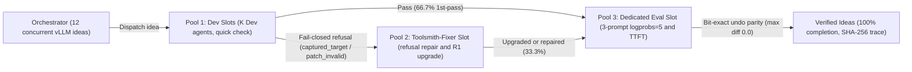

# Multi-Agent GPU Contention and Agent-Team Topologies

Running one coding agent against one dedicated GPU hides the cost of restarting an inference engine. Running a team of concurrent agents (`N = 2..8`) against a shared GPU budget (`C = 1..3`) exposes it immediately: every full restart stalls the slot for tens of seconds, serialization turns `N` agents into an `O(N)` FIFO queue, and idle GPUs waiting on CPU-side Python imports and CUDA graph capture dominate cluster spend.

This document reports a controlled empirical study on `3× NVIDIA B200` GPUs serving `Qwen/Qwen3-8B` on `vLLM 0.33.0` with CUDA graphs enabled (`our 2026-11-24 B200 run`), evaluating:

1. **Multi-agent GPU contention (`EXP-A`):** restart-per-edit (both Cold-JIT and Warm-JIT, verified by live multi-agent trials) versus `rsibox` shared-slot scheduling (`SandboxPool`, `core/livelab/rsibox/pool.py`) across `C ∈ {1, 2, 3}` GPUs and `N ∈ {1, 2, 4, 8}` concurrent agents, including synthetic-poison fault-injection cells.
2. **Multi-agent team topologies (`EXP-B`):** `27` cells (`324` end-to-end verified vLLM ideas) comparing `Monolithic`, `Dev+Eval Split`, and `Orchestrator + 3-Pool Triad` (`K Dev` + `Toolsmith-Fixer` + `Dedicated Eval`) on a realistic 6-idea concurrent workload with fail-closed refusals and automated repair.

### Headline Findings

- **43.7×–60.5× steady-state throughput speedup (`68.3–190.4` edits/min vs. `1.31–3.82` edits/min):** replacing Warm-JIT restarts (`45.74 ± 0.43 s` per edit, measured) with `SandboxPool` leasing over live hot-reload cuts per-edit slot hold time to `0.63–0.87 s`.
- **28.7× lower mean queue wait at `C = 1, N = 4`:** mean wait drops from `68.97 s` (p95 `137.84 s`) in the live restart trial to `2.40 s` (p95 `5.31 s`) on `rsibox`.
- **1 GPU running `rsibox` beats 3 GPUs running restart-per-edit by 19.2×:** a single B200 serving 8 concurrent agents achieves `68.3` edits/min on `rsibox`, versus `3.56` edits/min across 3 B200s running live restart-per-edit (`C = 3, N = 6`) — delivering `19.2×` higher throughput with `3×` fewer GPUs.
- **Automated refusal-to-repair lifts verified idea completion from `66.7%` to `100.0%`:** across all `27` `EXP-B` cells (`324` ideas), fail-closed refusals (`captured_target` and `patch_invalid`) let a Toolsmith-Fixer stage upgrade or repair failing edits cleanly with zero state contamination (`max_abs_logprob_diff == 0.0`).
- **Dedicated Eval pools eliminate Eval stalls (`0/12` vs. `10–12/12`), but static 1:1:1 GPU splits underutilize Dev and Toolsmith:** when full 3-prompt `logprobs=5` verification (`1.38 s`/idea) accounts for `64%` of total GPU-seconds (`2.14 s`/idea), pinning 1 GPU per role saturates the Eval GPU at `96–97%` while capping Dev (`28–31%`) and Toolsmith (`23–25%`). Pool shares should match measured stage service times ($C_{\text{eval}} / C \approx T_{\text{eval}} / T_{\text{total}}$) or reassign slots elastically.

---

## 1. Mechanism Cost Ladder & Experimental Setup

Following [Lesson 12](lessons.md#12-most-real-changes-need-a-restart-so-make-restarts-cheap-and-name-them-in-words), every action in this study is named by what it does together with its measured overhead on `Qwen/Qwen3-8B` (`BF16`, `TP=1`, CUDA graphs enabled, `our 2026-11-24 B200 run`):

| Action | Implementation | Measured overhead | What it updates |
|---|---|---|---|
| **Fast-path live CLI reconfigure** | [`repos/vllm/livelab/services/engine.py`](../repos/vllm/livelab/services/engine.py), [`live_reconfig.py`](../repos/vllm/livelab/services/live_reconfig.py) | **`~96 ms`** CLI wall (`92.9–99.6 ms` across `EXP-A`, `95.7 ms` mean; `4.3 ms` in-process control-plane update, measured) | Runtime scheduler flags (`--max-num-seqs`, `--scheduling-policy`, `--max-num-batched-tokens`) with zero restart and zero graph recapture |
| **In-place Python hot-swap** | [`core/livelab/kernel/swap.py`](../core/livelab/kernel/swap.py) | **`~80–120 ms`** install/undo (measured) | Function and method bodies outside captured CUDA graphs (worker sampler, scheduler utils, host-excluded modules) with journaled undo |
| **Selective CUDA graph recapture** | [`repos/vllm/livelab/adapter/recapture.py`](../repos/vllm/livelab/adapter/recapture.py) (`rebuild=["R1"]`) | **`~1.13 s`** mean (`0.78–1.64 s` across `EXP-A`, measured) | Graph-captured GPU kernels (e.g., `FlashAttentionImpl.forward`), recapturing only affected CUDA graphs in-place |
| **NVIDIA Dynamo GMS Shadow failover** *(optional warm recovery)* | [`core/livelab/rsibox/warm/README.md`](../core/livelab/rsibox/warm/README.md) | **`0.34 s`** Shadow failover; **`2.86 s`** CRIU + `cuda-checkpoint` restore (measured) | Sub-second fallback when a worker is poisoned, keeping GPU weights resident instead of restarting from disk |
| **Warm-JIT full engine restart** | Plain `vllm serve` respawn with warm on-disk compile cache | **`45.74 ± 0.43 s`** per edit (`44.76 s` start + `0.38 s` check + `0.59 s` stop, measured) | Fresh process with persistent compile cache (`1.31` edits/min on 1 GPU) |
| **Cold-JIT full engine restart** | Plain `vllm serve` first compile with empty cache | **`170.33 s`** wall (`164.08 s` to `/health`, measured) | Full cold compilation and initial graph capture |

### Hardware and Serving Configuration

- **Hardware:** `3× NVIDIA B200` (183,359 MiB HBM per GPU). All `EXP-A` and `EXP-B` cells ran sequentially inside one continuous `1,159.11 s` suite (`our 2026-11-24 B200 run`) after a `50.25 s` parallel 3-GPU warm pool boot.
- **Engine & Model:** `vLLM 0.33.0` serving `Qwen/Qwen3-8B` (`BF16`, `-tp 1`, `--distributed-executor-backend mp`, `--worker-extension-cls adapter.worker_ext.KernelWorkerExtension`, `--gpu-memory-utilization 0.42`, `--max-model-len 1024`, `--max-num-seqs 64`, `--max-num-batched-tokens 8192`, `--disable-flashinfer-autotune`, `--seed 0`).
- **CUDA Graphs:** `FULL_AND_PIECEWISE` mode with `--compilation-config '{"cudagraph_capture_sizes": [1, 2, 4, 8]}'`.
- **Determinism:** `VLLM_BATCH_INVARIANT=1`, greedy decoding (`temperature=0.0`, `seed=0`, `max_tokens=12`, `logprobs=5`).

### Trust & Tamper-Evident Verification Methodology

Every claim in this study is anchored to four independent verification layers rather than unverified summary prints:

1. **SHA-256 hash-chained lease traces (`39 / 39` passed):** every `SandboxPool` cell writes an append-only JSONL lease log chaining each record's `prev_sha256` into `record_sha256`. Post-run verification via `verify_trace(..., expected_head=...)` passed `39 / 39` traces (`100%`) across **`936` real lease records** (`180` in `EXP-A` + `756` in `EXP-B`).
2. **Bit-exact cross-agent and cross-GPU isolation (`max_abs_logprob_diff == 0.0`):** baseline `logprobs=5` outputs were cross-checked across all 3 GPUs (`cross_gpu_baseline_logprob_diff == 0.0`), and every post-install and post-undo check across all `39` cells produced `global_max_abs_logprob_diff == 0.0`. Every slot was asserted clean (`state == "base"`, zero poison) after every cell.
3. **Execution witnesses on every hot-path edit:** per [`core/livelab/INTERFACE.md`](../core/livelab/INTERFACE.md), live code swaps prove execution via witness counters — `12` calls per 12-token prompt (`36` across a 3-prompt Eval) for in-place Python hot-swaps (`vllm.v1.worker.gpu.sample.sampler`, `vllm.v1.core.sched.utils`) and `36` calls per decode step across 36 transformer layers for selective CUDA graph recapture (`FlashAttentionImpl.forward`).
4. **Continuous 1 Hz GPU hardware telemetry (`3,477` samples):** a background `nvidia-smi` sampler recorded memory (`~95.5 GiB` steady warm footprint per active slot), utilization, power, and temperature across every phase and verified clean return to baseline memory and `0%` utilization after shutdown.

---

## 2. Multi-Agent Contention Study (`EXP-A`)

### 2.1 Restart-per-Edit Baselines and Live Contention Trials

When agents restart the engine for each edit, the GPU spends over `97%` of wall clock restarting Python, reloading weights, and recapturing CUDA graphs (`1.9–3.7%` mean GPU utilization in our 1 Hz telemetry):

| Baseline measurement | GPUs (`C`) | Agents (`N`) | Edits | Wall clock (s) | Mean queue wait (s) | P95 queue wait (s) | Mean service (s) | Throughput (edits/min) |
|---|---:|---:|---:|---:|---:|---:|---:|---:|
| Cold-JIT single-GPU reference | 1 | 1 | 1 | `170.33` | `0.00` | `0.00` | `170.33` | `0.35` |
| Warm-JIT single-GPU (3× repeats) | 1 | 1 | 1 | `45.74 ± 0.43` | `0.00` | `0.00` | `45.74` | `1.31` |
| Live restart contention trial | 1 | 4 | 4 | `184.12` | `68.97` | `137.84` | `46.03` | `1.30` |
| Live restart contention trial | 3 | 6 | 6 | `101.14` | `25.45` | `51.21` | `50.47` | `3.56` |

To avoid burning hours of GPU time repeating 32-restart cells, the 12-cell comparison table below compares real `SandboxPool` runs against an analytical FIFO restart curve anchored to the measured `45.74 s` Warm-JIT repeat mean. The live `C = 1, N = 4` trial corroborates this analytical model within **`0.6%`** (`184.12 s` measured vs. `182.97 s` analytical; `1.304` vs. `1.312` edits/min). Furthermore, the live `C = 3, N = 6` trial shows that concurrent multi-GPU restarts suffer host-CPU and PCIe contention (`50.47 s` mean service vs. `45.74 s` single-GPU), meaning the analytical FIFO baseline is slightly *optimistic* for restart-per-edit and therefore conservative with respect to `rsibox` speedups.

### 2.2 Complete `SandboxPool` Contention Matrix (`C ∈ {1, 2, 3} × N ∈ {1, 2, 4, 8}`)

In every cell, `N` concurrent agent threads each execute `4` real leases (`4N` total leases) rotating through:
1. **In-place Python hot-swap** (`vllm.v1.worker.gpu.sample.sampler` or `vllm.v1.core.sched.utils`) + witness proof + undo parity check;
2. **Fast-path live CLI reconfigure** (`--max-num-seqs 32 --scheduling-policy priority` or `48 / fcfs`, `~96 ms`) + check;
3. **Selective CUDA graph recapture** (`FlashAttentionImpl.forward` with `rebuild=["R1"]`, `~1.13 s`) + witness proof + undo parity check;
4. **Fault/exclusion handling:** fail-closed broken-syntax refusal (`patch_invalid`) + `reset("state")`, host-side excluded `vllm.model_executor.models.config` hot-swap (zero recapture), or — in two explicitly marked fault-injection cells — synthetic worker poison triggering a real Warm-JIT respawn on the faulted slot.

| `C` | `N` | Leases | `rsibox` Wall (s) | `rsibox` Edits/min | Restart Edits/min *(FIFO)* | Speedup | Mean Q-Wait (s) | P95 Q-Wait (s) | Mean Hold (s) | Slot Recoveries | Max LP Diff | Proven | Trace OK |
|---:|---:|---:|---:|---:|---:|---:|---:|---:|---:|---|---:|---:|:---:|
| 1 | 1 | 4 | 3.02 | **79.4** | 1.31 | **60.5×** | 0.000 | 0.000 | 0.628 | 0 | 0.0 | 2/2 | Yes |
| 1 | 2 | 8 | 6.83 | **70.3** | 1.31 | **53.6×** | 0.803 | 1.804 | 0.729 | 0 | 0.0 | 4/4 | Yes |
| 1 | 4 | 16 | 13.74 | **69.9** | 1.31 | **53.3×** | 2.404 | 5.314 | 0.738 | 0 | 0.0 | 8/8 | Yes |
| 1 | 8 | 32 | 28.10 | **68.3** | 1.31 | **52.1×** | 5.700 | 12.784 | 0.758 | 0 | 0.0 | 16/16 | Yes |
| 2 | 1 | 4 | 3.45 | **69.5** | 1.31 | **53.0×** | 0.000 | 0.000 | 0.728 | 0 | 0.0 | 2/2 | Yes |
| 2 | 2 | 8 | 3.83 | **125.2** | 2.62 | **47.7×** | 0.000 | 0.000 | 0.725 | 0 | 0.0 | 4/4 | Yes |
| 2 | 4 | 16 | 51.29 | **18.7** | 2.62 | **7.1×**\* | 0.823 | 1.900 | 0.744 | 1 (`44.74 s`)\* | 0.0 | 8/8 | Yes |
| 2 | 8 | 32 | 13.71 | **140.0** | 2.62 | **53.4×** | 2.340 | 5.240 | 0.729 | 0 | 0.0 | 16/16 | Yes |
| 3 | 1 | 4 | 3.38 | **71.1** | 1.31 | **54.2×** | 0.000 | 0.000 | 0.706 | 0 | 0.0 | 2/2 | Yes |
| 3 | 2 | 8 | 4.19 | **114.6** | 2.62 | **43.7×** | 0.000 | 0.000 | 0.875 | 0 | 0.0 | 4/4 | Yes |
| 3 | 4 | 16 | 5.04 | **190.4** | 3.50 | **54.4×** | 0.221 | 0.671 | 0.739 | 0 | 0.0 | 8/8 | Yes |
| 3 | 8 | 32 | 53.53 | **35.9** | 3.82 | **9.4×**\* | 1.362 | 2.809 | 0.746 | 1 (`45.60 s`)\* | 0.0 | 16/16 | Yes |

\* *Fault-injection cells `(C = 2, N = 4)` and `(C = 3, N = 8)` deliberately injected synthetic session poison (`participant_failed`) on one lease to exercise end-to-end slot recovery.*

### 2.3 Takeaways from `EXP-A`

1. **Steady-state throughput scales linearly with `C` and stays flat under `8×` agent oversubscription:** on 1 GPU, `rsibox` sustains `68.3–79.4` edits/min across `N = 1..8` (`52.1×–60.5×` over Warm-JIT restart); scaling to `C = 2` reaches `140.0` edits/min (`N = 8`), and `C = 3` reaches `190.4` edits/min (`N = 4`).
2. **3× GPU savings with 19.2× higher throughput:** 1 B200 running `rsibox` with 8 concurrent agents (`68.3` edits/min) outperforms 3 B200s running live restart-per-edit (`3.56` edits/min at `C = 3, N = 6`) by **`19.2×`** while consuming `3×` fewer GPUs.
3. **28.7× queue-wait collapse:** at `C = 1, N = 4`, mean queue wait drops from `68.97 s` to `2.40 s` (`28.7×` reduction) and p95 queue wait drops from `137.84 s` to `5.31 s` (`25.9×` reduction).
4. **Fault isolation works — and quantifies why sub-second warm recovery matters:** in `(C = 2, N = 4)` and `(C = 3, N = 8)`, `SandboxPool` detected the synthetic poison on lease release, quarantined the faulted slot only long enough to execute a real Warm-JIT respawn (`44.74 s` and `45.60 s`), and kept sibling GPUs serving uninterrupted (mean queue wait remained `0.823 s` and `1.362 s`, with `0` slots left quarantined and `0.0` logprob diff). Because even one plain `45 s` respawn dominates cell wall clock (`51.29 s` and `53.53 s`), swapping that fallback to NVIDIA Dynamo GMS Shadow failover (`0.34 s`, measured) cuts fault-recovery wall clock by **`~130×`** and preserves steady-state pool throughput even under frequent worker crashes.

---

## 3. Multi-Agent Team Architecture & Division-of-Labor Study (`EXP-B`)

`EXP-A` treats all agents as homogeneous editors. Real autonomous engineering teams divide labor across roles: **Dev** agents propose patches and run quick sanity checks, a **Toolsmith-Fixer** diagnoses fail-closed sandbox refusals and repairs broken submissions, and a **Dedicated Eval** verifier runs full multi-prompt correctness and latency checks.

### 3.1 Real 6-Idea Concurrent vLLM Workload

Every `EXP-B` cell executes `12` concurrent tasks (`2×` each of `6` real vLLM ideas, producing `28` hash-chained `SandboxPool` leases per cell: `12` Dev + `4` Toolsmith-Fixer + `12` Eval):

| # | Idea | Initial Dev action | First-pass outcome | Toolsmith-Fixer action | Eval verification |
|---:|---|---|---|---|---|
| 1 | `idea1_r0_sampler` | In-place Python hot-swap on `vllm.v1.worker.gpu.sample.sampler` | Pass (`12` witness calls) | — | 3-prompt `logprobs=5` + TTFT + witness (`36`) + undo parity |
| 2 | `idea2_tier1_seqs_priority` | Fast-path live CLI reconfigure (`--max-num-seqs 32 --scheduling-policy priority`, `~96 ms`) | Pass (scheduler ack verified) | — | 3-prompt `logprobs=5` + TTFT |
| 3 | `idea3_r1_attn_missing_r1` | Edit `FlashAttentionImpl.forward` without graph recapture | **Refused fail-closed** (`captured_target`) | Upgrades request to selective CUDA graph recapture (`rebuild=["R1"]`, `~1.13 s`) | 3-prompt `logprobs=5` + TTFT + witness (`36`/step) + undo parity |
| 4 | `idea4_r0_host_config_excl` | In-place Python hot-swap on `vllm.model_executor.models.config` (host-excluded) | Pass (zero recapture) | — | 3-prompt `logprobs=5` + TTFT + undo parity\* |
| 5 | `idea5_broken_syntax_fault` | Broken Python syntax in `sampler` | **Refused fail-closed** (`patch_invalid`) | Repairs edit onto `vllm.v1.core.sched.utils` (in-place Python hot-swap) | 3-prompt `logprobs=5` + TTFT + witness (`36`) + undo parity |
| 6 | `idea6_tier1_batch_tokens` | Fast-path live CLI reconfigure (`--max-num-batched-tokens 4096`, `~96 ms`) | Pass (scheduler ack verified) | — | 3-prompt `logprobs=5` + TTFT |

\* *Witness transparency:* `6 / 6` inference-hot-path code edits per cell (Ideas 1, 3, and 5 × 2 repeats) prove non-zero execution witnesses. The remaining `2` code edits (Idea 4 × 2) target `verify_and_update_config` in `vllm.model_executor.models.config`, which is startup-only and deliberately tests `CAPTURED_EXCLUSIONS` so host-side config edits commit via in-place Python hot-swap without triggering CUDA graph recapture (`6 / 8` total code edits with inference witnesses; `4` ideas are live CLI reconfigurations verified by scheduler ack).

### 3.2 Complete 27-Cell Topology Matrix (`324` Verified Ideas)

Three topologies were evaluated over `C ∈ {1, 2, 3}` GPUs and `N ∈ {1, 2, 3, 4, 6, 8}` agents:
- **`monolithic`:** all `N` agents share one undifferentiated `C`-GPU `SandboxPool` for Dev, self-repair, and Eval.
- **`dev_eval_split` (`C ≥ 2`):** `C - 1` GPUs form the Dev/Repair pool (`K_dev = N - 1` agents) and `1` dedicated GPU forms the Eval pool.
- **`triad_orchestrator` (`C = 3`):** `1` GPU for Dev (`Pool 1`, `K_dev = N - 2` agents), `1` GPU for Toolsmith-Fixer (`Pool 2`), and `1` GPU for Dedicated Eval (`Pool 3`).

In all `27` cells: **1st-pass success = `66.7%`**, **post-Toolsmith verified success = `100.0%`**, **`max_abs_logprob_diff == 0.0`**, and **SHA-256 trace verification = `27 / 27` passed**.

#### `C = 1` GPU

| Topology | `N` | `K_dev` | Wall (s) | Ideas/min | Mean Q-Wait (s) | Eval Q-Wait (s) | Eval Stalls (`/12`) | Dev / TS / Eval Util | Mean TTFT (ms) |
|---|---:|---:|---:|---:|---:|---:|---:|---|---:|
| `monolithic` | 1 | 1 | 25.84 | **27.9** | 0.000 | **0.000** | **0** | 1.00 / — / 1.00 | 22.1 |
| `monolithic` | 2 | 2 | 25.84 | **27.9** | 0.878 | **1.048** | **12** | 1.00 / — / 1.00 | 21.4 |
| `monolithic` | 4 | 4 | 25.65 | **28.1** | 2.434 | **2.672** | **12** | 1.00 / — / 1.00 | 21.2 |
| `monolithic` | 6 | 6 | 25.90 | **27.8** | 3.630 | **4.055** | **12** | 1.00 / — / 1.00 | 21.5 |
| `monolithic` | 8 | 8 | 26.20 | **27.5** | 4.500 | **5.304** | **12** | 1.00 / — / 1.00 | 21.3 |

#### `C = 2` GPUs

| Topology | `N` | `K_dev` | Wall (s) | Ideas/min | Mean Q-Wait (s) | Eval Q-Wait (s) | Eval Stalls (`/12`) | Dev / TS / Eval Util | Mean TTFT (ms) |
|---|---:|---:|---:|---:|---:|---:|---:|---|---:|
| `monolithic` | 1 | 1 | 26.25 | **27.4** | 0.000 | **0.000** | **0** | 0.50 / — / 0.50 | 21.3 |
| `monolithic` | 2 | 2 | 13.52 | **53.2** | 0.000 | **0.000** | **0** | 0.94 / — / 0.94 | 21.6 |
| `monolithic` | 4 | 4 | 13.36 | **53.9** | 0.802 | **0.856** | **12** | 0.97 / — / 0.97 | 21.2 |
| `monolithic` | 6 | 6 | 13.13 | **54.8** | 1.386 | **1.456** | **12** | 0.98 / — / 0.98 | 21.1 |
| `monolithic` | 8 | 8 | 13.00 | **55.4** | 1.828 | **2.090** | **12** | 0.99 / — / 0.99 | 21.3 |
| `dev_eval_split` | 2 | 1 | 17.24 | **41.8** | 0.000 | **0.000** | **0** | 0.55 / — / 0.96 | 20.9 |
| `dev_eval_split` | 4 | 3 | 17.03 | **42.3** | 0.625 | **0.000** | **0** | 0.56 / — / 0.97 | 20.8 |
| `dev_eval_split` | 6 | 5 | 17.23 | **41.8** | 0.988 | **0.000** | **0** | 0.53 / — / 0.97 | 20.8 |
| `dev_eval_split` | 8 | 7 | 17.13 | **42.0** | 1.392 | **0.000** | **0** | 0.57 / — / 0.96 | 20.8 |

#### `C = 3` GPUs

| Topology | `N` | `K_dev` | Wall (s) | Ideas/min | Mean Q-Wait (s) | Eval Q-Wait (s) | Eval Stalls (`/12`) | Dev / TS / Eval Util | Mean TTFT (ms) |
|---|---:|---:|---:|---:|---:|---:|---:|---|---:|
| `monolithic` | 1 | 1 | 26.82 | **26.8** | 0.000 | **0.000** | **0** | 0.33 / — / 0.33 | 21.4 |
| `monolithic` | 2 | 2 | 13.31 | **54.1** | 0.000 | **0.000** | **0** | 0.64 / — / 0.64 | 21.1 |
| `monolithic` | 4 | 4 | 10.11 | **71.2** | 0.278 | **0.345** | **10** | 0.85 / — / 0.85 | 21.7 |
| `monolithic` | 6 | 6 | 10.01 | **72.0** | 0.695 | **0.664** | **11** | 0.89 / — / 0.89 | 21.2 |
| `monolithic` | 8 | 8 | 9.63 | **74.7** | 0.993 | **1.189** | **10** | 0.90 / — / 0.90 | 21.0 |
| `dev_eval_split` | 2 | 1 | 17.22 | **41.8** | 0.000 | **0.000** | **0** | 0.27 / — / 0.96 | 20.8 |
| `dev_eval_split` | 4 | 3 | 17.06 | **42.2** | 0.149 | **0.000** | **0** | 0.28 / — / 0.97 | 20.8 |
| `dev_eval_split` | 6 | 5 | 16.98 | **42.4** | 0.370 | **0.000** | **0** | 0.28 / — / 0.97 | 20.9 |
| `dev_eval_split` | 8 | 7 | 17.12 | **42.1** | 0.521 | **0.000** | **0** | 0.28 / — / 0.97 | 20.9 |
| `triad_orchestrator` | 3 | 1 | 17.81 | **40.4** | 0.000 | **0.000** | **0** | 0.30 / 0.23 / 0.97 | 20.8 |
| `triad_orchestrator` | 4 | 2 | 17.18 | **41.9** | 0.170 | **0.000** | **0** | 0.31 / 0.25 / 0.97 | 20.8 |
| `triad_orchestrator` | 6 | 4 | 17.24 | **41.8** | 0.480 | **0.000** | **0** | 0.31 / 0.24 / 0.96 | 20.8 |
| `triad_orchestrator` | 8 | 6 | 17.29 | **41.6** | 0.733 | **0.000** | **0** | 0.31 / 0.24 / 0.96 | 20.8 |

---

## 4. Empirical Scaling Law & Pool-Sizing Recommendations

The `EXP-B` matrix exposes a non-trivial scheduling trade-off that only appears under real GPU measurements:

1. **Dedicated Eval pools completely eliminate Eval interference.** Whenever `N > C` in `monolithic`, Eval leases queue behind Dev and repair leases: `10–12` of `12` evaluations stall with `0.35–5.30 s` mean Eval queue wait (`p95` up to `8.22 s`), and mean TTFT shows slightly more jitter (`21.0–22.1 ms`). Both `dev_eval_split` and `triad_orchestrator` reduce Eval stalls to **`0 / 12`** and Eval queue wait to **`0.000 s`** across every agent count (`N = 2..8`), holding mean TTFT tightly at `20.8–20.9 ms`.
2. **Static 1-GPU-per-role partitioning creates an Eval bottleneck.** Across all four `triad_orchestrator` traces (`48` Dev, `16` Toolsmith, `48` Eval leases), measured busy time (`hold_s + cleanup_s`) per idea averages:
   - **Eval** (3-prompt `logprobs=5` + TTFT + undo parity): **`1.38 s` / idea** (`16.54 s` per 12 ideas — **`64.4%`** of total GPU-seconds);
   - **Dev** (initial install + 1-prompt sanity check): **`0.42 s` / idea** (`5.03 s` per 12 ideas — **`19.6%`** of total GPU-seconds);
   - **Toolsmith-Fixer** (`1.03 s` per repaired idea across `4/12` failing ideas): **`0.34 s` amortized / idea** (`4.13 s` per 12 ideas — **`16.1%`** of total GPU-seconds).

   Because a single Eval GPU can process at most `60 / 1.38 ≈ 43.5` ideas/min, pinning 1 GPU to Eval caps both `dev_eval_split` and `triad_orchestrator` at `~41.6–42.4` ideas/min (`17.0–17.8 s` wall) with `96–97%` Eval utilization while leaving Dev (`28–31%`) and Toolsmith (`23–25%`) mostly idle. Meanwhile, `monolithic` (`C = 3, N = 8`) lets all 3 GPUs execute Eval concurrently and reaches **`74.7` ideas/min** (`9.63 s` wall, `90%` fleet utilization) at the cost of `10 / 12` Eval stalls (`1.19 s` mean Eval wait).

### Concrete Sizing Rules for Multi-Agent `SandboxPool` Deployments

1. **Match static role GPU counts to measured stage service time.** If strict Eval isolation is required (e.g., noiseless latency benchmarking or strict SLA on evaluation turnaround), size each role's GPU share proportionally to its amortized GPU-seconds per idea:

   $$\frac{C_{\text{eval}}}{C} \approx \frac{T_{\text{eval}}}{T_{\text{dev}} + T_{\text{toolsmith}} + T_{\text{eval}}}$$

   For this workload ($T_{\text{eval}} / T_{\text{total}} = 0.644$), a 3-GPU cluster should assign **2 GPUs to Eval and 1 shared GPU to Dev + Toolsmith** rather than 1:1:1 — lifting theoretical Eval capacity from `43.5` to `~87` ideas/min while keeping Dev + Toolsmith below saturation (`~79%` at `75` ideas/min).
2. **Prefer elastic role reassignment over fixed partitioning for small clusters (`C ≤ 3`).** Because `rsibox` resets any slot back to bit-exact `base` in `~80–120 ms` (verified by `max_abs_logprob_diff == 0.0` across all `936` leases), a `SandboxPool` slot does not need to be statically bound to one role forever. Running a shared pool with **priority-scheduled Eval leases** (or dynamically borrowing idle Dev/Toolsmith slots when Eval queue depth exceeds 1) captures both `monolithic`'s `74.7` ideas/min fleet throughput and `triad`'s low Eval wait without stranding `70%` of Dev/Toolsmith GPU capacity.
3. **Reserve dedicated Toolsmith GPUs only when failure rates or repair costs are high.** At a `33.3%` refusal rate with `1.03 s` average repair cost, Toolsmith consumes only `16%` of fleet GPU-seconds and shares a slot cleanly with Dev. A dedicated Toolsmith pool pays off only when repairs invoke heavier rebuilds (such as `.cu` side-library compilation at `7.3–19.2 s`) or multi-step diagnostic loops that would otherwise block Dev throughput.
