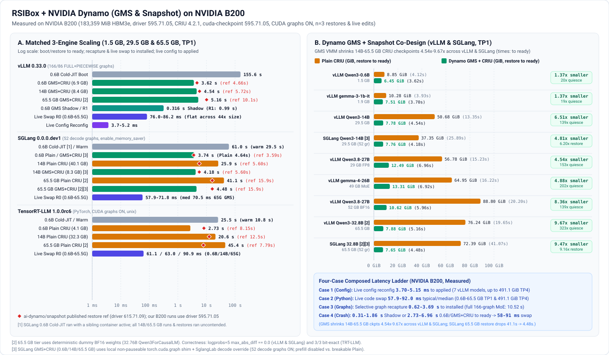

# Restart Boundaries, Interface & Tests

## Mechanisms by restart boundary

When an edit cannot be swapped in place, `rsibox` refuses before mutating state and names the cheapest restart boundary that can run it:

| Boundary | Mechanism | Edits handled | Implementation |
|---|---|---|---|
| **In place, Python** | Swap function code on every rank with journaled undo | Function & method bodies | [`core/livelab/kernel/swap.py`](../core/livelab/kernel/swap.py) |
| **In place, Triton** | Rebuild `@triton.jit` kernels & callers; restore binaries on undo | Triton kernel bodies | [`core/livelab/kernel/jit.py`](../core/livelab/kernel/jit.py) |
| **In place, CUDA graphs** | Selective `R1` recapture of affected graphs in live workers | Edits inside graph-captured paths | [`repos/vllm/livelab/adapter/recapture.py`](../repos/vllm/livelab/adapter/recapture.py) |
| **In place, C++/CUDA** | Compile edited `.cu` side-library, rebind `torch.ops._C` + `R1` recapture | Single-unit C++/CUDA kernels | [`repos/vllm/livelab/adapter/native.py`](../repos/vllm/livelab/adapter/native.py) |
| **In process, rebuild** | Re-import edited module and rebuild live objects | Constructors, new fields, module constants | [`repos/fastvideo/livelab/services/rebuild.py`](../repos/fastvideo/livelab/services/rebuild.py) |
| **Warm respawn (fork server)** | Fork from pre-imported server (`zygote`); weights served over CUDA IPC | Launch flags, startup code, refused edits | [`core/livelab/forksafe.py`](../core/livelab/forksafe.py), `repos/*/livelab/services/{zygote,weights,holder}.py` |
| **In-memory reshard** | Reshard held weights between TP and EP over CUDA IPC | Expert-parallelism layout switches | [`repos/vllm/livelab/services/reshard_live.py`](../repos/vllm/livelab/services/reshard_live.py) |
| **Dynamo GMS (weight-resident respawn & Shadow promotion)** | Keep weights resident in CUDA VMM (`gpu_memory_service`); zero-disk RO respawn or Scratch-KV Shadow promotion on crash/poison | Poisoned ranks, sticky CUDA faults, process crashes, startup/flag restarts | [`core/livelab/rsibox/warm/dynamo_gms.py`](../core/livelab/rsibox/warm/dynamo_gms.py), [`repos/vllm/livelab/services/snapshot_replay.py`](../repos/vllm/livelab/services/snapshot_replay.py) |
| **Dynamo Snapshot (CRIU + `cuda-checkpoint` + GMS)** | Freeze quiesced workers with `cuda-checkpoint` + CRIU while weights remain in GMS VMM; restore CUDA graphs and re-attach live-edit channels | Clean process-boundary restore without weight reload or graph recapture | [`core/livelab/rsibox/warm/snapshot_contract.py`](../core/livelab/rsibox/warm/snapshot_contract.py), [`repos/vllm/livelab/services/snapshot_replay.py`](../repos/vllm/livelab/services/snapshot_replay.py) |

See [`docs/kernels-and-graphs.md`](kernels-and-graphs.md) for the deeper kernel and CUDA graph design.

## Composing RSIBox with NVIDIA Dynamo (GMS + Snapshot)

RSIBox and NVIDIA Dynamo (GPU Memory Service + Snapshot) address orthogonal boundaries and compose into a single latency ladder:

- **In-process edits (RSIBox):** Live runtime parameter changes (`3.70–5.15 ms` to applied), live Python operator/scheduler/sampler swaps (`61.1–92.0 ms` to installed across vLLM, SGLang, and TensorRT-LLM), and selective CUDA-graph recapture (`0.62–3.69 s` to installed) run inside the live engine without restarting workers.
- **Process-boundary recovery (Dynamo GMS + Snapshot):** When an edit crashes a worker, leaves a sticky CUDA fault, or crosses a process boundary, RSIBox promotes a parked Dynamo GMS Scratch-KV shadow (`0.312–1.861 s` to ready) or restores a quiesced CRIU + `cuda-checkpoint` snapshot (`2.73–6.96 s` to ready across TensorRT-LLM, vLLM GMS+CRIU, and SGLang). Once recovered, RSIBox re-attaches its kernel channels so subsequent live Python swaps immediately resume at `61.1–90.6 ms`.



### Four Developer Scenarios (What Runs Where)

Each action is priced on NVIDIA B200 (`183,359 MiB` HBM3e, CUDA graphs enabled, measured `n=3`) with what the reported time runs to:

| Scenario | Cheapest Safe Action | Measured Latency (NVIDIA B200) | What Happens Next |
|---|---|---|---|
| **Case 1: Runtime config change** (e.g., `max_num_seqs`) | Live runtime config update (`in_process_live`) | `3.70–5.15 ms` to applied (`0.014–0.022 ms` in-engine apply across 6 models; 7 vLLM models `1.5 GB`–`491.1 GiB` TP4) | Engine stays warm; zero worker restart or graph recapture |
| **Case 2: Python operator, scheduler, or sampler edit** | Live Python code swap (`R0`, on live or CRIU-restored engine) | `61.1–92.0 ms` to installed (`61.1 ± 0.2 ms` TRT-LLM, `62.2 ± 8.7 ms` SGLang, `76.0–92.0 ms` vLLM; `123.5–125.5 ms` install + check on TRT-LLM & SGLang) | Witness proves edited path ran (`17` calls on SGLang & TRT-LLM); undo restores bit-exact baseline |
| **Case 3: Edit inside a CUDA-graph-captured forward path** | Selective CUDA-graph recapture (`R1`) | `0.62–3.69 s` to installed for selective sizes `[1, 2, 4]` (6 vLLM models `1.5 GB`–`491.1 GiB` TP4); `10.52 ± 0.45 s` for full 166-graph MoE recapture | Affected graphs updated in place without process restart or weight reload |
| **Case 4: Crash, `SIGKILL`, poison, or process-boundary fallback** | Dynamo GMS Scratch-KV shadow promotion or CRIU + `cuda-checkpoint` snapshot restore | `0.312–1.861 s` to ready (GMS shadow, 7 vLLM models up to `151.5 GiB` TP4) or `2.73–6.96 s` to ready (`0.6B` CRIU & vLLM GMS+CRIU up to `65.5 GB`; Plain CRIU `29–65.5 GB`: `15.23–20.20 s`) | RSIBox re-attaches control channels so the next live code swap runs at `61.1–90.6 ms`; GMS shrinks large-model CRIU checkpoints `4.54×–9.67×` |

### Matched 3-Engine `ai-dynamo/snapshot` Alignment (`Qwen/Qwen3-0.6B`, TP1, CUDA Graphs ON)

Directly aligned to NVIDIA `ai-dynamo/snapshot`'s published single-GPU `Qwen/Qwen3-0.6B` (`1.50 GB` weights, TP1) benchmarks across all three supported serving engines (vLLM, SGLang, and TensorRT-LLM) on NVIDIA B200 (`183,359 MiB` HBM3e, driver `595.71.05`, CRIU `4.2.1`, `cuda-checkpoint` `595.71.05`). All three engines run with CUDA graphs enabled and verify bit-exact recovery (`n=3` CRIU restores and `n=3` post-restore RSIBox live code swaps, with `n=3` rollback cycles on SGLang and TensorRT-LLM). Checkpoint sizes below are in decimal `GB` to match `ai-dynamo/snapshot` (with binary `GiB` in parentheses):

| Engine (CUDA Graphs & Memory Setup) | `ai-dynamo/snapshot` Ref (Cold → Restore / Ckpt) | Cold-JIT / Warm-JIT Disk Boot (to ready) | Plain CRIU Restore (`n=3`, to ready) / Ckpt | Dynamo GMS + CRIU / Shadow (`n=3`, to ready) | Post-Restore RSIBox Live Edit (`n=3`) | Correctness Gate |
|---|---|---:|---:|---:|---:|---|
| **vLLM** `0.33.0` (166 `FULL_AND_PIECEWISE` graphs, `0.35` GPU mem) | `104.4 s` → `4.66 s` (`8.13 GB`) | `155.60 s` / `35.07 ± 0.35 s` | `4.12 ± 0.13 s` (`9.51 GB` / `8.85 GiB`, dump `6.36 s`, wake `141.8 ± 15.3 ms`) | GMS+CRIU `3.62 ± 0.15 s` (`6.93 GB` / `6.45 GiB`); Shadow `0.316 ± 0.009 s` | Live code swap `82.7–84.7 ms` to installed; selective graph recapture `0.99 ± 0.05 s` to installed; live config `3.70 ± 2.39 ms` to applied *(live engine)* | `logprobs=5` `max_abs_diff == 0.0` |
| **SGLang** `0.0.0.dev1+g302b78ccf` (52 decode graphs, `enable_memory_saver`, `0.35` GPU mem) | `87.08 s` → `3.59 s` (`9.42 GB`) | `61.04 s`‡ / `29.52 s` | `4.64 ± 0.17 s` (`9.18 GB` / `8.55 GiB`, dump `7.21 s`, `55,810 MiB` KV re-allocated on wake, wake `11.7 ± 0.6 ms`) | *(GMS+SGLang measured w/ graphs OFF below)* | Live code swap `62.2 ± 8.7 ms` to installed (`125.5 ms` install + check, `17` witness calls, undo `29.7 ± 36.1 ms`) | `logprobs=5` (`240` entries) `max_abs_diff == 0.0` |
| **TensorRT-LLM** `1.0.0rc6`§ (PyTorch, CUDA graphs ON, `max_batch_size=4`, `0.15` KV frac, `unix`) | `121.26 s` → `8.15 s` (`8.04 GB`) | `25.54 s` / `10.84 s` | `2.73 ± 0.15 s` (`4.14 GB` / `3.86 GiB`, dump `3.66 s`, `24,168 MiB` KV freed, wake `7.0 ± 0.3 ms`) | *(upstream `1.0.0rc6` build tested without GMS VMM)* | Live code swap `61.1 ± 0.2 ms` to installed (`123.5 ± 1.2 ms` install + check, `17` witness calls, undo `7.4 ± 0.5 ms`) | `3/3` bit-exact tokens & rollback |

### Matched 3-Engine Scaling Alignment (`Qwen3-14B` `29.54 GB` Tier, TP1, CUDA Graphs ON)

Directly aligned to NVIDIA `ai-dynamo/snapshot`'s published single-GPU `Qwen3-14B` (`29.54 GB` weights, TP1) benchmarks across all three engines on NVIDIA B200 (`hkust-nlp/drkernel-14b`, exact `Qwen3ForCausalLM` 40-layer BF16 `29.54 GB` geometry, driver `595.71.05`, CRIU `4.2.1`, `cuda-checkpoint` `595.71.05`, `n=3` CRIU restores and `n=3` post-restore RSIBox live code swaps per mode):

| Engine (CUDA Graphs & Memory Setup) | `ai-dynamo/snapshot` Ref (Cold → Restore / Ckpt) | Cold-JIT / Warm-JIT Boot (to ready) | Plain CRIU Restore (`n=3`, to ready) / Ckpt | Dynamo GMS + CRIU (`n=3`, to ready) / Ckpt | Post-Restore RSIBox Live Edit (`n=3`) | Correctness Gate |
|---|---|---:|---:|---:|---:|---|
| **vLLM** `0.33.0` (166 `FULL_AND_PIECEWISE` graphs, `0.50` GPU mem) | `122.76 s` → `5.72 s` (`37.71 GB`) | `174.50 s` / `42.28 s` *(GMS RO)* | `13.35 ± 0.51 s` (`54.41 GB` / `50.68 GiB`, dump `28.81 s`, quiesce `15.70 s`, wake `0.719 ± 0.030 s`) | `4.54 ± 0.06 s` (`8.35 GB` / `7.78 GiB` — `6.51×` smaller, dump `7.34 s`, quiesce `0.113 s`, wake `0.565 ± 0.042 s`) | Live code swap `79.2 ± 10.3 ms` *(Plain)* / `82.8 ± 3.0 ms` *(GMS)* to installed | `logprobs=5` `max_abs_diff == 0.0`, `0` GMS errors |
| **SGLang** `0.0.0.dev1+g302b78ccf` (52 decode graphs, `enable_memory_saver`, `0.45` GPU mem) | `106.26 s` → `5.60 s` (`40.19 GB`) | `73.14 s` / `41.32 s` | `25.89 ± 2.69 s` (`40.11 GB` / `37.35 GiB`, dump `31.52 s`, quiesce `0.033 s`, wake `11.6 ± 1.3 ms`) | *(GMS+SGLang measured w/ graphs OFF below)* | Live code swap `71.8 ± 14.1 ms` to installed (`179.0 ± 107.3 ms` check, `17` witness calls, undo `50.7 ± 73.1 ms`) | `logprobs=5` (`240` entries) `max_abs_diff == 0.0` |
| **TensorRT-LLM** `1.0.0rc6`§ (PyTorch, CUDA graphs ON, `max_batch_size=4`, `0.25` KV frac, `unix`) | `127.02 s` → `12.50 s` (`36.38 GB`) | `32.21 s` / `17.31 s` | `20.65 ± 1.06 s` (`32.27 GB` / `30.05 GiB`, dump `28.56 s`, quiesce `0.154 s`, `33,532 MiB` KV freed, wake `25.6 ± 26.8 ms`) | *(upstream `1.0.0rc6` build tested without GMS VMM)* | Live code swap `63.0 ± 2.1 ms` to installed (`205.2 ± 3.3 ms` install + check, `17` witness calls, undo `7.6 ± 0.6 ms`) | `3/3` bit-exact tokens & rollback |

Across the 20× model-weight jump from `1.50 GB` (`Qwen3-0.6B`) to `29.54 GB` (`Qwen3-14B`), plain CRIU without GMS scales with weight volume (`32.3–54.4 GB` checkpoints, `13.4–25.9 s` restore on driver `595.71.05`, compared to NVIDIA's driver `615.71.09` fast GPU-state restore); adding Dynamo GMS on vLLM shrinks the `14B` checkpoint `6.51×` (`50.68 GiB → 7.78 GiB`) and cuts restore to `4.54 ± 0.06 s`, while RSIBox live code swaps stay flat at `63.0–82.8 ms` across all three engines.

### Verified NVIDIA B200 Multi-Model Scaling Benchmarks (vLLM `1.5 GB` → `491.1 GiB`)

Measured on NVIDIA B200 GPUs (183,359 MiB HBM3e per GPU; driver `595.71.05`, vLLM `0.33.0`, NVIDIA Dynamo GMS `0.9.0`, CRIU `4.2.1`, `cuda-checkpoint` `595.71.05`) across 8 vLLM model configurations (6 TP1 models from `1.5 GB` to `65.5 GB` and 2 TP4 models at `151.5 GiB` and `491.1 GiB`, all with `FULL_AND_PIECEWISE` CUDA graphs, `torch.compile`, and FlashInfer autotune enabled) plus SGLang GMS + quiesce/resume (`gemma-3-1b-it`, TP1, CUDA graphs disabled). Values are `mean ± std` where `n >= 2` (`n=3` for live edits, Shadow promotion, and CRIU restores; `n=2–3` for Warm-JIT and GMS read-only restarts; `n=1` for Cold-JIT and `gemma-4-26B-A4B-it` Warm-JIT/GMS read-only).

| Model (Tier / TP / CUDA Graphs) | Cold-JIT Boot (to ready) | Warm-JIT Boot (to ready) | GMS Read-Only Boot (to ready) | Plain CRIU Restore (to ready) | GMS + CRIU Restore (to ready) | GMS Shadow Fallback (to ready) | Selective Graph Recapture (to installed) | Live Code Swap (to installed) | Live Config Reconfig (to applied) |
|---|---:|---:|---:|---:|---:|---:|---:|---:|---:|
| `Qwen/Qwen3-0.6B` (1.5 GB, TP1, 166) | 155.60 s | 35.07 ± 0.35 s | 33.83 ± 0.71 s | 4.12 ± 0.13 s | 3.62 ± 0.15 s | 0.316 ± 0.009 s | 0.99 ± 0.05 s | 84.7 ± 0.3 ms | 3.70 ± 2.39 ms |
| `google/gemma-3-1b-it` (1.9 GB, TP1, 166) | 258.22 s | 45.12 ± 5.69 s | 37.96 ± 0.18 s | 3.93 ± 0.03 s | 3.70 ± 0.10 s | 0.312 ± 0.010 s | 0.62 ± 0.07 s | 79.4 ± 5.2 ms | 5.05 ± 2.47 ms |
| `Qwen/Qwen3.8-27B-FP8` (29 GB, TP1, 166) | 258.15 s | 84.97 ± 8.87 s | 73.17 ± 1.45 s | 15.23 ± 0.24 s | 6.96 ± 0.08 s | 1.034 ± 0.073 s | 0.98 ± 0.03 s | 82.7 ± 8.0 ms | 4.38 ± 0.02 ms |
| `google/gemma-4-26B-A4B-it` (49 GB MoE, TP1, 166) | 757.40 s | 87.95 s | 72.42 s | 16.22 ± 0.82 s | 6.92 ± 0.23 s | 0.807 ± 0.105 s | 10.52 ± 0.45 s (all 166) | 77.6 ± 5.8 ms | 4.40 ± 2.07 ms |
| `Qwen/Qwen3.8-27B` BF16 (52 GB, TP1, 86) | 219.03 s | 74.29 ± 0.17 s | 63.77 ± 1.56 s | 20.20 ± 0.52 s | 5.96 ± 0.08 s | 0.975 ± 0.015 s | 1.01 ± 0.17 s | 80.9 ± 3.0 ms | 4.36 ± 2.09 ms |
| `Qwen3-32.8B-Dummy`\* (65.5 GB, TP1, 86) | 183.61 s | 49.76 ± 1.38 s | 38.42 ± 1.05 s | 19.65 ± 0.68 s | 5.16 ± 0.40 s | 0.817 ± 0.094 s | 0.91 ± 0.14 s | 76.0 ± 2.8 ms | 5.15 ± 2.33 ms |
| `Qwen/Qwen3-Next-80B-A3B` (151.5 GiB, TP4, 30) | 779.09 s | 91.72 ± 10.42 s | 60.89 ± 1.31 s | n/a (driver <615) | n/a (driver <615) | 1.861 ± 0.146 s | -- | 90.6 ± 4.9 ms | -- |
| `nvidia/DeepSeek-V4.1-Flash-NVFP4` (491.1 GiB, TP4, 30) | 1,840.35 s | 296.39 ± 91.28 s | blocked (GMS 0.9.0†) | n/a (driver <615) | n/a (driver <615) | blocked (GMS 0.9.0†) | 3.69 ± 0.68 s | 92.0 ± 6.0 ms | 5.12 ± 2.35 ms |

SGLang GMS + quiesce/resume (`google/gemma-3-1b-it`, TP1, decode and prefill CUDA graphs disabled): Cold-JIT disk boot `37.99 s`, Warm-JIT disk boot `15.82 ± 1.68 s`, GMS read-only restart `15.33 ± 0.33 s` (`0.308 s` GMS import), quiesce `0.844 ± 0.023 s`, resume `0.300 ± 0.021 s`, post-restore live code swap `68.0 ± 0.3 ms` to installed (undo `9.8 ± 0.2 ms`, 100% proven, bit-exact rollback).

### Snapshot Volume & Quiesce Scissors (`Plain CRIU` vs `Dynamo GMS + CRIU`)

Keeping weights resident in Dynamo GMS VMM removes weight serialization from both `quiesce()` and `criu dump`, so checkpoint volume (binary `GiB`) and quiesce latency diverge sharply as model size grows:

| Model Tier (TP1) | Plain CRIU Ckpt | GMS + CRIU Ckpt | Volume Reduction | Plain Quiesce | GMS Quiesce | Quiesce Speedup | Restore Speedup (to ready) |
|---|---:|---:|---:|---:|---:|---:|---:|
| `Qwen/Qwen3-0.6B` (1.5 GB) | 8.85 GiB | 6.45 GiB | 1.37× (-27.1%) | 1.290 s | 0.064 s | 20.0× | 1.14× |
| `google/gemma-3-1b-it` (1.9 GB) | 10.28 GiB | 7.51 GiB | 1.37× (-27.0%) | 1.509 s | 0.079 s | 19.2× | 1.06× |
| `Qwen3-14B` (`drkernel-14b`, 29.5 GB) | 50.68 GiB | 7.78 GiB | 6.51× (-84.6%) | 15.701 s | 0.113 s | 138.6× | 2.94× |
| `Qwen/Qwen3.8-27B-FP8` (29 GB) | 56.78 GiB | 12.49 GiB | 4.54× (-78.0%) | 15.396 s | 0.101 s | 153.1× | 2.19× |
| `google/gemma-4-26B-A4B-it` (49 GB) | 64.95 GiB | 13.31 GiB | 4.88× (-79.5%) | 19.664 s | 0.098 s | 201.6× | 2.34× |
| `Qwen/Qwen3.8-27B` BF16 (52 GB) | 88.80 GiB | 10.62 GiB | 8.36× (-88.0%) | 26.866 s | 0.193 s | 139.3× | 3.39× |
| `Qwen3-32.8B-Dummy`\* (65.5 GB) | 76.24 GiB | 7.88 GiB | 9.67× (-89.7%) | 22.696 s | 0.070 s | 323.3× | 3.81× |

### Scope and Empirical Notes

- **Correctness:** All runs recording `logprobs=5` (`Qwen3-0.6B` and `Qwen3-14B` `drkernel-14b` on vLLM and SGLang CRIU, `Qwen3.8-27B-FP8`, `Qwen3.8-27B` BF16, `Qwen3-32.8B-Dummy`, `Qwen3-Next-80B-A3B`, and `DeepSeek-V4.1-Flash-NVFP4`) verified `max_abs_logprob_diff == 0.0` across restarts, restores, Shadow promotions, and live-edit rollbacks; `gemma-3-1b-it`, `gemma-4-26B-A4B-it`, SGLang GMS+quiesce, and TensorRT-LLM (`0.6B` and `14B`) verified 100% bit-exact output digests. All GMS read-only and Shadow runs that completed attachment recorded `0` handshake recv errors.
- **§TensorRT-LLM CRIU setup & scope:** The TensorRT-LLM `1.0.0rc6` benchmark ran with the pending TensorRT-LLM adapter (not yet merged under `repos/` on `main`), using the PyTorch backend with `TLLM_WORKER_USE_SINGLE_PROCESS=1`, `max_batch_size=4`, and `kv_free_gpu_memory_fraction=0.15` (fewer captured CUDA graphs and smaller KV headroom than vLLM's 166 graphs at `0.35` GPU memory or SGLang's 52 graphs at `0.35`, which contributes to the smaller `4.14 GB` / `3.86 GiB` snapshot and `2.73 ± 0.15 s` restore vs the `8.15 s` published reference). Prior to `criu dump`, the quiesce hook releases `24,168 MiB` of KV-cache pools (`quiesce 0.132 s`, `45,662 -> 21,494 MiB`) and re-allocates `24,168 MiB` on wake (`7.0 ± 0.3 ms` over `unix` transport). Isolating OpenMPI/UCX shared memory (`--ipc=private`, `UCX_TLS=^sysv`, `OMPI_MCA_shmem=posix`), capping Inductor compile workers (`TORCHINDUCTOR_COMPILE_THREADS=1`, `TORCHINDUCTOR_WORKER_START=subprocess`) so forked workers do not inherit `/dev/nvidia*` VMAs, and restoring with `criu restore --restore-sibling -d --ext-unix-sk` keep the checkpointed tree to 2 tasks (`61.1 ± 0.2 ms` post-restore live code swap). For repeatable multi-restore benchmarks from one CRIU image, `--link-remap` files and open worker logs are restored to their pre-dump state between repeats.
- **‡SGLang Cold-JIT & KV-release notes:** During the single SGLang Cold-JIT run (`61.04 s` boot / `66.03 s` to first completion), a sibling container briefly shared the GPU (`117.37 GB` free); Warm-JIT (`29.52 s`) and `criu dump` logged `159.11 GB` free after that container exited, and all 3 CRIU restores and 3 post-restore live code swaps ran consecutively afterward. SGLang KV-cache re-allocation (`55,810 MiB` = `54.50 GiB`, `quiesce 0.046 s`) is verified across all 3 restores from `vram_pre_wake -> vram_post_wake` (`23,297 -> 79,107 MiB`).
- **GMS `0.9.0` RW seed pattern:** Under vLLM `0.33.0` with `FULL_AND_PIECEWISE` CUDA graphs, first-writer GMS RW mode hits `CUDA_ERROR_ILLEGAL_ADDRESS` during FULL graph capture after deferred `publish_pending_gms_write()`. Seeding weights once via an eager RW pre-loader (`--enforce-eager`) and attaching serving workers in GMS RO mode (`--gms-read-only`) resolves this cleanly with full CUDA graphs enabled.
- **Determinism and `R1` recapture scope:** On `gemma-4-26B-A4B-it`, default FlashInfer CUTLASS unquantized MoE was non-deterministic across greedy calls (`VLLM_BATCH_INVARIANT=0`); switching to `--moe-backend triton` restored bit-exact determinism while retaining all 166 CUDA graphs. `R1` on `gemma-4-26B-A4B-it` recaptured all 166 graphs (`10.52 s`), whereas the other 6 `R1`-measured models selectively recaptured sizes `[1, 2, 4]` (`0.62–3.69 s`).
- **\*Dummy weights (`65.5 GB` tier):** `Qwen3-32.8B-Dummy` uses deterministic dummy BF16 weights (`Qwen3ForCausalLM`, 32.76B params, `65.52 GB` tensor bytes, 17 safetensors shards) matching the `65.3 GB` single-GPU tier; memory footprint, disk I/O, CUDA graph capture, GMS VMM registration, and CRIU checkpoint size match real weights of the same geometry, while generated tokens are synthetic (deterministic with `max_abs_logprob_diff == 0.0`).
- **†Upstream GMS `0.9.0` and multi-GPU NCCL CRIU limits:** On `nvidia/DeepSeek-V4.1-Flash-NVFP4` (TP4), 4-GPU GMS RW seeding committed `488.61 GiB` (`163.99 s`, with `--engram-config '{"cpu_offload":false}'`), but GMS RO attachment failed inside upstream `gpu_memory_service 0.9.0` `_create_meta_model` due to a shape mismatch on post-processed `wo_a.weight` (`(2048, 4096)` vs `(2, 1024, 4096)`). Pure BF16 `Qwen/Qwen3-Next-80B-A3B-Instruct` (`151.5 GiB`, TP4) verified 4-GPU GMS RO restart (`60.89 s`, `7.83 s` weight import) and 4-GPU Shadow promotion (`1.861 s`) on the same 4× NVIDIA B200 GPUs. Multi-GPU NCCL CRIU checkpoint/restore requires NVIDIA driver `615+` with the `cuInterpose` shim (unavailable on host driver `595.71.05`).
- **SGLang GMS vs. SGLang CRIU:** The SGLang GMS + quiesce/resume run (`gemma-3-1b-it`, TP1) ran with `cuda_graph_backend_decode=disabled` and `cuda_graph_backend_prefill=disabled`, whereas the matched SGLang `Qwen/Qwen3-0.6B` CRIU benchmark ran with 52 decode CUDA graphs enabled (`enable_memory_saver=True`).

## Sandbox interface & verification suite

Every engine adapter implements [`core/livelab/INTERFACE.md`](../core/livelab/INTERFACE.md): `install(patch)`, `check(workload)`, `reset()`, `uninstall()`, and `status()` (`base`, `edited`, or `poisoned`).

The sandbox verification suite ([`core/livelab/conformance/README.md`](../core/livelab/conformance/README.md)) verifies:

- **c0–c2:** Repeatable workload; no-op edit stays bit-exact; visible edit changes output and triggers execution checks (`witness`) on every rank.
- **c3:** Live-edited output (and a chain of 3 edits) matches a fresh process started with the edit.
- **c4, c7, c9:** Undo restores output and code identity to base, step-by-step through chains, and across a 20-cycle repeated install/undo stress test.
- **c5–c6:** Mid-install faults roll back all ranks; unsupported or silent no-op edits are refused without mutating state.
- **c8:** Crashed, hung, or externally tampered workers mark the sandbox faulted (`poisoned`) until respawned at base.
- **c10:** Startup-only edits whose new code never ran are reported not proven (`zero_witness`).

**Limits:** A live check proves the edited path ran and matched on the chosen workload, not equivalence on all inputs. Engines need a Python control layer reachable between steps, and one agent operates one warm process at a time.

## Full CPU test suite

What CPU CI runs (`.github/workflows/cpu-tests.yml`); torch, vLLM, and Linux-only cases skip automatically on a laptop:

```sh
PYTHONPATH=core/livelab python3 -m rsibox doctor
python3 -m unittest discover -s core/livelab/kernel -t core/livelab
python3 -m unittest discover -s core/livelab/rsibox -t core/livelab
python3 -m unittest discover -s core/livelab -p 'test_forksafe.py'
python3 -m unittest discover -s core/livelab/survey -t core/livelab
(cd core/livelab && python3 -m unittest discover -s conformance -t .)
python3 -m unittest discover -s template/livelab/adapter -t template/livelab
python3 -m unittest discover -s scripts -p 'test_*.py'
python3 scripts/verify_facts.py --strict
python3 .github/modal-ci/test_modal_ci.py -v
```
