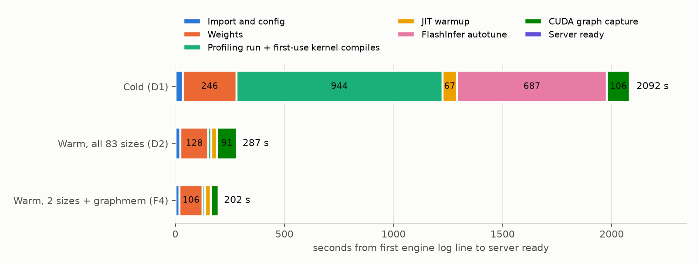

# vLLM costs

Prior measurements, gathered before any new run. Each table says where it came from.

## Restart vs live, one-line scheduler edit (1 GB200)

Source: LiveLab-MLSys paper draft, Figure 1. Warm on-disk caches.

| Step removed | Check time | vs restart |
|---|---:|---:|
| Restart with caches (baseline) | 228 s | 1.0× |
| + reuse autotune config | 157 s | 1.5× |
| + keep model weights | 100 s | 2.3× |
| + keep CUDA graphs | 58 s | 3.9× |
| + keep the live process (hot swap) | 23.6 s | 9.6× |
| then skip the logprob check | 14.1 s | |
| then test with a small batch | 2.4 s | 95× end to end |

Reading: setup is 204 s of the 228 s. The ladder is the disaggregation opportunity: each row is
a piece of state that can be kept separately.

## DeepSeek-V4.1-Flash startup (TP4, 4× B200)

Source: our startup measurement, 2026-10-08, `vllm/vllm-openai:v0.31.0`,
`--max-model-len 16384`. Seconds.

| Phase | Cold | Warm |
|---|---:|---:|
| Weight load (TP0) | 178.6 | 124.9 |
| Profile + memory-profiling CUDA graph capture | 111.0 | 79.0 |
| JIT kernel warmup (190 keys) | 52.5 | 52.5 |
| FlashInfer autotune | 625.4 | 627.2 (retuned despite saved configs) |
| Final CUDA graph capture | 40 | 40 |
| **Time to /health** | **1110.2** | **1012.2** |

Reading: autotune is 62% of a warm start and its cache did not help. Engram tables are 2 × 23.6 GiB
pinned host memory per rank. No torch.compile for this model in this image.

## Restart after one edit (Qwen3-8B, warm caches otherwise)

Source: our per-edit restart measurement (pre-v0 internal tree), dev workload.

| Edit | Ready | vs warm 17.8 s |
|---|---:|---:|
| Triton kernel in the V2 runner | 17.9 s | +0.1 |
| Comment in `qwen3.py` | 31.0 s | +13.2 |
| Attention forward in `qwen3.py` | 41.7 s | +23.9 |
| Backend FLASHINFER → FLASH_ATTN | 60.7 s | +42.9 |
| Full cache loss (cold) | 150.3 s | |

Native CUDA incremental rebuild: 8.0–24.2 s per file (`ninja`, sm100).

## FastRSI v0 overhead (Qwen3-8B, 1 GPU, sampler edits)

Source: `legacy/v0` branch, `receipts/overhead-vllm.json`, `docs/overhead.md`.

| Cost | Value |
|---|---:|
| Workload, stock vs agent loaded | 0.2924 s vs 0.2923 s (not detected) |
| Install, median / max | 22 / 44 ms |
| Undo, median / max | 4 / 9 ms |
| Host growth | +0.37 MiB per install/undo cycle |
| Restart to base | 40 s |
| Witness, per call | 34 ns |
| Repeatability, 32 prompts batched | 1 distinct output in 60 runs |

## Not measured yet

- DeepSeek-V4.1-Flash on 4× GB200 EP4DP4 (the target workload): restart breakdown and each
  probe's cost.
- Cost of `install` per group for the three example PRs.

## Live install of vllm#62240 (first live lab run, 2026-11-04)

DeepSeek-V4.1-Flash config with dummy weights, 4× GB200, TP4, `sparse_indexer_topk_backend="deep_select"`
on both arms, 16K cached prefix + 8K new tokens, 5 prefills per arm, one warm engine.

| Step | Value |
|---|---:|
| Engine start (once) | 885 s |
| `install` on all 4 ranks | 12 ms |
| `uninstall` (base code hash restored on every rank) | 0.5 ms |
| Witness after 5 edited prefills | 40 calls of the new code per rank |
| Prefill median: base / edited / base again | 0.3260 / 0.3217 / 0.3269 s |

The edited arm is 1.4% faster here. The blog reports +15.6% at 32K new tokens after a 128K
prefix, and the gain grows with the number of keys, so this small shape is not comparable.
Not checked: output equality (each prefill used fresh random tokens).

## Same edit on a long-running `vllm serve` (2026-11-04, second session)

One server (dev mode, lab extension, dummy weights, TP4, `deep_select` on both arms), two
experiments with no restart in between. Same prompts in every arm.

| Shape | Install | Uninstall | Witness per rank | Prefill: base / edited / base again |
|---|---:|---:|---:|---|
| 16K cached + 8K new, 5 reps | 15 ms | 1.2 ms | 20 calls | 0.185 / 0.188 / 0.189 s (median) |
| 130K cached + 32K new, 3 reps | 16 ms | 1.4 ms | 12 calls | 0.341, 0.676, 0.679 / 0.331, 0.326, 0.323 / 0.328, 0.316, 0.322 s |

Reading: no speedup is detected at either shape. At 130K + 32K the base arm had two slow
requests, so its median is not usable; base again matches edited. The witness shows the new
function ran (4 calls per request), but not whether its DeepSelect branch was taken; that needs
a branch-level witness. Dummy weights make outputs irreproducible (base vs base again: 0 of 5
tokens equal), so output equality needs real weights.

## Cold vs warm engine start with the startup services (2026-11-05)

DeepSeek-V4.1-Flash (real weights, read from shared storage), 4× GB200 with IMEX, TP4,
`--max-model-len 163840`, same node and settings for both starts. Cold = empty cache root;
warm = same cache root, second start. Data: `measurements/2026-11-05-startup-D1.json` (cold),
`-D2.json` (warm); parsed from the engine log by `livelab/startup/phases.py`.

| Phase (s) | Cold (D1) | Warm, 83 sizes (D2) | Warm, 2 sizes + graphmem (F4) |
|---|---:|---:|---:|
| Import and config | 34 | 23 | 19 |
| Weights | 246 | 128 | 106 |
| Profiling run + first-use kernel compiles | 944 | 13 | 12 |
| JIT warmup | 67 | 27 | 26 |
| FlashInfer autotune | 687 | 0 | 0 |
| CUDA graph capture | 106 | 91 | 35 |
| Server ready | 8 | 5 | 4 |
| **Total** | **2092** | **287** | **202** |

F4 captures only the batch sizes the experiment uses at start (`cudagraph_capture_sizes: [1, 2048]`;
vLLM requires the largest size to be captured, because buffers are sized by it) and adds more
sizes later with the lab hook `fastrsi_capture`: capturing size 128 on the running engine took
4.1 s on each of the 4 ranks. Graph-memory reuse worked on all 4 ranks (F4 logs it; in D2 it
worked too but the log line was dropped, now fixed).

What the warm start saved and why:
- Autotune: all 44 tuning passes of the cold start were skipped; results came from the cache.
- First-use compiles: the cold start wrote 1,449 Triton, 426 FlashInfer, 93 TileLang and 125 vLLM
  cache files; the warm start wrote none.
- Weights: 246 → 106-128 s from the OS page cache only. Weight IPC, status:
  - Engram tables must be on the GPU (`--engram-config '{"cpu_offload": false}'`): host tensors
    are sent by value and exceed the 16 GiB message limit.
  - The MXFP8 batched-matmul kernel needs `patches/ipc-mxfp8-bmm.patch` (one line) to accept
    the daemon's already-processed weights. With it, weights map in 5.4-5.7 s.
  - The engine then crashes in its first forward pass (illegal address, zero-copy). Leading
    guess, not proven: Engram builds a table of raw GPU addresses for cross-GPU reads, and
    addresses of memory borrowed from the daemon are not valid that way. Copy mode does not fit
    (daemon 130 GB/GPU plus the engine's copy).
- Autotune: sharing one cache root between preload daemons and engines, plus pinning the
  autotune cache key (`startup/autotune_key.py`, `--autotune-key`), keeps it at 0 tuning passes
  even when the config hash changes.

Still left in a warm start (F4, 202 s): weights 106, graph capture 35, JIT warmup 26, import 19.
